# Информация

## Докладчик

::::: {.columns align="center"}
::: {.column width="70%"}
- Глушенок Анна Александровна
- Студент НПИбд-01-24
- Российский университет дружбы народов
- <1132246844@pfur.ru>
:::

::: {.column width="30%"}
:::
:::::

## Цель работы

Приобретение практических навыков по установке и конфигурированию
SMTP-сервера.

## Задание

1.  Установите на виртуальной машине server SMTP-сервер postfix (см.
    раздел 8.4.1).
2.  Сделайте первоначальную настройку postfix при помощи утилиты
    postconf, задав отправку писем не на локальный хост, а на сервер в
    домене (см. раздел 8.4.2).
3.  Проверьте отправку почты с сервера и клиента (см. раздел 8.4.3).
4.  Сконфигурируйте Postfix для работы в домене. Проверьте отправку
    почты с сервера и клиента (см. раздел 8.4.4).
5.  Напишите скрипт для Vagrant, фиксирующий действия по установке и
    настройке Postfix во внутреннем окружении виртуальной машины server.
    Соответствующим образом внесите изменения в Vagrantfile (см. раздел
    8.4.5).

# Выполнение лабораторной работы

# Установка Postfix

## Установка Postfix

1.  На ВМ server войдите под вашим пользователем, откройте терминал,
    перейдите в режим суперпользователя: sudo -i

{#fig:001 width="60%"}

## Установка Postfix

{#fig:002
width="60%"}

## Установка Postfix

2.  Установите необходимые для работы пакеты: postfix и s-nail

{#fig:003 width="60%"}

## Установка Postfix

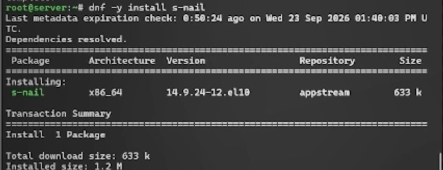{#fig:004 width="60%"}

## Установка Postfix

3.  Сконфигурируйте межсетевой экран, разрешив работать службе протокола
    SMTP

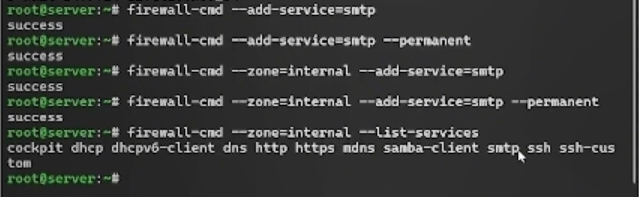{#fig:005 width="60%"}

## Установка Postfix

4.  Восстановите контекст безопасности в SELinux: restorecon -vR /etc

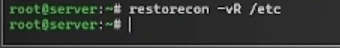{#fig:006
width="60%"}

## Установка Postfix

5.  Запустите Postfix:

{#fig:007
width="60%"}

# Изменение параметров Postfix с помощью postconf

## Изменение параметров Postfix с помощью postconf

1.  Для просмотра списка текущих настроек Postfix введите: postconf

{#fig:008
width="60%"}

## Изменение параметров Postfix с помощью postconf

2.  Посмотрите текущее значение параметра myorigin: postconf myorigin
3.  Посмотрите текущее значение параметра mydomain: postconf mydomain
4.  Замените значение параметра myorigin на значение параметра mydomain:
    postconf -e 'myorigin = \$mydomain'
5.  Повторите команду postconf myorigin (замена параметра была успешно
    произведена)

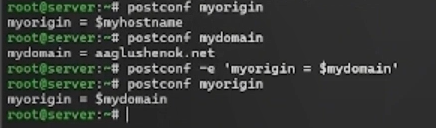{#fig:009
width="40%"}

## Изменение параметров Postfix с помощью postconf

6.  Проверьте корректность содержания конфигурационного файла main.cf:
    postfix check
7.  Перезагрузите конфигурационные файлы Postfix: systemctl reload
    postfix

{#fig:010 width="60%"}

## Изменение параметров Postfix с помощью postconf

8.  Просмотрите параметры с значением, отличным от значения по
    умолчанию: postconf -n

{#fig:011 width="60%"}

## Изменение параметров Postfix с помощью postconf

9.  Задайте жёстко значение домена (вместо user укажите свой логин):
    postconf -e 'mydomain = user.net'

{#fig:012
width="60%"}

## Изменение параметров Postfix с помощью postconf

10. Отключите IPv6 в списке разрешённых Postfix протоколов и оставьте
    только IPv4

{#fig:013 width="60%"}

## Изменение параметров Postfix с помощью postconf

11. Перезагрузите конфигурацию Postfix:

{#fig:014 width="60%"}

# Проверка работы Postfix

## Проверка работы Postfix

1.  На сервере под учётной записью пользователя отправьте себе письмо,
    используя утилиту mail: echo .\| mail -s test1 user@server.user.net

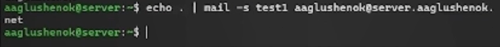{#fig:015
width="60%"}

## Проверка работы Postfix

2.  На втором терминале запустите мониторинг работы почтовой службы и
    посмотрите, что произошло с вашим сообщением: tail -f
    /var/log/maillog

{#fig:016 width="60%"}

## Проверка работы Postfix

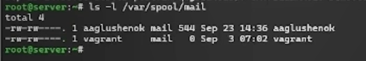{#fig:017 width="60%"}

Из информации мониторинга видим, что сообщение с темой test1 доставлено.
Из содержания каталога mail видим, что каталог с именем пользователя
появился.

## Проверка работы Postfix

3.  На ВМ client войдите под вашим пользователем и откройте терминал.
    Перейдите в режим суперпользователя: sudo -i

{#fig:018 width="60%"}

## Проверка работы Postfix

4.  На клиенте установите необходимые для работы пакеты

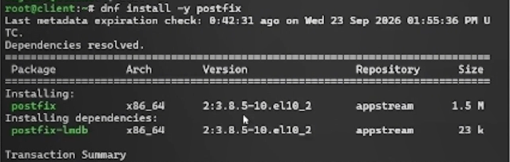{#fig:019
width="60%"}

## Проверка работы Postfix

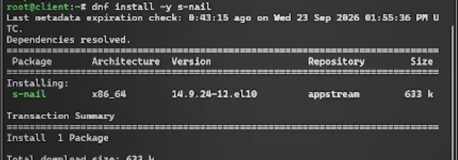{#fig:020
width="60%"}

## Проверка работы Postfix

5.  Отключите IPv6 в списке разрешённых в работе Postfix протоколов и
    оставьте только IPv4
6.  На клиенте запустите Postfix

{#fig:021
width="60%"}

## Проверка работы Postfix

7.  На клиенте под учётной записью пользователя аналогичным образом
    отправьте себе второе письмо, используя утилиту mail (письмо НЕ
    отправлено из-за нарушения соединения с SMTP-сервером)

{#fig:022 width="60%"}

## Проверка работы Postfix

8.  На сервере в конфигурации Postfix посмотрите значения параметров
    сетевых интерфейсов и сетевых адресов

{#fig:023
width="60%"}

## Проверка работы Postfix

9.  Разрешите Postfix прослушивать соединения не только с локального
    узла, но и с других интерфейсов сети: postconf -e 'inet_interfaces =
    all'
10. Добавьте адрес внутренней сети, разрешив пересылку сообщений между
    узлами сети: postconf -e 'mynetworks = 127.0.0.0/8, 192.168.0.0/16'

{#fig:024 width="60%"}

## Проверка работы Postfix

11. Перезагрузите конфигурацию Postfix и перезапустите Postfix:

{#fig:025 width="60%"}

## Проверка работы Postfix

12. Повторите отправку сообщения с клиента (сообщение доставлено)

{#fig:026 width="40%"}

# Конфигурация Postfix для домена

## Конфигурация Postfix для домена

1.  С клиента отправьте письмо на свой доменный адрес: echo .\| mail -s
    test2 user@user.net
2.  Запустите мониторинг работы почтовой службы и посмотрите, что
    произошло с вашим сообщением: tail -f /var/log/maillog (письмо
    застряло в очереди)
3.  Дополнительно посмотрите, какие сообщения ожидают в очереди на
    отправление: postqueue -p

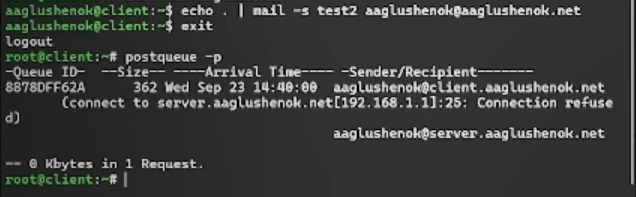{#fig:027
width="60%"}

## Конфигурация Postfix для домена

4.  Для настройки возможности отправки сообщений не на конкретный узел
    сети, а на доменный адрес внесите изменения в файлы прямой и
    обратной DNS-зоны

{#fig:028 width="60%"}

## Конфигурация Postfix для домена

{#fig:029 width="60%"}

## Конфигурация Postfix для домена

5.  В конфигурации Postfix добавьте домен в список элементов сети, для
    которых данный сервер является конечной точкой доставки почты

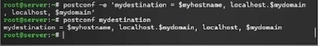{#fig:030 width="60%"}

## Конфигурация Postfix для домена

6.  Перезагрузите конфигурацию Postfix

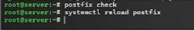{#fig:031
width="60%"}

## Конфигурация Postfix для домена

7.  Восстановите контекст безопасности в SELinux
8.  Перезапустите DNS: systemctl restart named

{#fig:032 width="60%"}

## Конфигурация Postfix для домена

9.  Попробуйте отправить сообщения, находящиеся в очереди на
    отправление: postqueue -f (отправлено)
10. Проверьте отправку почты с клиента на доменный адрес

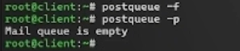{#fig:033
width="60%"}

## Конфигурация Postfix для домена

{#fig:034 width="60%"}

# Внесение изменений в настройки внутреннего окружения виртуальной машины

## Внесение изменений в настройки внутреннего окружения виртуальной машины

1.  На ВМ server перейдите в каталог для внесения изменений в настройки
    внутреннего окружения /vagrant/provision/server/
2.  Замените конфигурационные файлы DNS-сервера

{#fig:035 width="60%"}

## Внесение изменений в настройки внутреннего окружения виртуальной машины

3.  В каталоге /vagrant/provision/server создайте исполняемый файл
    mail.sh

{#fig:036 width="40%"}

## Внесение изменений в настройки внутреннего окружения виртуальной машины

{#fig:037
width="60%"}

## Внесение изменений в настройки внутреннего окружения виртуальной машины

{#fig:038
width="60%"}

## Внесение изменений в настройки внутреннего окружения виртуальной машины

4.  На ВМ client перейдите в каталог для внесения изменений в настройки
    внутреннего окружения /vagrant/provision/client/
5.  В каталоге /vagrant/provision/client создайте исполняемый файл
    mail.sh

{#fig:039 width="60%"}

## Внесение изменений в настройки внутреннего окружения виртуальной машины

{#fig:040
width="60%"}

## Внесение изменений в настройки внутреннего окружения виртуальной машины

6.  Для отработки созданного скрипта во время загрузки ВМ server в
    Vagrantfile необходимо внести изменения в конфигурации сервера
7.  Для отработки созданного скрипта во время загрузки ВМ client в
    Vagrantfile необходимо внести изменения в конфигурации клиента

{#fig:041
width="60%"}

## Внесение изменений в настройки внутреннего окружения виртуальной машины

{#fig:042 width="60%"}

## Внесение изменений в настройки внутреннего окружения виртуальной машины

{#fig:043 width="60%"}

# Выводы

## Выводы

В ходе выполнения лабораторной работы № 8 мне удалось приобрести
практические навыки по установке и конфигурированию SMTP-сервера.
