---
## Front matter
title: "Лабораторная работа № 8. Настройка SMTP-сервера"
subtitle: "Отчет"
author: "Анна Александровна Глушенок"

## Generic options
lang: ru-RU
toc-title: "Содержание"

## Pdf output format
toc: true
toc-depth: 2
lof: true
lot: false
fontsize: 12pt
linestretch: 1.5
papersize: a4
documentclass: scrreprt

## I18n babel
babel-lang: russian
babel-otherlangs: english

## Fonts
mainfont: Liberation Serif
sansfont: Liberation Sans
monofont: Liberation Mono

## Pandoc-crossref LaTeX customization
figureTitle: "Рис."
tableTitle: "Таблица"
lofTitle: "Список иллюстраций"

## Misc options
indent: true
header-includes:
  - \usepackage{indentfirst}
  - \usepackage{float}
  - \floatplacement{figure}{H}
---

# Цель работы

Приобретение практических навыков по установке и конфигурированию SMTP-сервера.

# Задание

1. Установите на виртуальной машине server SMTP-сервер postfix (см. раздел 8.4.1).
2. Сделайте первоначальную настройку postfix при помощи утилиты postconf, задав отправку писем не на локальный хост, а на сервер в домене (см. раздел 8.4.2).
3. Проверьте отправку почты с сервера и клиента (см. раздел 8.4.3).
4. Сконфигурируйте Postfix для работы в домене. Проверьте отправку почты с сервера и клиента (см. раздел 8.4.4).
5. Напишите скрипт для Vagrant, фиксирующий действия по установке и настройке Postfix во внутреннем окружении виртуальной машины server. Соответствующим образом внесите изменения в Vagrantfile (см. раздел 8.4.5).

# Выполнение лабораторной работы

## Установка Postfix

1. На ВМ server войдите под вашим пользователем, откройте терминал, перейдите в режим суперпользователя: sudo -i

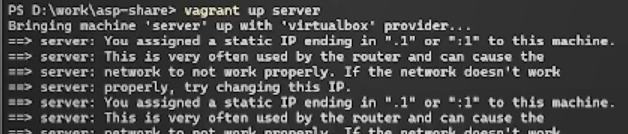{#fig:001 width=60%}

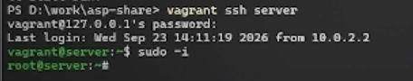{#fig:002 width=60%}

2. Установите необходимые для работы пакеты: postfix и s-nail

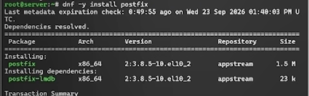{#fig:003 width=60%}

{#fig:004 width=60%}

3. Сконфигурируйте межсетевой экран, разрешив работать службе протокола SMTP

{#fig:005 width=60%}

4. Восстановите контекст безопасности в SELinux: restorecon -vR /etc

{#fig:006 width=60%}

5. Запустите Postfix:

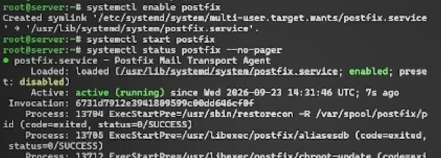{#fig:007 width=60%}

## Изменение параметров Postfix с помощью postconf

1. Для просмотра списка текущих настроек Postfix введите: postconf

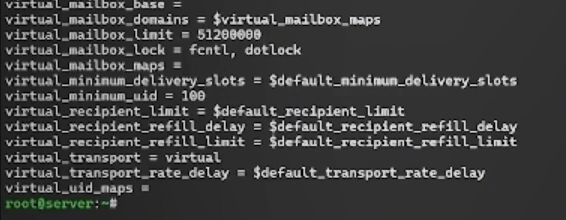{#fig:008 width=60%}

2. Посмотрите текущее значение параметра myorigin: postconf myorigin
3. Посмотрите текущее значение параметра mydomain: postconf mydomain
4. Замените значение параметра myorigin на значение параметра mydomain: postconf -e ‘myorigin = $mydomain’
5. Повторите команду postconf myorigin (замена параметра была успешно произведена)

{#fig:009 width=60%}

6. Проверьте корректность содержания конфигурационного файла main.cf: postfix check
7. Перезагрузите конфигурационные файлы Postfix: systemctl reload postfix

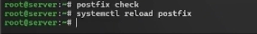{#fig:010 width=60%}

8. Просмотрите параметры с значением, отличным от значения по умолчанию: postconf -n

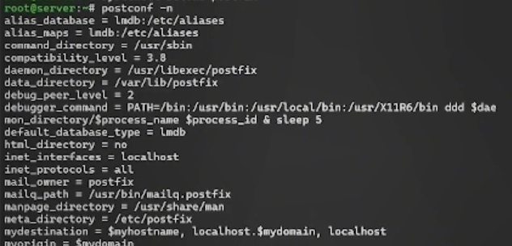{#fig:011 width=60%}

9. Задайте жёстко значение домена (вместо user укажите свой логин): postconf -e 'mydomain = user.net'

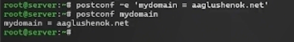{#fig:012 width=60%}

10. Отключите IPv6 в списке разрешённых Postfix протоколов и оставьте только IPv4

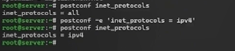{#fig:013 width=60%}

11. Перезагрузите конфигурацию Postfix:

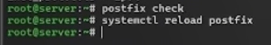{#fig:014 width=60%}

## Проверка работы Postfix

1. На сервере под учётной записью пользователя отправьте себе письмо, используя утилиту mail: echo .| mail -s test1 user@server.user.net

{#fig:015 width=60%}

2. На втором терминале запустите мониторинг работы почтовой службы и посмотрите, что произошло с вашим сообщением: tail -f /var/log/maillog

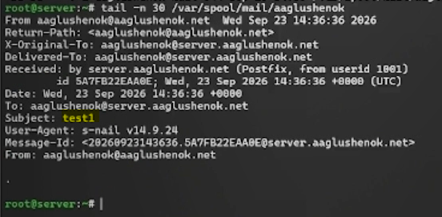{#fig:016 width=60%}

{#fig:017 width=60%}

Из информации мониторинга видим, что сообщение с темой test1 доставлено.
Из содержания каталога mail видим, что каталог с именем пользователя появился.

3. На ВМ client войдите под вашим пользователем и откройте терминал. Перейдите в режим суперпользователя: sudo -i

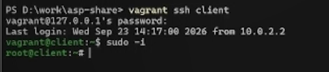{#fig:018 width=60%}

4. На клиенте установите необходимые для работы пакеты

{#fig:019 width=60%}

{#fig:020 width=60%}

5. Отключите IPv6 в списке разрешённых в работе Postfix протоколов и оставьте только IPv4
6. На клиенте запустите Postfix

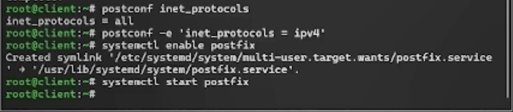{#fig:021 width=60%}

7. На клиенте под учётной записью пользователя аналогичным образом отправьте себе второе письмо, используя утилиту mail (письмо НЕ отправлено из-за нарушения соединения с SMTP-сервером)

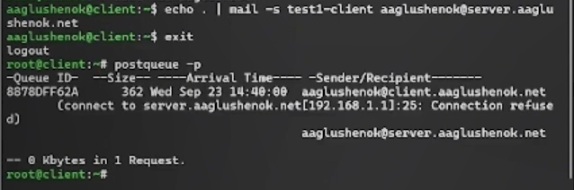{#fig:022 width=60%}

8. На сервере в конфигурации Postfix посмотрите значения параметров сетевых интерфейсов и сетевых адресов

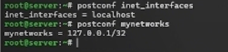{#fig:023 width=60%}

9. Разрешите Postfix прослушивать соединения не только с локального узла, но и с других интерфейсов сети: postconf -e 'inet_interfaces = all'
10. Добавьте адрес внутренней сети, разрешив пересылку сообщений между узлами сети: postconf -e 'mynetworks = 127.0.0.0/8, 192.168.0.0/16'

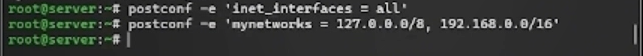{#fig:024 width=60%}

11. Перезагрузите конфигурацию Postfix и перезапустите Postfix:

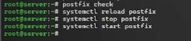{#fig:025 width=60%}

12. Повторите отправку сообщения с клиента (сообщение доставлено)

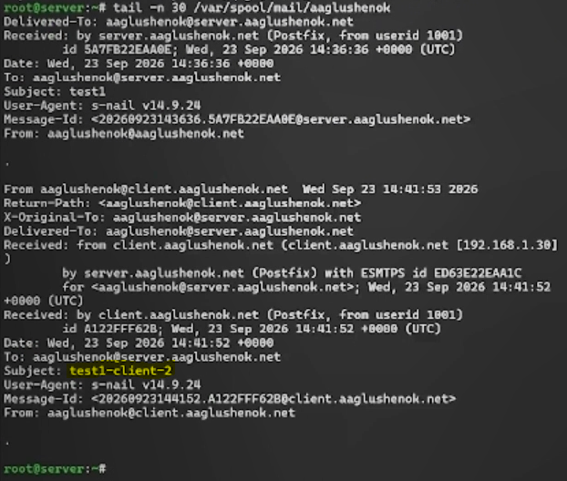{#fig:026 width=60%}

## Конфигурация Postfix для домена

1. С клиента отправьте письмо на свой доменный адрес: echo .| mail -s test2 user@user.net
2. Запустите мониторинг работы почтовой службы и посмотрите, что произошло с вашим сообщением: tail -f /var/log/maillog (письмо застряло в очереди)
3. Дополнительно посмотрите, какие сообщения ожидают в очереди на отправление: postqueue -p

{#fig:027 width=60%}

4. Для настройки возможности отправки сообщений не на конкретный узел сети, а на доменный адрес внесите изменения в файлы прямой и обратной DNS-зоны

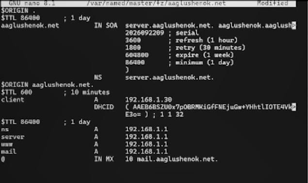{#fig:028 width=60%}

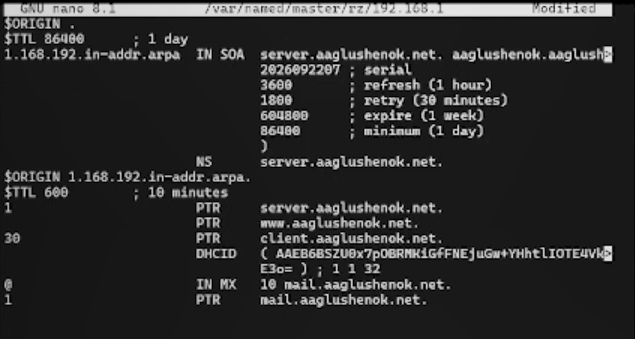{#fig:029 width=60%}

5. В конфигурации Postfix добавьте домен в список элементов сети, для которых данный сервер является конечной точкой доставки почты

{#fig:030 width=60%}

6. Перезагрузите конфигурацию Postfix

{#fig:031 width=60%}

7. Восстановите контекст безопасности в SELinux
8. Перезапустите DNS: systemctl restart named

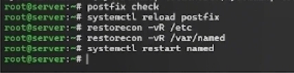{#fig:032 width=60%}

9. Попробуйте отправить сообщения, находящиеся в очереди на отправление: postqueue -f (отправлено)
10. Проверьте отправку почты с клиента на доменный адрес

{#fig:033 width=60%}

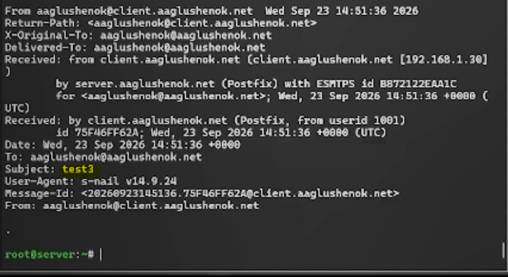{#fig:034 width=60%}

##  Внесение изменений в настройки внутреннего окружения виртуальной машины

1. На ВМ server перейдите в каталог для внесения изменений в настройки внутреннего окружения /vagrant/provision/server/
2. Замените конфигурационные файлы DNS-сервера

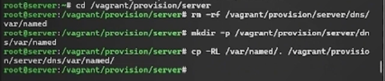{#fig:035 width=60%}

3. В каталоге /vagrant/provision/server создайте исполняемый файл mail.sh

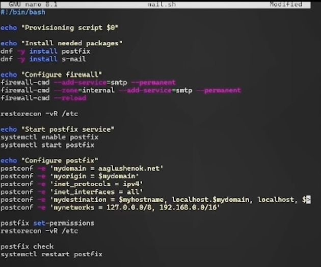{#fig:036 width=60%}

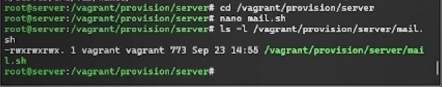{#fig:037 width=60%}

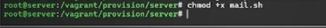{#fig:038 width=60%}

4. На ВМ client перейдите в каталог для внесения изменений в настройки внутреннего окружения /vagrant/provision/client/
5. В каталоге /vagrant/provision/client создайте исполняемый файл mail.sh

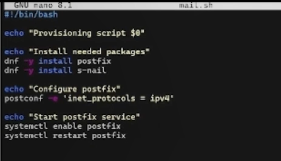{#fig:039 width=60%}

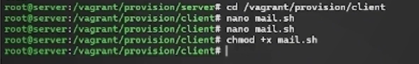{#fig:040 width=60%}

6. Для отработки созданного скрипта во время загрузки ВМ server в Vagrantfile необходимо внести изменения в конфигурации сервера
7. Для отработки созданного скрипта во время загрузки ВМ client в Vagrantfile необходимо внести изменения в конфигурации клиента

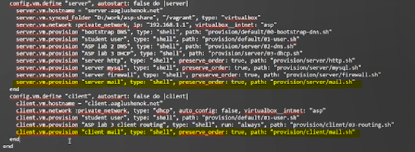{#fig:041 width=60%}

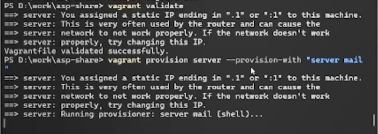{#fig:042 width=60%}

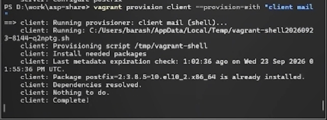{#fig:043 width=60%}

# Контрольные вопросы 

1. В каком каталоге и в каком файле следует смотреть конфигурацию Postfix?

Настройки Postfix хранятся в каталоге /etc/postfix, а основной файл конфигурации — main.cf.

2. Каким образом можно проверить корректность синтаксиса в конфигурационном файле Postfix?

Для проверки корректности конфигурационного файла main.cf используется команда postfix check. Она выполняется после внесения изменений и перед перезагрузкой конфигурации.

3. В каких параметрах конфигурации Postfix требуется внести изменения в значениях для настройки возможности отправки писем не на локальный хост, а на доменные адреса?

Для этого изменяются следующие параметры:

- myorigin — домен, с которого отправляется локальная почта (заменяется на $mydomain);  
- mydomain — название домена, в котором расположен сервер;  
- mydestination — сущности сети, для которых сервер является конечной точкой доставки (добавляется $mydomain);  
- inet_interfaces — сетевые интерфейсы, на которые принимается почта (устанавливается all);  
- mynetworks — доверенные внутренние сети (добавляется адрес внутренней сети, например 192.168.0.0/16).  

4. Приведите примеры работы с утилитой mail по отправке письма, просмотру имеющихся писем, удалению письма.

- Отправка письма: echo .| mail -s test1 user@server.user.net — отправка себе письма с темой «test1».
- Просмотр писем: при чтении почты утилита mailx выводит заголовки первых сообщений и приглашение командного режима. Команда n переходит к следующему письму, h n показывает заголовок письма с номером n.  
- Удаление письма: команда d удаляет письмо, dq — удаляет письмо и выходит из mail.  

5. Приведите примеры работы с утилитой postqueue. Как посмотреть очередь сообщений? Как определить число сообщений в очереди? Как отправить все сообщения, находящиеся в очереди? Как удалить письмо из очереди?

- Посмотреть очередь сообщений: postqueue -p — выводит сообщения, ожидающие отправки.  
- Определить число сообщений в очереди: в выводе postqueue -p в строке -- N Kbytes in M Requests -- число M и есть количество сообщений в очереди.  
- Отправить все сообщения из очереди: postqueue -f — принудительно запускает обработку всей очереди.  
- Удалить письмо из очереди: postsuper -d QUEUE_ID — удаляет сообщение с указанным идентификатором; postsuper -d ALL — удаляет все сообщения.  

# Выводы

В ходе выполнения лабораторной работы № 8 мне удалось приобрести практические навыки по установке и конфигурированию SMTP-сервера.

