---
## Front matter
lang: ru-RU
title: Лабораторная работа № 9. Настройка POP3/IMAP сервера
subtitle: Презентация
author:
  - Глушенок А. А.
institute:
  - Российский университет дружбы народов, Москва, Россия
date: 28 октября 2026

## Formatting pdf
toc: false
slide_level: 2
aspectratio: 169
section-titles: true
theme: metropolis
header-includes:
 - \metroset{progressbar=frametitle,sectionpage=progressbar,numbering=fraction}
 - \usepackage{graphicx}
 - \usepackage{caption}
 - \captionsetup{labelformat=empty, labelsep=none}
 
## Fonts
mainfont: Liberation Serif
sansfont: PT Sans
monofont: Liberation Mono
---

# Информация

## Докладчик

:::::::::::::: {.columns align=center}
::: {.column width="70%"}

  * Глушенок Анна Александровна
  * Студент НПИбд-01-24
  * Российский университет дружбы народов
  * [1132246844@pfur.ru](mailto:1132246844@pfur.ru)

:::
::: {.column width="30%"}

:::
::::::::::::::

## Цель работы

Приобретение практических навыков по установке и простейшему конфигурированию POP3/IMAP-сервера.

## Задание

1. Установите на ВМ server Dovecot и Telnet для дальнейшей проверки корректности работы почтового сервера.
2. Настройте Dovecot.
3. Установите на ВМ client программу для чтения почты Evolution и настройте её для манипуляций с почтой вашего пользователя. Проверьте корректность работы почтового сервера как с ВМ server, так и с ВМ client.
4. Измените скрипт для Vagrant, фиксирующий действия по установке и настройке Postfix и Dovecote во внутреннем окружении ВМ server, создайте скрипт для Vagrant, фиксирующий действия по установке Evolution во внутреннем окружении ВМ client. Соответствующим образом внесите изменения в Vagrantfile.

# Выполнение лабораторной работы

# Установка Dovecot

## Установка Dovecot

1. На ВМ server войдите под вашим пользователем, откройте терминал. Перейдите в режим суперпользователя.

{#fig:001 width=60%}

## Установка Dovecot

{#fig:002 width=60%}

## Установка Dovecot

2. Установите необходимые для работы пакеты: dnf -y install dovecot telnet.

{#fig:003 width=60%}

# Настройка dovecot

## Настройка dovecot

1. В конфигурационном файле /etc/dovecot/dovecot.conf пропишите список почтовых протоколов, по которым разрешено работать Dovecot: protocols = imap pop3.

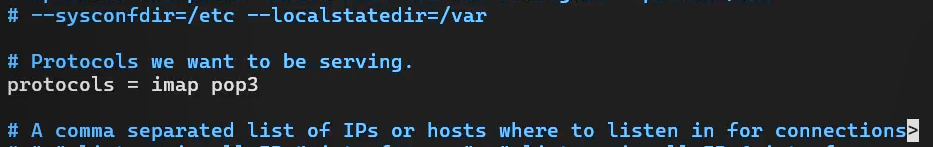{#fig:004 width=60%}

## Настройка dovecot

2. В конфигурационном файле /etc/dovecot/conf.d/10-auth.conf проверьте, что укаан метод аутентификации plain: auth_mechanisms = plain.

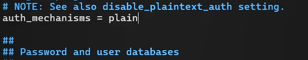{#fig:005 width=60%}

## Настройка dovecot

{#fig:006 width=60%}

## Настройка dovecot

{#fig:007 width=60%}

## Настройка dovecot

3. В конфигурационном файле /etc/dovecot/conf.d/auth-system.conf.ext проверьте, что для поиска пользователей и паролей используется pam и файл passwd.

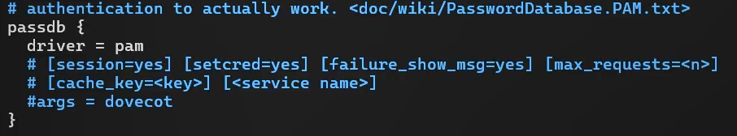{#fig:008 width=60%}

## Настройка dovecot

{#fig:039 width=60%}

## Настройка dovecot

4. В конфигурационном файле /etc/dovecot/conf.d/10-mail.conf настройте месторасположение почтовых ящиков пользователей: mail_location = maildir:~/Maildir.

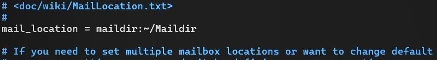{#fig:009 width=60%}

## Настройка dovecot

5. В Postfix задайте каталог для доставки почты: postconf -e 'home_mailbox = Maildir/'.

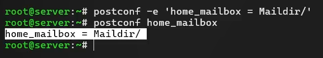{#fig:011 width=60%}

## Настройка dovecot

6. Сконфигурируйте межсетевой экран, разрешив работать службам протоколов POP3 и IMAP.

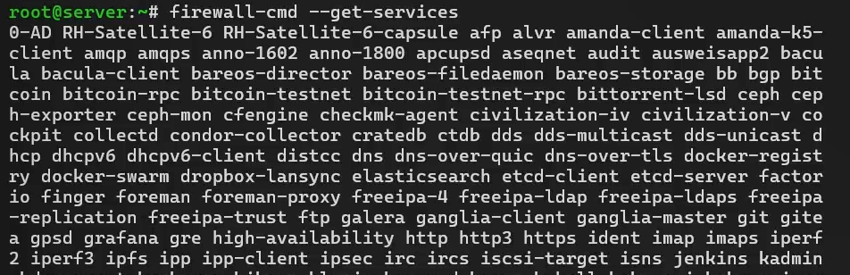{#fig:012 width=60%}

## Настройка dovecot

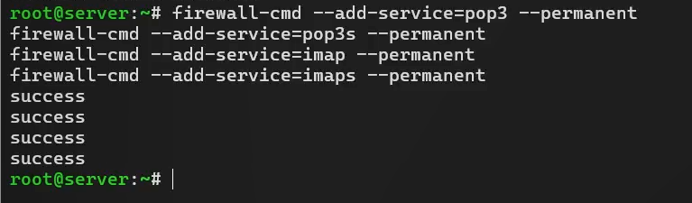{#fig:013 width=60%}

## Настройка dovecot

{#fig:014 width=60%}

## Настройка dovecot

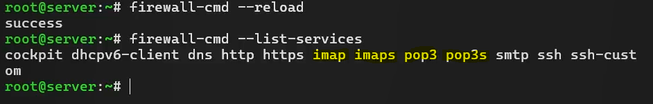{#fig:015 width=60%}

## Настройка dovecot

7. Восстановите контекст безопасности в SELinux: restorecon -vR /etc.

{#fig:016 width=60%}

## Настройка dovecot

8. Перезапустите Postfix и запустите Dovecot.

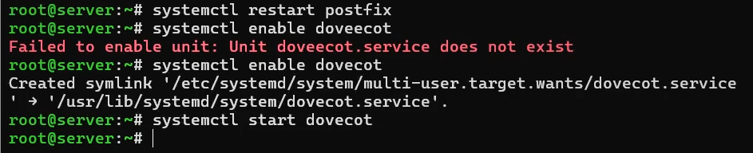{#fig:017 width=60%}

## Настройка dovecot

{#fig:018 width=60%}

## Настройка dovecot

{#fig:019 width=60%}

# Проверка работы Dovecot

## Проверка работы Dovecot

0. Заранее отправим на почту 3 тестовых сообщения

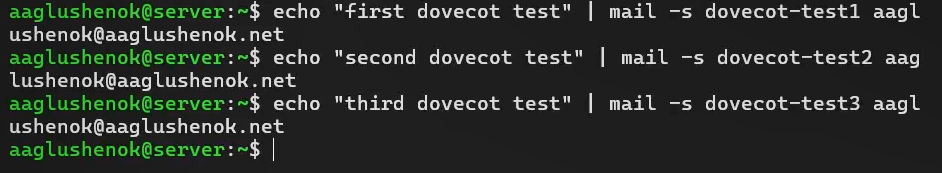{#fig:020 width=60%}

## Проверка работы Dovecot

1. На дополнительном терминале ВМ server запустите мониторинг работы почтовой службы: tail -f /var/log/maillog.
2. На терминале сервера для просмотра почты используйте: MAIL=~/Maildir mail (видим 3 отправленных ранее тестовых сообщения).

{#fig:021 width=60%}

## Проверка работы Dovecot

{#fig:023 width=60%}

## Проверка работы Dovecot

3. Для просмотра mailbox пользователя на сервере используйте: doveadm mailbox list -u user.

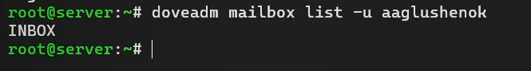{#fig:022 width=60%}

## Проверка работы Dovecot

4. На ВМ client войдите под вашим пользователем, перейдите в режим суперпользователя.
5. Установите почтовый клиент: dnf -y install evolution

{#fig:024 width=60%}

## Проверка работы Dovecot

6. Запустите и настройте почтовый клиент Evolution:

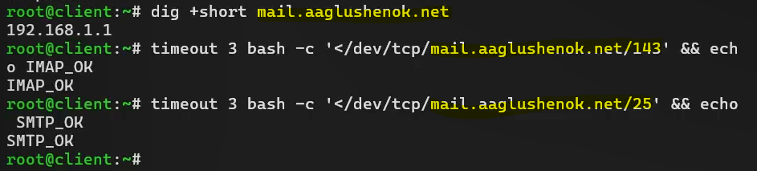{#fig:025 width=60%}

## Проверка работы Dovecot

{#fig:026 width=60%}

## Проверка работы Dovecot

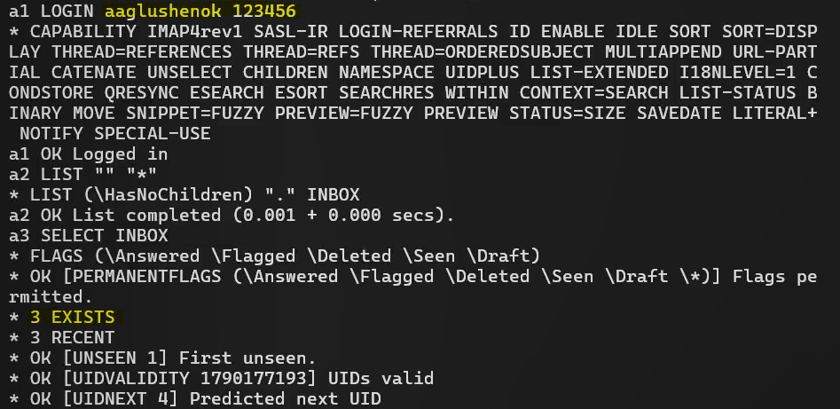{#fig:027 width=60%}

## Проверка работы Dovecot

{#fig:028 width=60%}

## Проверка работы Dovecot

7. Из почтового клиента отправьте себе несколько тестовых писем, убедитесь, что они доставлены.

{#fig:029 width=60%}

## Проверка работы Dovecot

8. Посмотрите, какие сообщения выдаются при мониторинге почтовой службы на сервере, при использовании doveadm и mail.

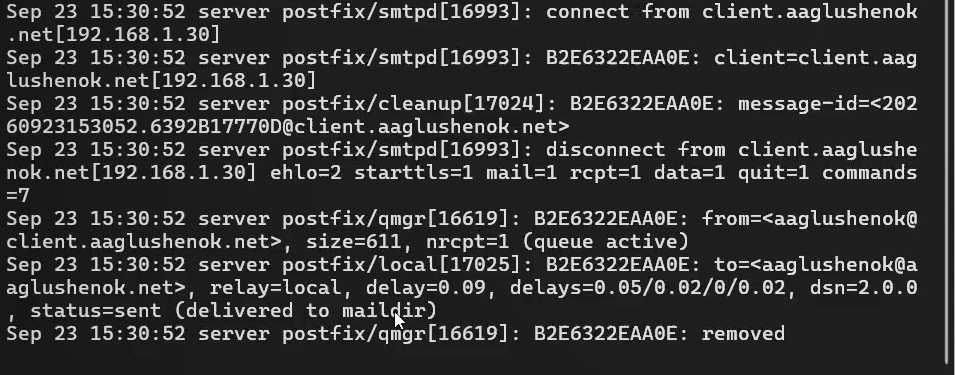{#fig:030 width=60%}

## Проверка работы Dovecot

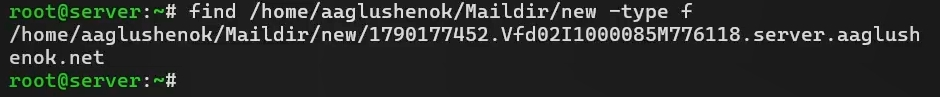{#fig:040 width=60%}

## Проверка работы Dovecot

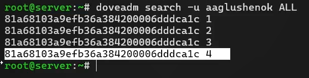{#fig:031 width=60%}

## Проверка работы Dovecot

9. Проверьте работу почтовой службы, используя на сервере протокол Telnet:
- подключение с помощью протокола Telnet к почтовому серверу по протоколу POP3 (через порт 110), ввод логина и пароля.

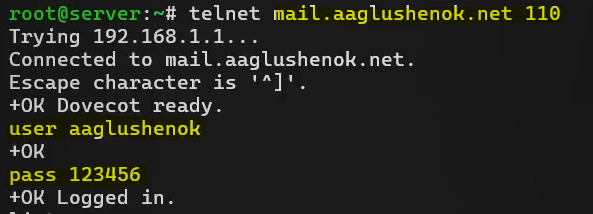{#fig:032 width=60%}

## Проверка работы Dovecot

- получение списка писем (list), получение 1-го письма из списка (retr 1), удаление 2-го письмо из списка (dele 2), завершение сеанса работы с telnet (quit).

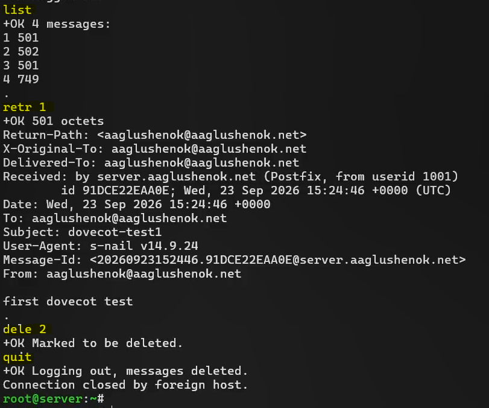{#fig:033 width=45%}

## Проверка работы Dovecot

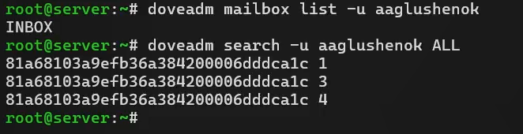{#fig:034 width=60%}

# Внесение изменений в настройки внутреннего окружения ВМ

## Внесение изменений в настройки внутреннего окружения ВМ

1. На ВМ server перейдите в каталог для внесения изменений в настройки внутреннего окружения /vagrant/provision/server/. В соответствующие подкаталоги поместите конфигурационные файлы Dovecot.

{#fig:035 width=60%}

## Внесение изменений в настройки внутреннего окружения ВМ

2. Внесите изменения в файл /vagrant/provision/server/mail.sh.

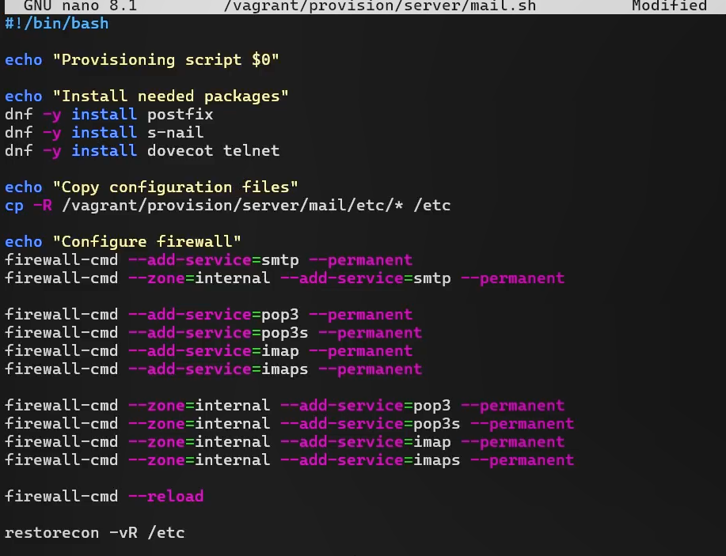{#fig:036 width=50%}

## Внесение изменений в настройки внутреннего окружения ВМ

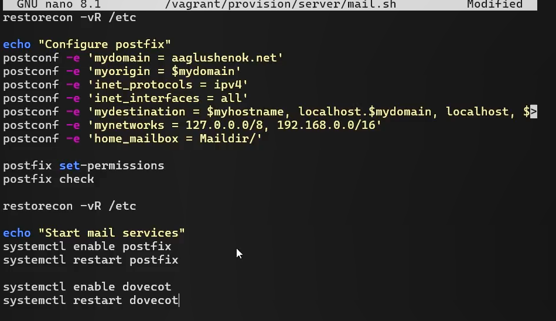{#fig:037 width=60%}

## Внесение изменений в настройки внутреннего окружения ВМ

3. На виртуальной машине client в каталоге /vagrant/provision/client скорректируйте файл mail.sh: dnf -y install evolution.

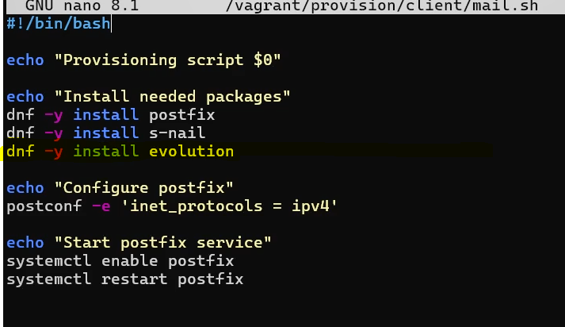{#fig:038 width=60%}

# Выводы

## Выводы

В ходе выполнения лабораторной работы № 9 мне удалось приобрести практические навыки по установке и простейшему конфигурированию POP3/IMAP-сервера.
