---
## Front matter
title: "Лабораторная работа № 9. Настройка POP3/IMAP сервера"
subtitle: "Отчет"
author: "Анна Александровна Глушенок"

## Generic options
lang: ru-RU
toc-title: "Содержание"

## Pdf output format
toc: true
toc-depth: 2
lof: true
lot: false
fontsize: 12pt
linestretch: 1.5
papersize: a4
documentclass: scrreprt

## I18n babel
babel-lang: russian
babel-otherlangs: english

## Fonts
mainfont: Liberation Serif
sansfont: Liberation Sans
monofont: Liberation Mono

## Pandoc-crossref LaTeX customization
figureTitle: "Рис."
tableTitle: "Таблица"
lofTitle: "Список иллюстраций"

## Misc options
indent: true
header-includes:
  - \usepackage{indentfirst}
  - \usepackage{float}
  - \floatplacement{figure}{H}
---

# Цель работы

Приобретение практических навыков по установке и простейшему конфигурированию POP3/IMAP-сервера.

# Задание

1. Установите на ВМ server Dovecot и Telnet для дальнейшей проверки корректности работы почтового сервера.
2. Настройте Dovecot.
3. Установите на ВМ client программу для чтения почты Evolution и настройте её для манипуляций с почтой вашего пользователя. Проверьте корректность работы почтового сервера как с ВМ server, так и с ВМ client.
4. Измените скрипт для Vagrant, фиксирующий действия по установке и настройке Postfix и Dovecote во внутреннем окружении ВМ server, создайте скрипт для Vagrant, фиксирующий действия по установке Evolution во внутреннем окружении ВМ client. Соответствующим образом внесите изменения в Vagrantfile.

# Выполнение лабораторной работы

## Установка Dovecot

1. На ВМ server войдите под вашим пользователем, откройте терминал. Перейдите в режим суперпользователя.

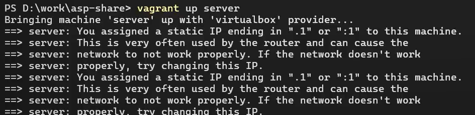{#fig:001 width=60%}

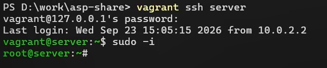{#fig:002 width=60%}

2. Установите необходимые для работы пакеты: dnf -y install dovecot telnet.

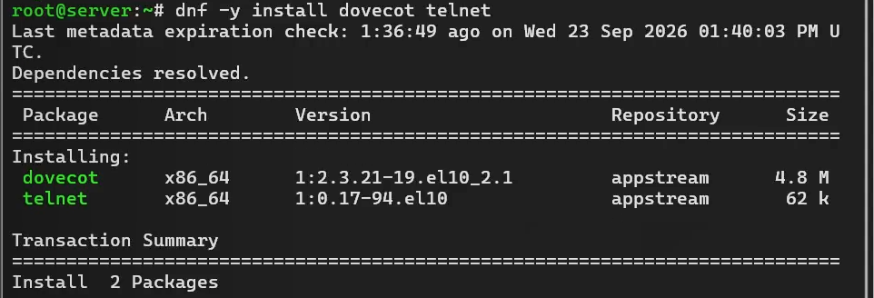{#fig:003 width=60%}

## Настройка dovecot

1. В конфигурационном файле /etc/dovecot/dovecot.conf пропишите список почтовых протоколов, по которым разрешено работать Dovecot: protocols = imap pop3.

{#fig:004 width=60%}

2. В конфигурационном файле /etc/dovecot/conf.d/10-auth.conf проверьте, что укаан метод аутентификации plain: auth_mechanisms = plain.

{#fig:005 width=60%}

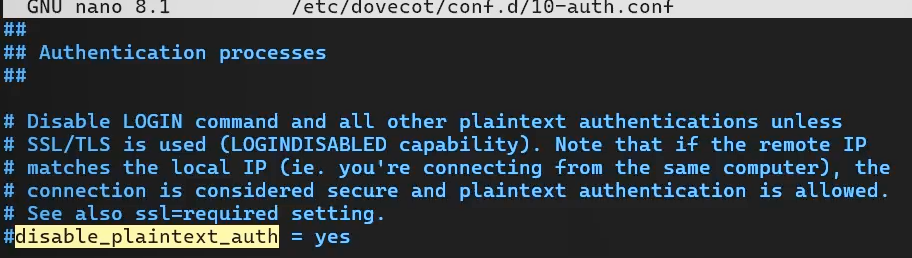{#fig:006 width=60%}

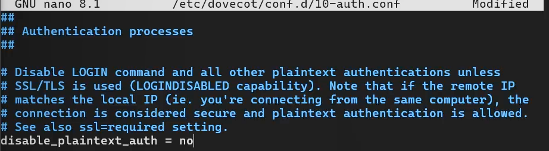{#fig:007 width=60%}

3. В конфигурационном файле /etc/dovecot/conf.d/auth-system.conf.ext проверьте, что для поиска пользователей и паролей используется pam и файл passwd.

{#fig:008 width=60%}

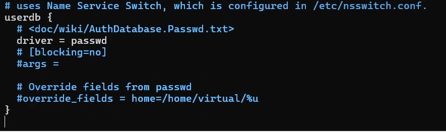{#fig:039 width=60%}

4. В конфигурационном файле /etc/dovecot/conf.d/10-mail.conf настройте месторасположение почтовых ящиков пользователей: mail_location = maildir:~/Maildir.

{#fig:009 width=60%}

5. В Postfix задайте каталог для доставки почты: postconf -e 'home_mailbox = Maildir/'.

{#fig:011 width=60%}

6. Сконфигурируйте межсетевой экран, разрешив работать службам протоколов POP3 и IMAP.

{#fig:012 width=60%}

{#fig:013 width=60%}

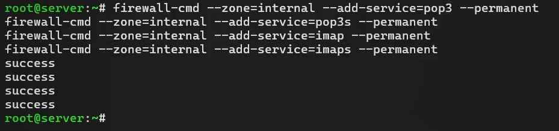{#fig:014 width=60%}

{#fig:015 width=60%}

7. Восстановите контекст безопасности в SELinux: restorecon -vR /etc.

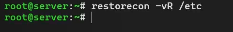{#fig:016 width=60%}

8. Перезапустите Postfix и запустите Dovecot.

{#fig:017 width=60%}

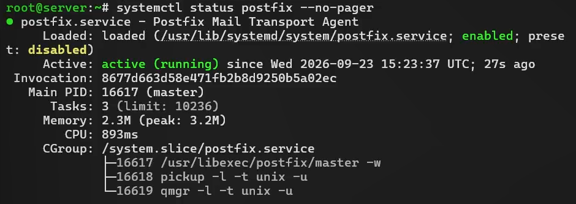{#fig:018 width=60%}

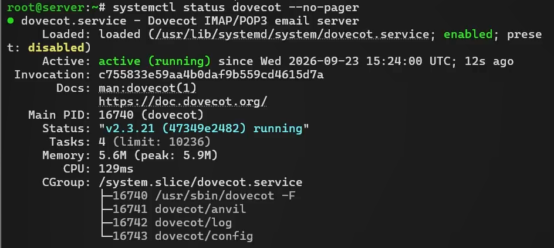{#fig:019 width=60%}

## Проверка работы Dovecot

0. Заранее отправим на почту 3 тестовых сообщения

{#fig:020 width=60%}

1. На дополнительном терминале ВМ server запустите мониторинг работы почтовой службы: tail -f /var/log/maillog.
2. На терминале сервера для просмотра почты используйте: MAIL=~/Maildir mail (видим 3 отправленных ранее тестовых сообщения).

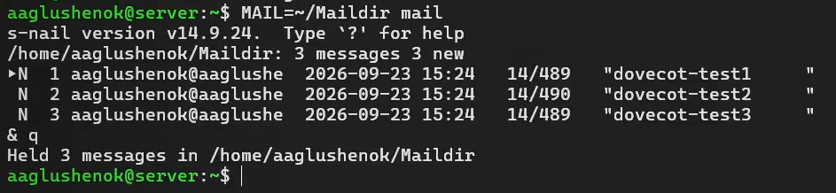{#fig:021 width=60%}

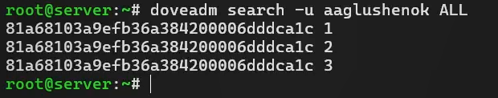{#fig:023 width=60%}

3. Для просмотра mailbox пользователя на сервере используйте: doveadm mailbox list -u user.

{#fig:022 width=60%}

4. На ВМ client войдите под вашим пользователем, перейдите в режим суперпользователя.
5. Установите почтовый клиент: dnf -y install evolution

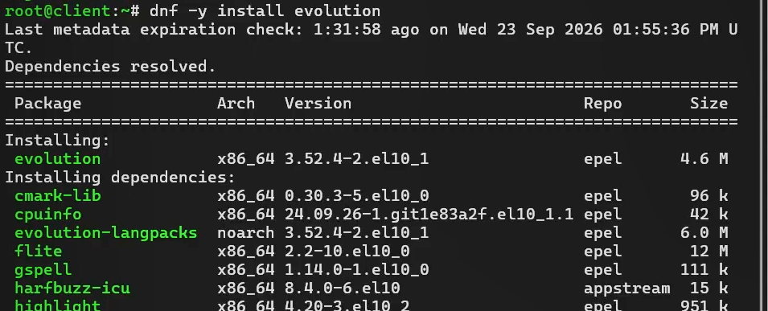{#fig:024 width=60%}

6. Запустите и настройте почтовый клиент Evolution:

{#fig:025 width=60%}

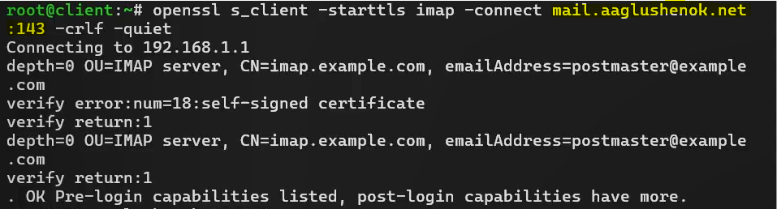{#fig:026 width=60%}

{#fig:027 width=60%}

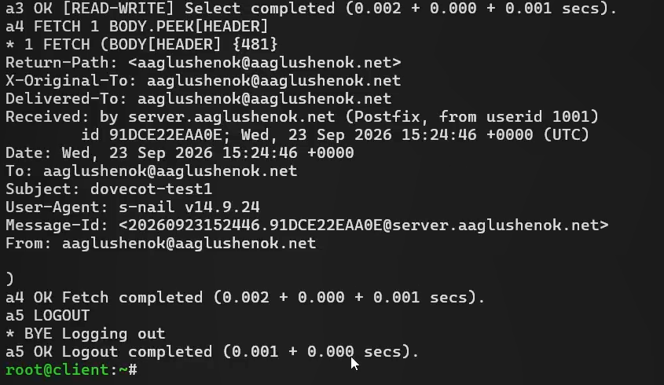{#fig:028 width=60%}

7. Из почтового клиента отправьте себе несколько тестовых писем, убедитесь, что они доставлены.

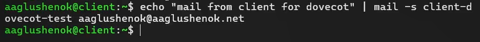{#fig:029 width=60%}

8. Посмотрите, какие сообщения выдаются при мониторинге почтовой службы на сервере, при использовании doveadm и mail.

{#fig:030 width=60%}

{#fig:040 width=60%}

{#fig:031 width=60%}

9. Проверьте работу почтовой службы, используя на сервере протокол Telnet:
- подключение с помощью протокола Telnet к почтовому серверу по протоколу POP3 (через порт 110), ввод логина и пароля.

{#fig:032 width=60%}

- получение списка писем (list), получение 1-го письма из списка (retr 1), удаление 2-го письмо из списка (dele 2), завершение сеанса работы с telnet (quit).

{#fig:033 width=60%}

{#fig:034 width=60%}

## Внесение изменений в настройки внутреннего окружения ВМ

1. На ВМ server перейдите в каталог для внесения изменений в настройки внутреннего окружения /vagrant/provision/server/. В соответствующие подкаталоги поместите конфигурационные файлы Dovecot.

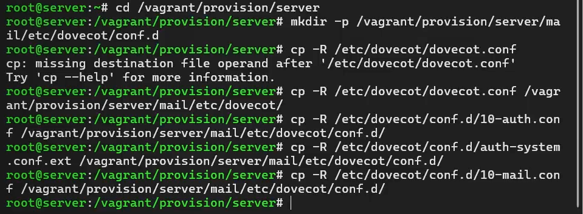{#fig:035 width=60%}

2. Внесите изменения в файл /vagrant/provision/server/mail.sh.

{#fig:036 width=60%}

{#fig:037 width=60%}

3. На виртуальной машине client в каталоге /vagrant/provision/client скорректируйте файл mail.sh: dnf -y install evolution.

{#fig:038 width=60%}

# Контрольные вопросы

1. За что отвечает протокол SMTP?  
За ОТПРАВКУ почты (исходящая почта). Он передает письма от отправителя к почтовому серверу получателя.

2. За что отвечает протокол IMAP?  
За ПОЛУЧЕНИЕ и ХРАНЕНИЕ почты на сервере. Позволяет читать и управлять письмами прямо на сервере с разных устройств (письма не скачиваются навсегда, а синхронизируются).

3. За что отвечает протокол POP3?  
За СКАЧИВАНИЕ почты. Он забирает письма с сервера на компьютер пользователя (обычно после скачивания письма удаляются с сервера).

4. В чём назначение Dovecot?  
Это ПОЧТОВЫЙ СЕРВЕР (MDA). Его задача — принимать входящие письма от Postfix и отдавать их пользователю по протоколам IMAP или POP3.

5. В каких файлах обычно находятся настройки работы Dovecot? За что отвечает каждый из файлов?  
Главный файл — /etc/dovecot/dovecot.conf.  
Дополнительные настройки лежат в папке /etc/dovecot/conf.d/:
- 10-auth.conf — настройки аутентификации (как проверять логин/пароль).
- 10-mail.conf — где хранятся почтовые ящики (формат Maildir).
- 10-ssl.conf — настройки шифрования (сертификаты).

6. В чём назначение Postfix?  
Это ПОЧТОВЫЙ СЕРВЕР (MTA). Его задача — принимать письма и доставлять их по назначению (в локальные ящики через Dovecot или на другие серверы в интернете).

7. Какие методы аутентификации пользователей можно использовать в Dovecot и в чём их отличие?
- Основные: plain (обычный пароль) и pam (через системных пользователей Linux).
- Отличие: plain — простой пароль внутри почтовой системы, pam — проверка пароля через общую базу пользователей операционной системы (как при входе в Linux).

8. Приведите пример заголовка письма с пояснениями его полей.  
From: aaglushenok@aaglushenok.net  (Кто отправил)  
To: aaglushenok@aaglushenok.net    (Кому)  
Subject: dovecot-test1             (Тема письма)  
Date: Wed, 23 Sep 2026 15:24:46    (Дата и время)  
Message-ID: <...@server>           (Уникальный ID письма)  
Received: by server...             (Следы прохождения через серверы)  

9. Приведите примеры использования команд для работы с почтовыми протоколами через терминал (например telnet).  
Пример для POP3 (порт 110):  
telnet mail.aaglushenok.net 110  
user aaglushenok       # ввод логина  
pass 123456            # ввод пароля  
list                   # показать список писем  
retr 1                 # прочитать первое письмо  
dele 2                 # удалить второе письмо  
quit                   # выйти  

10. Приведите примеры с пояснениями по работе с doveadm.  
doveadm — утилита для управления почтовым сервером Dovecot из консоли.
- doveadm search -u aaglushenok ALL — показать все письма пользователя (выводит ID).
- doveadm mailbox list -u aaglushenok — показать список папок (ящиков) пользователя.
- doveadm expunge -u aaglushenok mailbox INBOX BEFORE 7d — удалить из "Входящих" письма старше 7 дней.

# Выводы

В ходе выполнения лабораторной работы № 9 мне удалось приобрести практические навыки по установке и простейшему конфигурированию POP3/IMAP-сервера.

# Список литературы 

1. Dovecot Documentation. — URL: https : / / dovecot . org / documentation (дата обращения: 31/10/2026).
2. Postfix Documentation. — URL: http://www.postfix.org/documentation.html (дата обращения: 31/10/2026).
