---
## Front matter
lang: ru-RU
title: Лабораторная работа № 10. Расширенные настройки SMTP-сервера
subtitle: Презентация
author:
  - Глушенок А. А.
institute:
  - Российский университет дружбы народов, Москва, Россия
date: 2 октября 2026

## Formatting pdf
toc: false
slide_level: 2
aspectratio: 169
section-titles: true
theme: metropolis
header-includes:
 - \metroset{progressbar=frametitle,sectionpage=progressbar,numbering=fraction}
 - \usepackage{graphicx}
 - \usepackage{caption}
 - \captionsetup{labelformat=empty, labelsep=none}
 
## Fonts
mainfont: Liberation Serif
sansfont: PT Sans
monofont: Liberation Mono
---

# Информация

## Докладчик

:::::::::::::: {.columns align=center}
::: {.column width="70%"}

  * Глушенок Анна Александровна
  * Студент НПИбд-01-24
  * Российский университет дружбы народов
  * [1132246844@pfur.ru](mailto:1132246844@pfur.ru)

:::
::: {.column width="30%"}

:::
::::::::::::::

## Цель работы

Приобретение практических навыков по конфигурированию SMTP-сервера в части настройки аутентификации.

## Задание

1. Настройте Dovecot для работы с LMTP.
2. Настройте аутентификацию посредством SASL на SMTP-сервере.
3. Настройте работу SMTP-сервера поверх TLS.
4. Скорректируйте скрипт для Vagrant, фиксирующий действия расширенной настройки SMTP-сервера во внутреннем окружении ВМ server.

# Выполнение лабораторной работы

# Настройка LMTP в Dovecote

## Настройка LMTP в Dovecote

1. Запускаем ВМ server, подключаемся по SSH, переходим к суперпользователю.

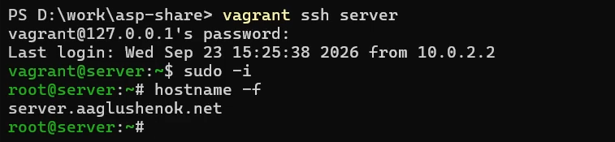{#fig:001 width=60%}

## Настройка LMTP в Dovecote

2. В дополнительном терминале запускаем мониторинг работы почтовой службы.

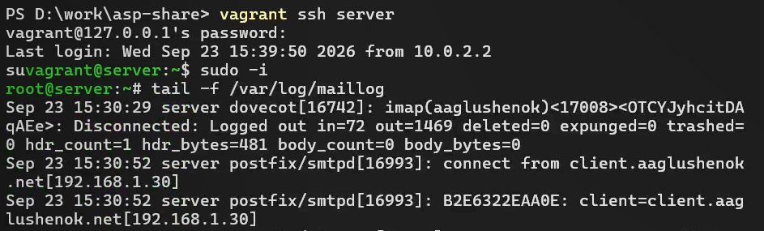{#fig:002 width=60%}

## Настройка LMTP в Dovecote

3. Вносим изменения в файл /etc/dovecot/dovecot.conf: добавляем в список протоколов, с которыми может работать Dovecot, протокол LMTP.

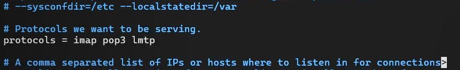{#fig:003 width=60%}

## Настройка LMTP в Dovecote

4. Вносим изменения в файл /etc/dovecot/conf.d/10-master.conf: настраиваем в Dovecot сервис lmtp для связи с Postfix. 

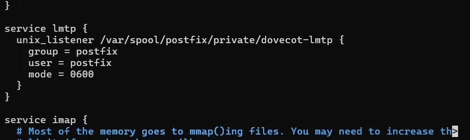{#fig:004 width=60%}

## Настройка LMTP в Dovecote

5. Переопределяем в Postfix с помощью postconf передачу сообщений не на прямую, а через unix-сокет.

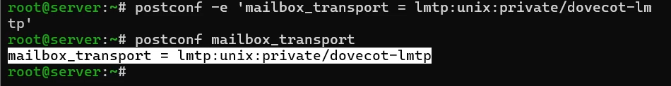{#fig:005 width=60%}

## Настройка LMTP в Dovecote

6. Вносим изменения в файл /etc/dovecot/conf.d/10-auth.conf: задаем формат имени пользователя для аутентификации в форме логина пользователя без указания домена.

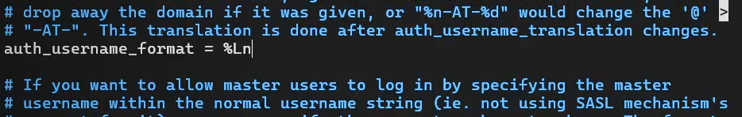{#fig:006 width=60%}

## Настройка LMTP в Dovecote

7. Сначала перезапускаем Postfix и Dovecot. 

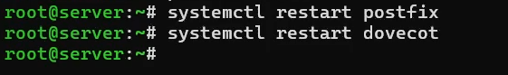{#fig:007 width=60%}

## Настройка LMTP в Dovecote

Далее проверяем, что работа сервера Postfix запущена.

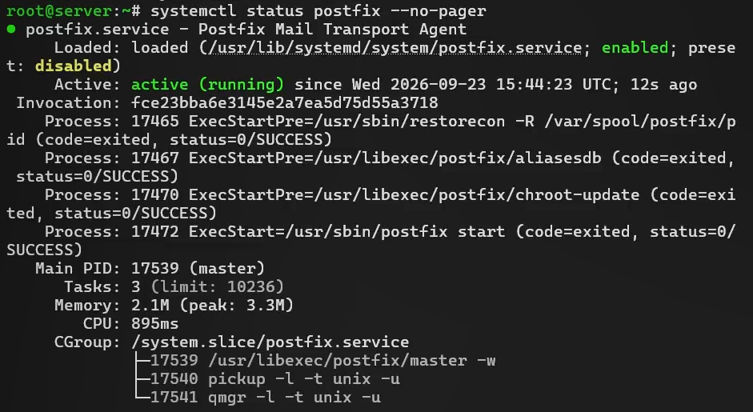{#fig:008 width=60%}

## Настройка LMTP в Dovecote

Затем проверяем, что работа сервера Dovecot запущена.

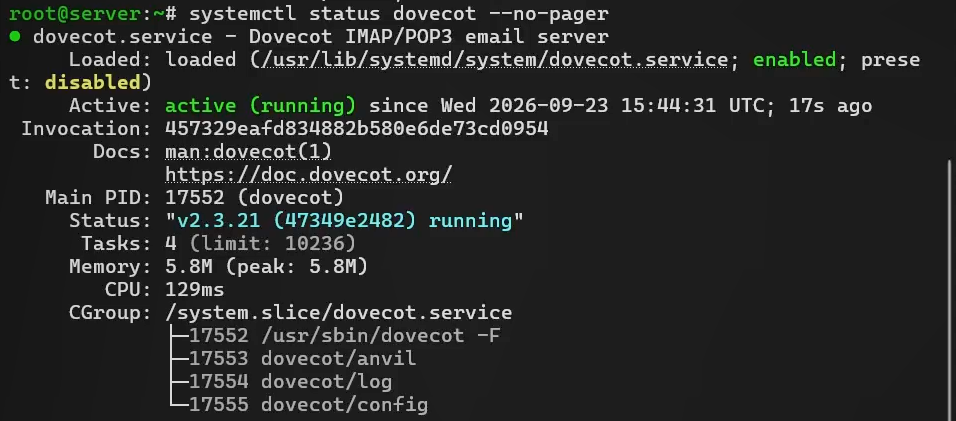{#fig:009 width=60%}

## Настройка LMTP в Dovecote

8. Сначала из-под учётной записи своего пользователя отправляем письмо с ВМ client. 

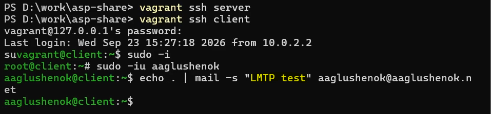{#fig:010 width=60%}

## Настройка LMTP в Dovecote

Затем просматриваем содержание логов мониторинга почтовой службы (подключение почтового клиента > присвоение письму идентификатора > создан Message-ID письма > письмо от пользователя aaglushenok, поставлено в очередь > сессия отправки завершена > письмо передано на доставку через LMTP > Dovecot LMTP подключился > письмо сохранено в ящик INBOX > подтверждение успешной доставки (status=sent) > отключение LMTP > письмо удалено из очереди Postfix).

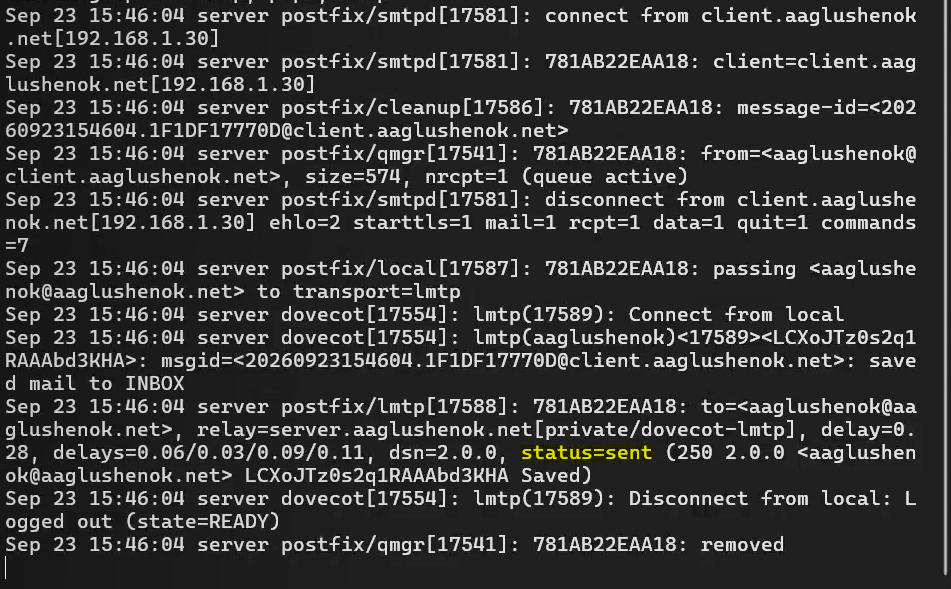{#fig:011 width=40%}

## Настройка LMTP в Dovecote

9. Сначала на server просматриваем почтовый ящик пользователя: видим, что отправленное с client письмо доставлено в почтовый ящик на server. 

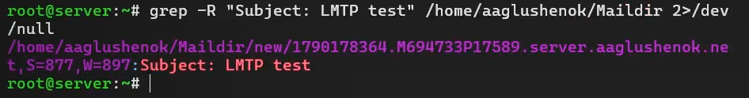{#fig:012 width=60%}

## Настройка LMTP в Dovecote

Затем дополнительно проверяем доставку письма через doveadm: отправленное с client письмо доставлено и отображается с номером 5.

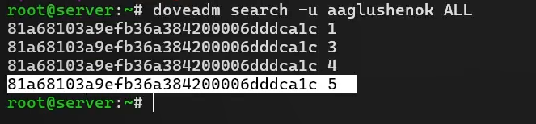{#fig:013 width=60%}

# Настройка SMTP-аутентификации

## Настройка SMTP-аутентификации

1. Вносим изменения в файл /etc/dovecot/conf.d/10-master.conf: определяем службу аутентификации пользователей.

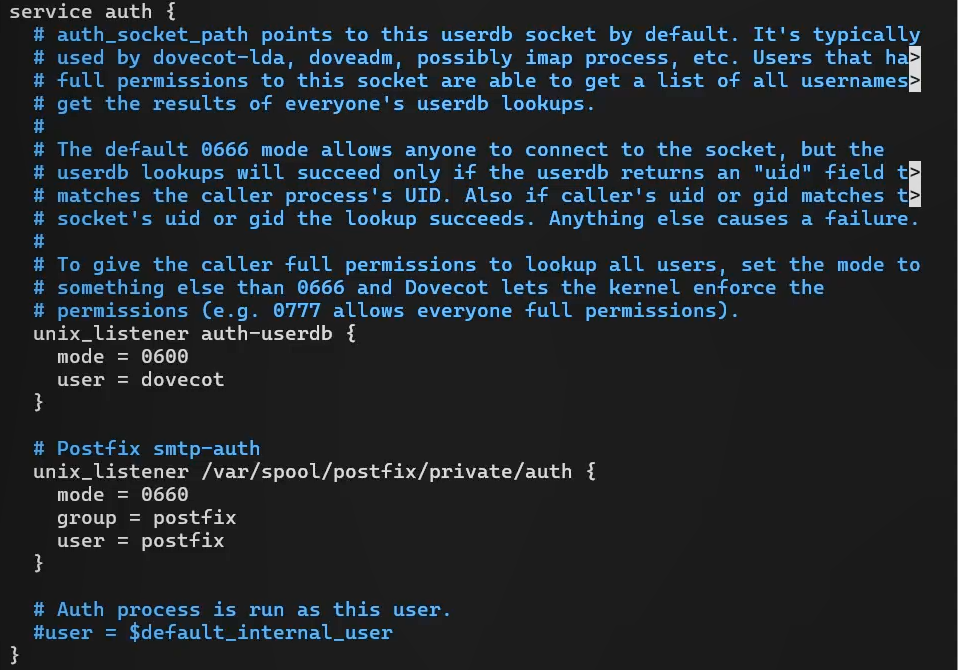{#fig:014 width=55%}

## Настройка SMTP-аутентификации

2. Задаем для Postfix тип аутентификации SASL для smtpd и путь к соответствующему unix-сокету.

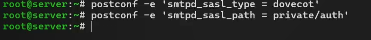{#fig:015 width=60%}

## Настройка SMTP-аутентификации

3. Настраиваем Postfix для приёма почты из Интернета только для обслуживаемых нашим сервером пользователей или для произвольных пользователей локальной машины, обеспечивая тем самым запрет на использование почтового сервера в качестве SMTP relay для спам-рассылок.

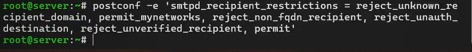{#fig:016 width=60%}

## Настройка SMTP-аутентификации

4. Ограничиваем в настройках Postfix прием почты только локальным адресом SMTP-сервера сети.

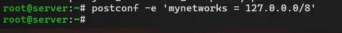{#fig:017 width=60%}

## Настройка SMTP-аутентификации

5. Для проверки работы аутентификации временно запускаем SMTP-сервер (порт 25) с возможностью аутентификации. Для этого вносим изменения в файл /etc/postfix/master.cf.

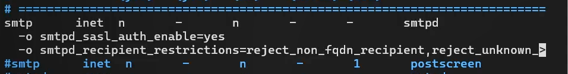{#fig:018 width=60%}

## Настройка SMTP-аутентификации

6. Перезапускаем Postfix и Dovecot.

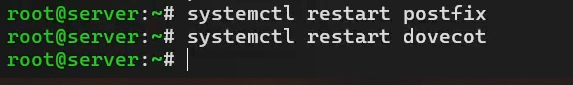{#fig:019 width=60%}

## Настройка SMTP-аутентификации

7. На client устанавливаем telnet.

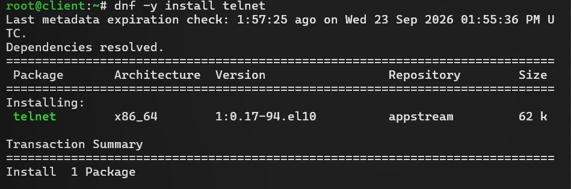{#fig:020 width=60%}

## Настройка SMTP-аутентификации

8. На client получаем строку для аутентификации в формате base64.

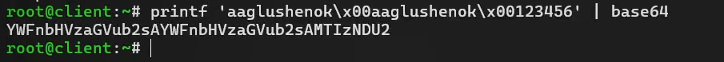{#fig:021 width=60%}

## Настройка SMTP-аутентификации

9. Подключаемся на client к SMTP-серверу посредством telnet. Тестируем соединение (EHLO test), проверяем авторизацию (AUTH PLAIN), завершаем сессию telnet на client (QUIT).

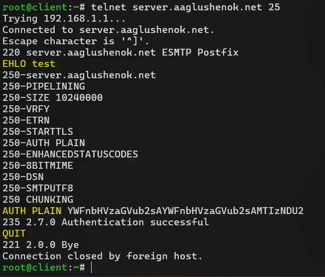{#fig:022 width=40%}

# Настройка SMTP over TLS

## Настройка SMTP over TLS

0. Настраиваем на сервере TLS, воспользовавшись временным сертификатом Dovecot. Предварительно копируем необходимые файлы сертификата и ключа из каталога /etc/pki/dovecot в каталог /etc/pki/tls/. 

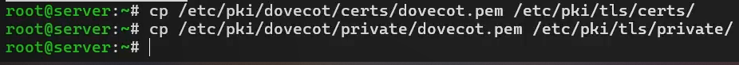{#fig:023 width=60%}

## Настройка SMTP over TLS

1. Сконфигурируем Postfix, указав пути к сертификату и ключу, а также к каталогу для хранения TLS-сессий и уровня безопасности.

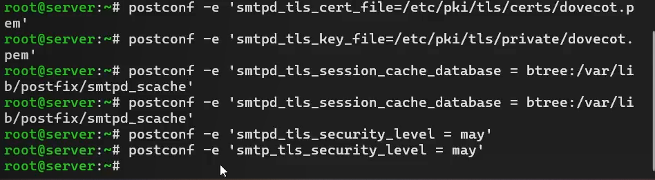{#fig:024 width=60%}

## Настройка SMTP over TLS

2. Вносим изменения в файл /etc/postfix/master.cf: добавляем строки для запуска SMTP-сервера на 587 порту.

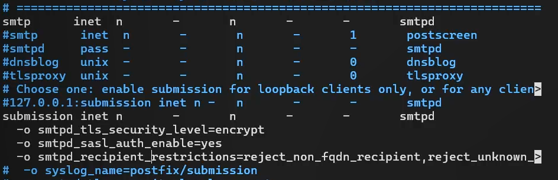{#fig:025 width=60%}

## Настройка SMTP over TLS

3. Настраиваем межсетевой экран. Сначала просматриваем список доступных служб.

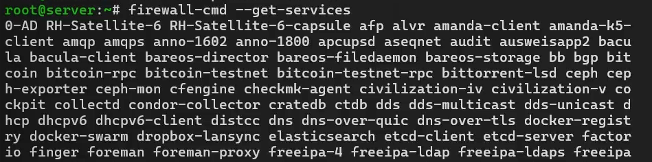{#fig:026 width=60%}

## Настройка SMTP over TLS

Затем добавляем службу smtp-submission в список доступных служб.

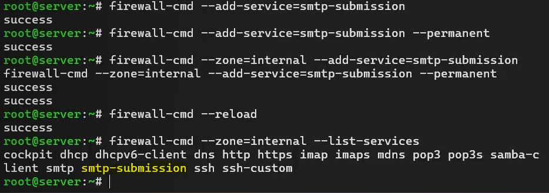{#fig:027 width=60%}

## Настройка SMTP over TLS

4. Перезапускаем Postfix.

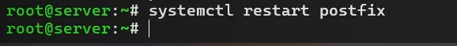{#fig:028 width=60%}

## Настройка SMTP over TLS

5. На client подключаемся к SMTP-серверу через 587-й порт посредством openssl. Тестируем подключение по telnet (EHLO test), проверяем аутентификацию (AUTH PLAIN).

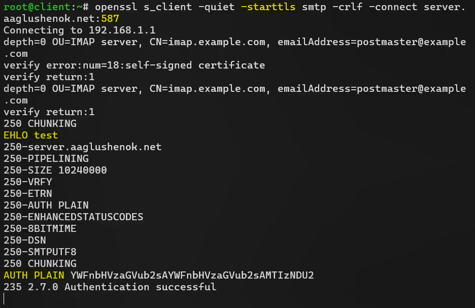{#fig:0291 width=50%}

## Настройка SMTP over TLS

6. Сначала проверяем корректность отправки сообщений с client посредством клиента Evolution (для SMTP-сервера указываем порт 587, STARTTLS и обычный пароль). 

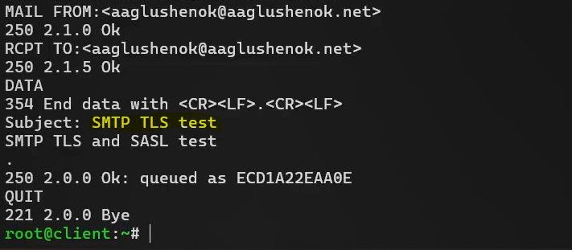{#fig:030 width=60%}

## Настройка SMTP over TLS

Затем по логу мониторинга почты видим, что сообщение успешно отправлено и доставлено.

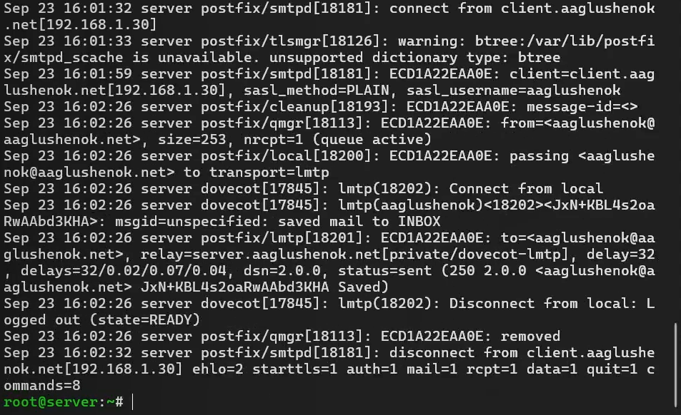{#fig:031 width=60%}

# Внесение изменений в настройки внутреннего окружения виртуальной машины

## Внесение изменений в настройки внутреннего окружения виртуальной машины

1. На ВМ server вносим изменения (относящиеся к Dovecot и Postfix) в каталог /vagrant/provision/server/ для настройки внутреннего окружения.

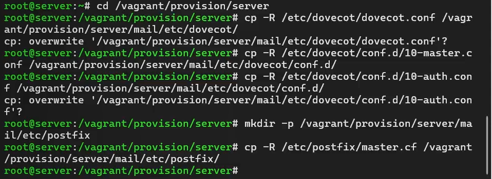{#fig:032 width=60%}

## Внесение изменений в настройки внутреннего окружения виртуальной машины

2. Вносим изменения в файл /vagrant/provision/**server**/mail.sh по расширенной конфигурации SMTP-сервера.

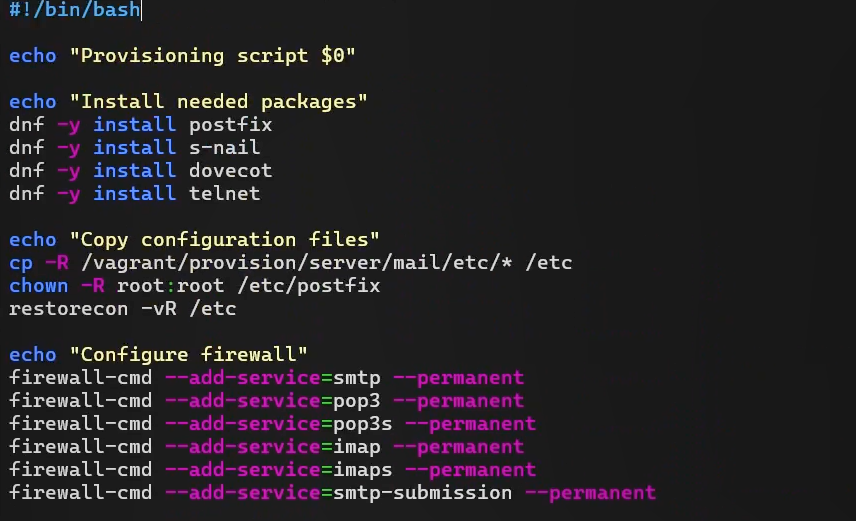{#fig:033 width=60%}

## Внесение изменений в настройки внутреннего окружения виртуальной машины

3. Вносим изменения в файл /vagrant/provision/**client**/mail.sh: добавляем установку telnet.

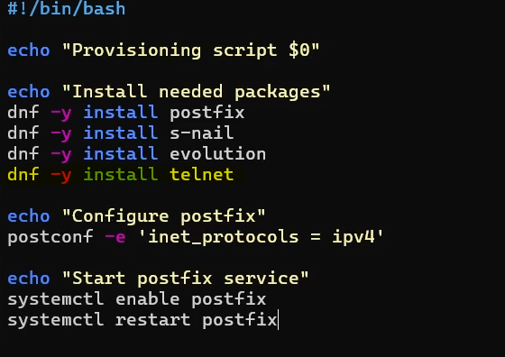{#fig:034 width=55%}

## Внесение изменений в настройки внутреннего окружения виртуальной машины

4. Проверяем Vagrantfile на отсутствие синтаксических ошибок.

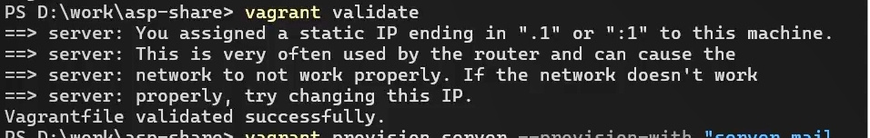{#fig:035 width=60%}

## Внесение изменений в настройки внутреннего окружения виртуальной машины

5. Сначала применяем изменения, касающиеся server mail.

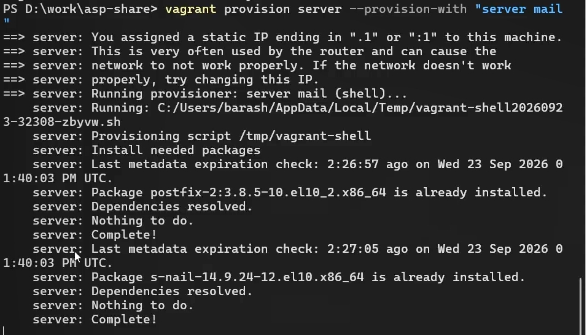{#fig:036 width=60%}

## Внесение изменений в настройки внутреннего окружения виртуальной машины

Затем применяем изменения, касающиеся client mail.

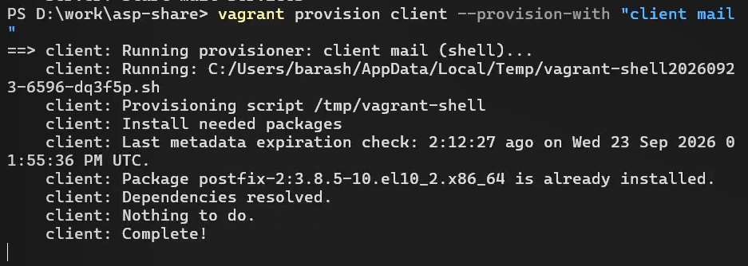{#fig:037 width=60%}

# Выводы

## Выводы

В ходе выполнения лабораторной работы № 10 мне удалось приобрести практические навыки по конфигурированию SMTP-сервера в части настройки аутентификации.

# Список литературы 

## Список литературы 

1. Postfix SASL Howto. — URL: http : / / www . postfix . org / SASL _ README . html (дата обращения: 02/11/2026).

