# Цель работы

Приобретение практических навыков по конфигурированию SMTP-сервера в
части настройки аутентификации.

# Задание

1.  Настройте Dovecot для работы с LMTP.
2.  Настройте аутентификацию посредством SASL на SMTP-сервере.
3.  Настройте работу SMTP-сервера поверх TLS.
4.  Скорректируйте скрипт для Vagrant, фиксирующий действия расширенной
    настройки SMTP-сервера во внутреннем окружении ВМ server.

# Выполнение лабораторной работы

## Настройка LMTP в Dovecote

1.  Запускаем ВМ server, подключаемся по SSH, переходим к
    суперпользователю.

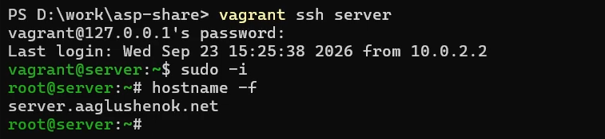{#fig:001 width="60%"}

2.  В дополнительном терминале запускаем мониторинг работы почтовой
    службы.

{#fig:002 width="60%"}

3.  Вносим изменения в файл /etc/dovecot/dovecot.conf: добавляем в
    список протоколов, с которыми может работать Dovecot, протокол LMTP.

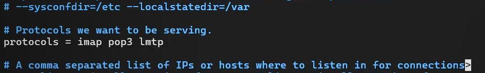{#fig:003 width="60%"}

4.  Вносим изменения в файл /etc/dovecot/conf.d/10-master.conf:
    настраиваем в Dovecot сервис lmtp для связи с Postfix.

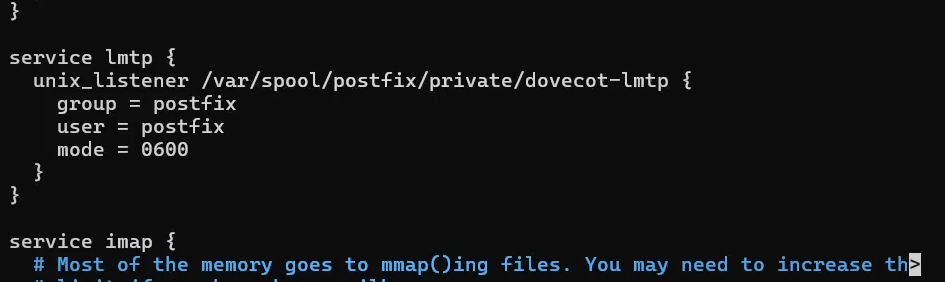{#fig:004 width="60%"}

5.  Переопределяем в Postfix с помощью postconf передачу сообщений не на
    прямую, а через unix-сокет.

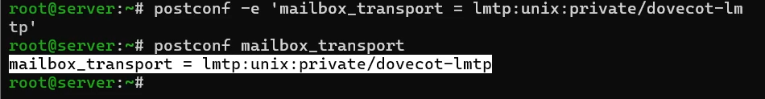{#fig:005
width="60%"}

6.  Вносим изменения в файл /etc/dovecot/conf.d/10-auth.conf: задаем
    формат имени пользователя для аутентификации в форме логина
    пользователя без указания домена.

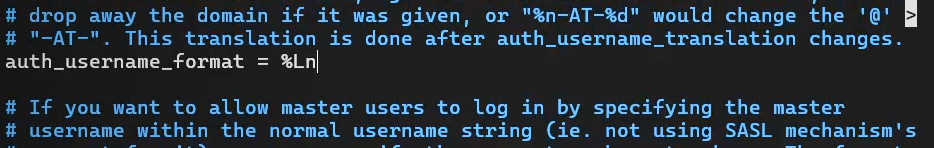{#fig:006
width="60%"}

7.  Перезапускаем Postfix и Dovecot. Проверяем, что работа каждого из
    серверов запущена.

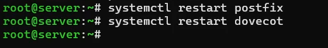{#fig:007
width="60%"}

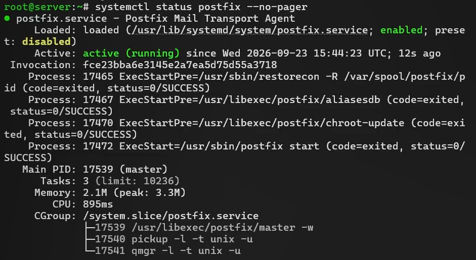{#fig:008 width="60%"}

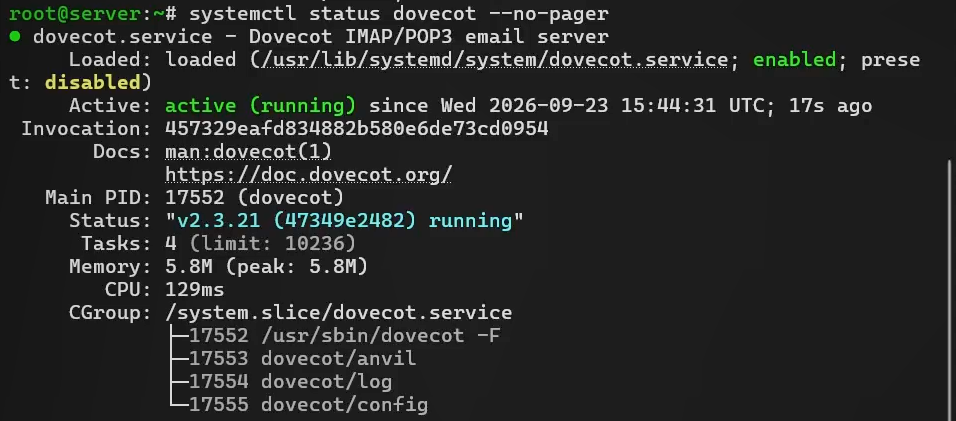{#fig:009 width="60%"}

8.  Из-под учётной записи своего пользователя отправляем письмо с ВМ
    client. Просматриваем содержание логов мониторинга почтовой службы
    (подключение почтового клиента **-\>** присвоение письму
    идентификатора 781AB22EAA18 **-\>** создан Message-ID письма **-\>**
    письмо от пользователя aaglushenok, размер 574 байта, 1 получатель,
    поставлено в очередь **-\>** сессия отправки завершена **-\>**
    письмо передано на доставку через LMTP **-\>** Dovecot LMTP
    подключился **-\>** письмо сохранено в ящик INBOX **-\>**
    подтверждение успешной доставки (status=sent) **-\>** отключение
    LMTP **-\>** письмо удалено из очереди Postfix).

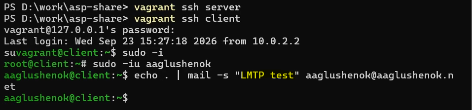{#fig:010
width="60%"}

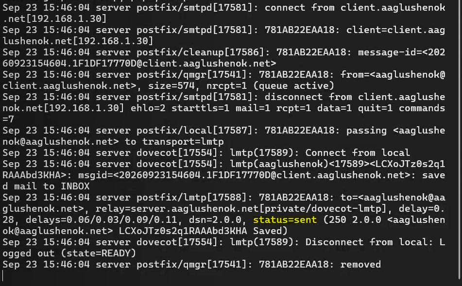{#fig:011
width="60%"}

9.  На server просматриваем почтовый ящик пользователя: видим, что
    отправленное с client письмо доставлено в почтовый ящик на server.
    Дополнительно проверяем доставку письма через doveadm: отправленное
    с client письмо доставлено и отображается с номером 5.

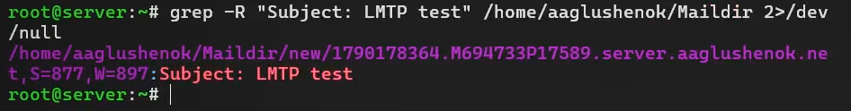{#fig:012 width="60%"}

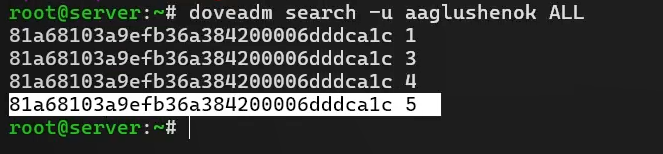{#fig:013
width="60%"}

## Настройка SMTP-аутентификации

1.  Вносим изменения в файл /etc/dovecot/conf.d/10-master.conf:
    определяем службу аутентификации пользователей.

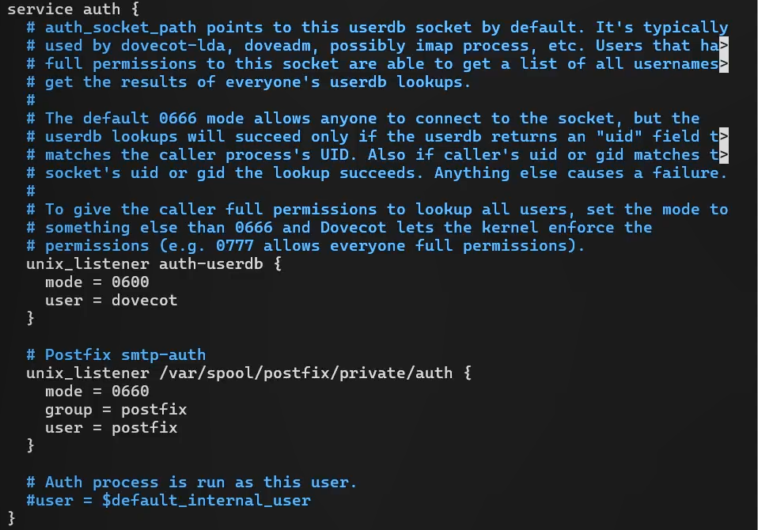{#fig:014
width="60%"}

2.  Задаем для Postfix тип аутентификации SASL для smtpd и путь к
    соответствующему unix-сокету.

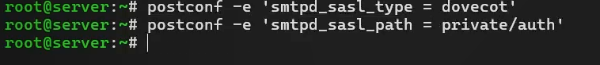{#fig:015
width="60%"}

3.  Настраиваем Postfix для приёма почты из Интернета только для
    обслуживаемых нашим сервером пользователей или для произвольных
    пользователей локальной машины, обеспечивая тем самым запрет на
    использование почтового сервера в качестве SMTP relay для
    спам-рассылок.

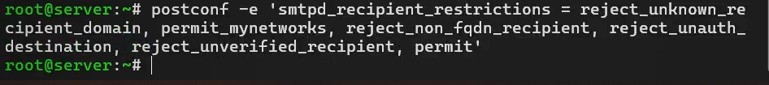{#fig:016
width="60%"}

Коомментарии к использованным опциям: - reject_unknown_recipient_domain:
Отклоняет письмо, если домен получателя не имеет DNS-записи A или MX.
Это отсекает часть спама, отправляемого на несуществующие домены. -
permit_mynetworks: Разрешает приём без дальнейших проверок, если клиент
находится в списке доверенных сетей (mynetworks). -
reject_non_fqdn_recipient: Требует, чтобы адрес получателя был в формате
FQDN (полное доменное имя, а не просто user). Это защита от ошибок
конфигурации и некоторых видов атак . - reject_unauth_destination:
Ключевая опция против спама. Postfix отклоняет письмо, если домен
получателя не является для него «своим» (не входит в mydestination,
virtual\_\* или relay_domains). - reject_unverified_recipient: Отклоняет
письмо, если адрес получателя невозможно проверить (например, через
recipient_verification). Это снижает нагрузку от писем на несуществующие
ящики. - permit: Разрешающий вердикт по умолчанию, если ни одно из
предыдущих правил не сработало.

4.  Ограничиваем в настройках Postfix прием почты только локальным
    адресом SMTP-сервера сети.

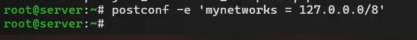{#fig:017
width="60%"}

5.  Для проверки работы аутентификации временно запускаем SMTP-сервер
    (порт 25) с возможностью аутентификации. Для этого вносим изменения
    в файл /etc/postfix/master.cf.

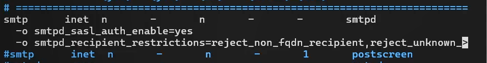{#fig:018
width="60%"}

6.  Перезапускаем Postfix и Dovecot.

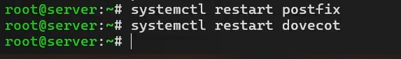{#fig:019
width="60%"}

7.  На client устанавливаем telnet.

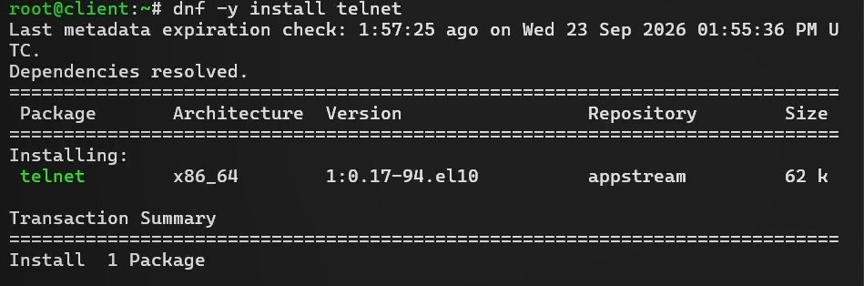{#fig:020 width="60%"}

8.  На client получаем строку для аутентификации в формате base64.

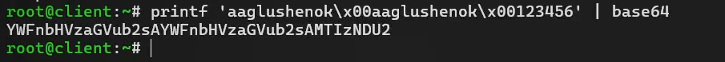{#fig:021
width="60%"}

9.  Подключаемся на client к SMTP-серверу посредством telnet. Тестируем
    соединение (EHLO test), проверяем авторизацию (AUTH PLAIN),
    завершаем сессию telnet на client (QUIT).

{#fig:022 width="60%"}

## Настройка SMTP over TLS

0.  Настраиваем на сервере TLS, воспользовавшись временным сертификатом
    Dovecot. Предварительно копируем необходимые файлы сертификата и
    ключа из каталога /etc/pki/dovecot в каталог /etc/pki/tls/.

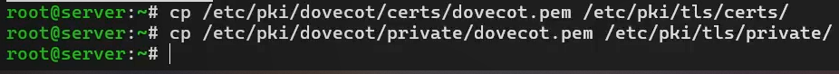{#fig:023 width="60%"}

1.  Сконфигурируем Postfix, указав пути к сертификату и ключу, а также к
    каталогу для хранения TLS-сессий и уровня безопасности.

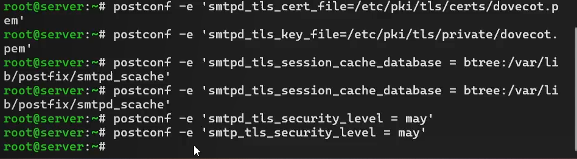{#fig:024 width="60%"}

2.  Вносим изменения в файл /etc/postfix/master.cf: добавляем строки для
    запуска SMTP-сервера на 587 порту.

{#fig:025 width="60%"}

3.  Настраиваем межсетевой экран, разрешая работать службе
    smtp-submission.

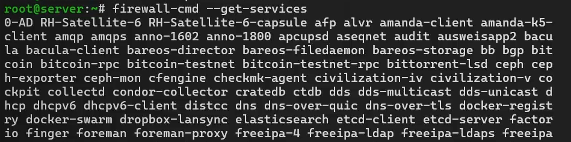{#fig:026 width="60%"}

{#fig:027 width="60%"}

4.  Перезапускаем Postfix.

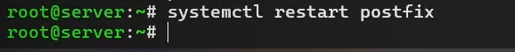{#fig:028 width="60%"}

5.  На client подключаемся к SMTP-серверу через 587-й порт посредством
    openssl. Тестируем подключение по telnet (EHLO test), проверяем
    аутентификацию (AUTH PLAIN).

{#fig:0291 width="60%"}

6.  Проверяем корректность отправки сообщений с client посредством
    клиента Evolution (для SMTP-сервера указываем порт 587, STARTTLS и
    обычный пароль). По логу мониторинга почты видим, что сообщение
    успешно отправлено и доставлено.

{#fig:030 width="60%"}

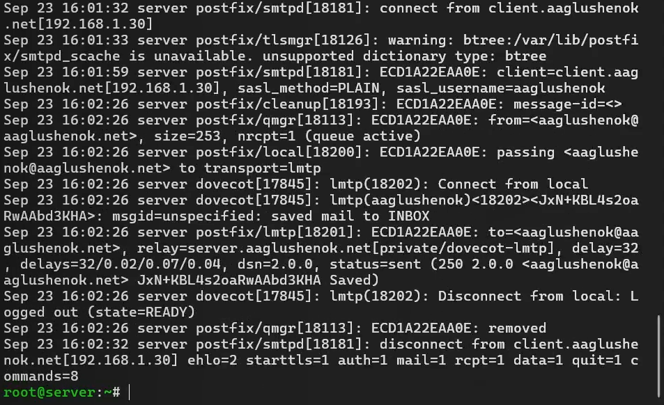{#fig:031
width="60%"}

## Внесение изменений в настройки внутреннего окружения виртуальной машины

1.  На ВМ server вносим изменения (относящиеся к Dovecot и Postfix) в
    каталог /vagrant/provision/server/ для настройки внутреннего
    окружения.

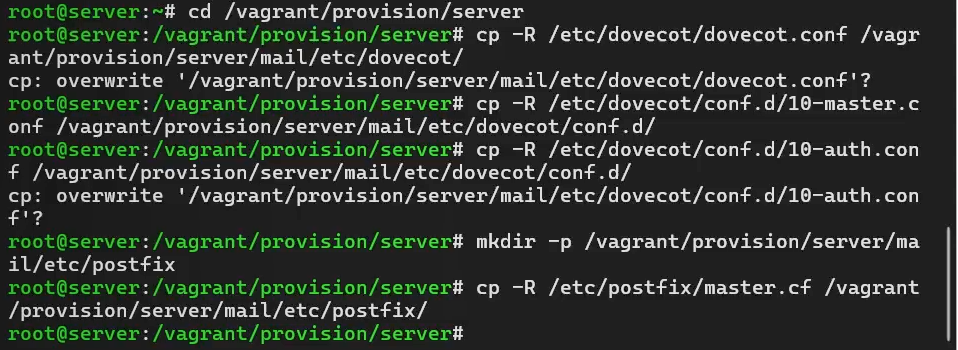{#fig:032
width="60%"}

2.  Вносим изменения в файл /vagrant/provision/**server**/mail.sh по
    расширенной конфигурации SMTP-сервера.

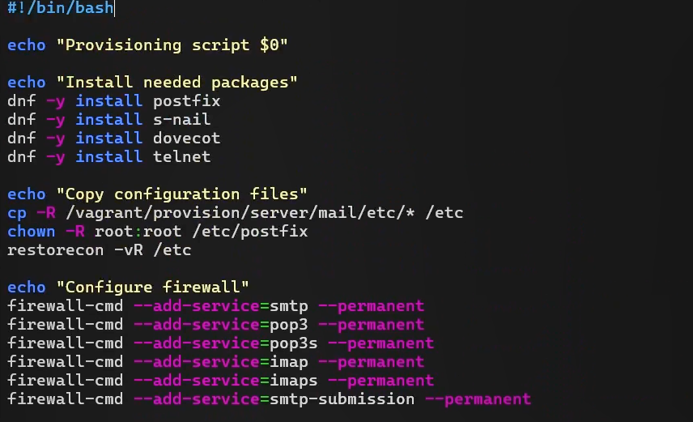{#fig:033
width="60%"}

3.  Вносим изменения в файл /vagrant/provision/**client**/mail.sh:
    добавляем установку telnet.

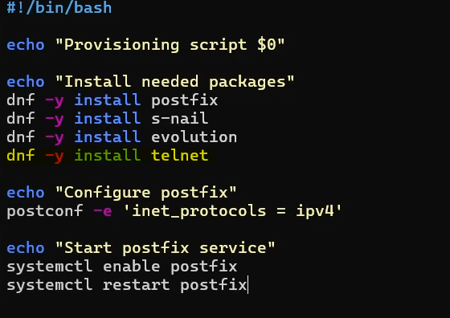{#fig:034
width="60%"}

4.  Проверяем Vagrantfile на отсутствие синтаксических ошибок.

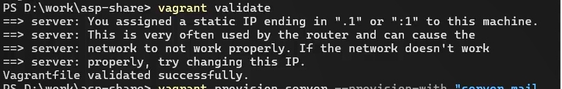{#fig:035
width="60%"}

5.  Применяем изменения, касающиеся server mail и client mail.

{#fig:036 width="60%"}

{#fig:037 width="60%"}

# Контрольные вопросы

1.  Приведите пример задания формата аутентификации пользователя в
    Dovecot в форме логина с указанием домена.\
    В файле /etc/dovecot/conf.d/10-auth.conf: **auth_username_format =
    %Lu**

- %L --- логин пользователя (без домена)
- %u --- полный логин
- %d --- домен
- %n --- имя пользователя
- %Lu --- логин с указанием домена (полное имя вида user@domain)
- %Ln --- логин без домена (используется в работе)

2.  Какие функции выполняет почтовый Relay-сервер?\
    Relay-сервер (ретранслятор) принимает почту от клиентов/серверов и
    передаёт её дальше по назначению. Функции:

- пересылает сообщения между почтовыми серверами (SMTP-ретрансляция);
- может выполнять роль промежуточного узла (smart host) для исходящей
  почты;
- обеспечивает маршрутизацию почты, когда прямой доставки нет;
- может фильтровать/проверять почту (антиспам, антивирус) на
  промежуточном узле.

3.  Какие угрозы безопасности могут возникнуть в случае настройки
    почтового сервера как Relay-сервера?\

- **Open relay** --- сервер принимает и пересылает почту от любых
  внешних пользователей без аутентификации → используется для
  спам-рассылок, что ведёт к попаданию в чёрные списки (RBL), блокировке
  домена/IP.
- **Подделка отправителя** (spoofing) и рассылка фишинга от имени
  сервера.
- **Утечка ресурсов** и отказ в обслуживании (DoS) из-за массовых
  рассылок.
- **Репутационные и юридические последствия** для владельца сервера.
- Защита: ограничение mynetworks, smtpd_recipient_restrictions
  (permit_sasl_authenticated, reject_unauth_destination), обязательная
  аутентификация SASL.

# Выводы

В ходе выполнения лабораторной работы № 10 мне удалось приобрести
практические навыки по конфигурированию SMTP-сервера в части настройки
аутентификации.

# Список литературы

1.  Postfix SASL Howto. --- URL: http : / / www . postfix . org / SASL
    \_ README . html (дата обращения: 02/11/2026).
