# Информация

## Докладчик

::::: {.columns align="center"}
::: {.column width="70%"}
- Глушенок Анна Александровна
- Студент НПИбд-01-24
- Российский университет дружбы народов
- <1132246844@pfur.ru>
:::

::: {.column width="30%"}
:::
:::::

# Цель работы

Приобретение практических навыков по настройке удалённого доступа к
серверу с помощью SSH.

# Задание

1.  Настройте запрет удалённого доступа на сервер по SSH для
    пользователя root.
2.  Настройте разрешение удалённого доступа к серверу по SSH только для
    пользователей группы vagrant и вашего пользователя.
3.  Настройте удалённый доступ к серверу по SSH через порт 2022.
4.  Настройте удалённый доступ к серверу по SSH по ключу.
5.  Организуйте SSH-туннель с клиента на сервер, перенаправив локальное
    соединение с TCP-порта 80 на порт 8080.
6.  Используя удалённое SSH-соединение, выполните с клиента несколько
    команд на сервере.
7.  Используя удалённое SSH-соединение, запустите с клиента графическое
    приложение на сервере.
8.  Напишите скрипт для Vagrant, фиксирующий действия по настройке
    SSH-сервера во внутреннем окружении виртуальной машины server.
    Соответствующим образом внесите изменения в Vagrantfile.

# Выполнение лабораторной работы

# Запрет удалённого доступа по SSH для пользователя root

## Запрет удалённого доступа по SSH для пользователя root

1.  На server задаем пароль для root.

{#fig:001 width="60%"}

## Запрет удалённого доступа по SSH для пользователя root

2.  На server в дополнительном терминале запускаем мониторинг системных
    событий.

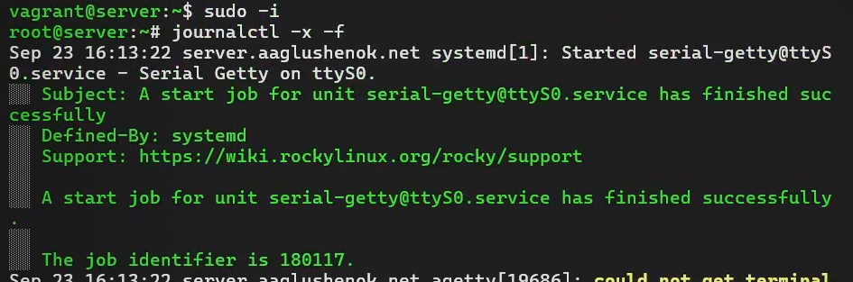{#fig:002
width="60%"}

## Запрет удалённого доступа по SSH для пользователя root

3.  С client пытаемся получить доступ к серверу посредством
    SSH-соединения через root.

{#fig:003 width="60%"}

Cистема выдала предупреждение об отсутствии ключа и запросила
подтверждение отпечатка. После подтверждения сервер запросил пароль, и
соединение было **успешно установлено**. Прямой удалённый доступ по SSH
для пользователя root разрешён, что демонстрирует уязвимость стандартных
настроек.

## Запрет удалённого доступа по SSH для пользователя root

4.  На server открываем файл /etc/ssh/sshd_config и запрещаем вход на
    сервер пользователю root.

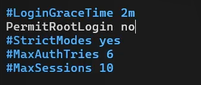{#fig:004
width="60%"}

## Запрет удалённого доступа по SSH для пользователя root

5.  Сохраняем изменения в файле конфигурации, перезапускаем sshd.

{#fig:005 width="60%"}

## Запрет удалённого доступа по SSH для пользователя root

6.  Повторяем попытку получения доступа с client к серверу посредством
    SSH-соединения через пользователя root.

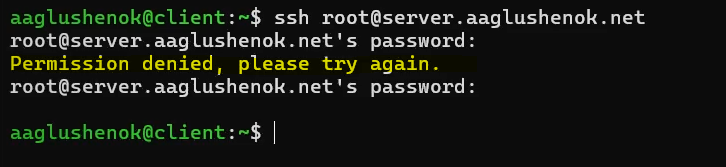{#fig:006
width="60%"}

Попытка подключения с client завершилась **отказом**. Сервер запросил
пароль, однако после его ввода выдал сообщение Permission denied, please
try again. и разорвал соединение. Прямой удалённый доступ по SSH для
пользователя root заблокирован.

# Ограничение списка пользователей для удалённого доступа по SSH

## Ограничение списка пользователей для удалённого доступа по SSH

1.  С client пытаемся получить доступ к серверу посредством
    SSH-соединения через пользователя.

{#fig:007 width="60%"}

После ввода пароля соединение было установлено, и предоставлен доступ к
командной оболочке сервера. Вход **выполнен успешно**, так как на данном
этапе список разрешенных пользователей (AllowUsers) ещё НЕ настроен.

## Ограничение списка пользователей для удалённого доступа по SSH

2.  На server открываем файл /etc/ssh/sshd_config и обновляем список
    разрешенных пользователей.

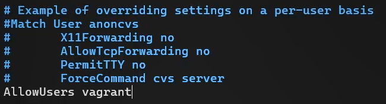{#fig:008
width="60%"}

## Ограничение списка пользователей для удалённого доступа по SSH

3.  Сохраняем изменения в файле конфигурации, перезапускаем sshd.
4.  Повторяем попытку получения доступа с client к серверу посредством
    SSH-соединения через пользователя.

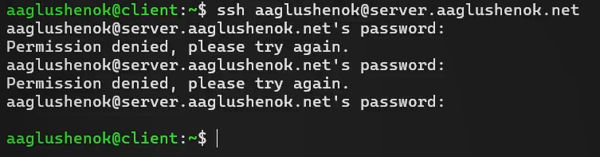{#fig:009
width="60%"}

Попытка подключения завершилась **отказом**. Сервер запросил пароль
трижды, после каждого ввода выдавал сообщение Permission denied, please
try again., и разорвал соединение. Прямой удалённый доступ по SSH для
пользователя aaglushenok заблокирован, так как он НЕ входит в список
разрешённых пользователей.

## Ограничение списка пользователей для удалённого доступа по SSH

5.  На server открываем файл /etc/ssh/sshd_config и обновляем список
    разрешенных пользователей.

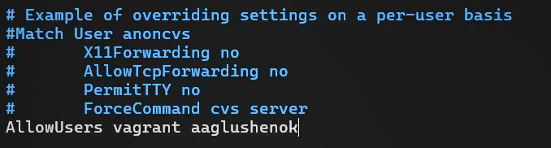{#fig:010
width="60%"}

## Ограничение списка пользователей для удалённого доступа по SSH

6.  Сохраняем изменения в файле конфигурации, перезапускаем sshd. Вновь
    пытаемся получить доступ с client к серверу посредством
    SSH-соединения через пользователя.

{#fig:011 width="60%"}

Попытка подключения завершилась **успешно**. Сервер запросил пароль, и
после его ввода предоставил доступ к командной оболочке. При входе
система вывела сообщение о 2 неудачных попытках входа (сделанных на
предыдущих шагах). Пользователь aaglushenok получил доступ, так как
теперь явно указан в списке разрешённых.

# Настройка дополнительных портов для удалённого доступа по SSH

## Настройка дополнительных портов для удалённого доступа по SSH

1.  На server в файле /etc/ssh/sshd_config добавляем порты 22 и 2022.

{#fig:012 width="60%"}

## Настройка дополнительных портов для удалённого доступа по SSH

2.  Сохраняем изменения в файле конфигурации, перезапускаем sshd.
3.  Смотрим расширенный статус работы sshd (служба запустилась, но видим
    отказ в работе через порт 2022, вызванный ограничениями безопасности
    SELinux, поэтому прослушивается только стандартный порт - 22)

{#fig:013 width="40%"}

## Настройка дополнительных портов для удалённого доступа по SSH

4.  Исправляем на server метки SELinux к порту 2022.
5.  В настройках межсетевого экрана открываем порт 2022 протокола TCP.

{#fig:014 width="60%"}

## Настройка дополнительных портов для удалённого доступа по SSH

6.  Вновь перезапускаем sshd и смотрим расширенный статус его работы
    (видим, что теперь прослушиваются оба порта).

{#fig:015 width="60%"}

## Настройка дополнительных портов для удалённого доступа по SSH

7.  С client пытаемся получить доступ к серверу посредством
    SSH-соединения через пользователя, после открытия оболочки
    пользователя получаем доступ root.

{#fig:016 width="60%"}

## Настройка дополнительных портов для удалённого доступа по SSH

8.  Повторяем попытку получения доступа с client к серверу посредством
    SSH-соединения через пользователя, указав порт 2022, после открытия
    оболочки пользователя получаем доступ root.

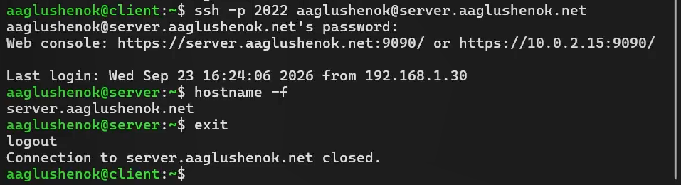{#fig:017
width="60%"}

# Настройка удалённого доступа по SSH по ключу

## Настройка удалённого доступа по SSH по ключу

1.  На server в файле /etc/ssh/sshd_config задаем параметр, разрешающий
    аутентификацию по ключу.

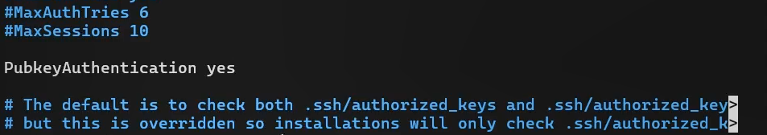{#fig:018
width="60%"}

## Настройка удалённого доступа по SSH по ключу

2.  Сохраняем изменения в файле конфигурации, перезапускаем sshd.
3.  На client формируем SSH-ключ.

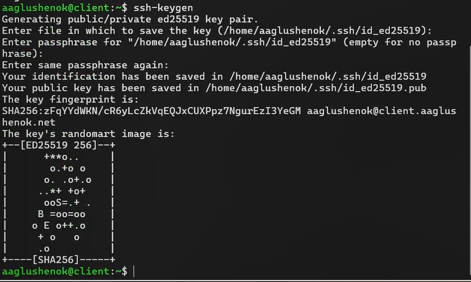{#fig:019 width="60%"}

## Настройка удалённого доступа по SSH по ключу

4.  Закрытый ключ записан в файл \~/.ssh/id_rsa, открытый ключ - в файл
    \~/.ssh/id_rsa.**pub**.
5.  Копируем открытый ключ на сервер.

{#fig:020 width="60%"}

## Настройка удалённого доступа по SSH по ключу

6.  Пробуем получить доступ с client к серверу посредством
    SSH-соединения (видим, что аутентификацию теперь проходит без ввода
    пароля).

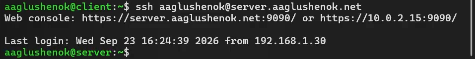{#fig:021
width="80%"}

# Организация туннелей SSH, перенаправление TCP-портов

## Организация туннелей SSH, перенаправление TCP-портов

1.  На client смотрим, запущены ли какие-то службы с протоколом TCP
    (видим, что локальный порт 8080 свободен).
2.  Перенаправляем порт 80 на server.user.net на порт 8080 на локальной
    машине.
3.  Вновь на client смотрим, запущены ли какие-то службы с протоколом
    TCP (видим, что туннель создался успешно: в системе появился процесс
    ssh, который прослушивает локальный порт 8080).

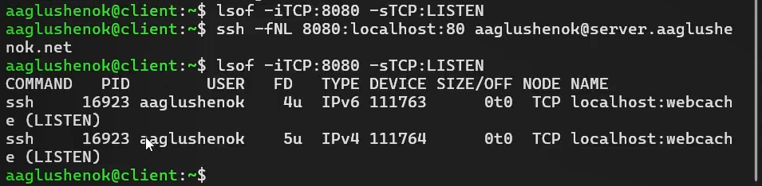{#fig:022
width="60%"}

## Организация туннелей SSH, перенаправление TCP-портов

4.  На client запускаем браузер, и в адресной строке вводим
    localhost:8080. Видим страницу с приветствием.

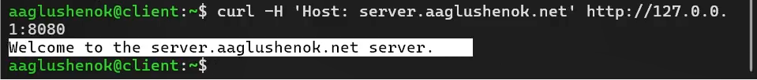{#fig:023
width="80%"}

# Запуск консольных приложений через SSH

## Запуск консольных приложений через SSH

1.  На client открываем терминал под пользователем.
2.  Смотрим с client имя узла сервера.
3.  Смотрим с client список файлов на сервере.

{#fig:024 width="60%"}

## Запуск консольных приложений через SSH

4.  Смотрим с client почту на сервере.

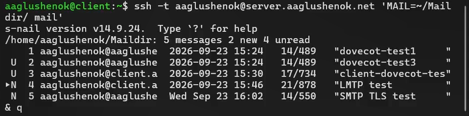{#fig:025
width="60%"}

# Запуск графических приложений через SSH (X11Forwarding)

## Запуск графических приложений через SSH (X11Forwarding)

1.  На server в файле /etc/ssh/sshd_config разрешаем отображать на
    локальном клиентском компьютере графические интерфейсы X11.

{#fig:026
width="60%"}

## Запуск графических приложений через SSH (X11Forwarding)

2.  Сохраняем изменения в файле конфигурации, перезапускаем sshd.
3.  Пробуем с client удалённо подключиться к серверу и запустить
    графическое приложение, например, firefox. Видим, что после ввода
    пароля поверх терминла открывается окно браузера Firefox.

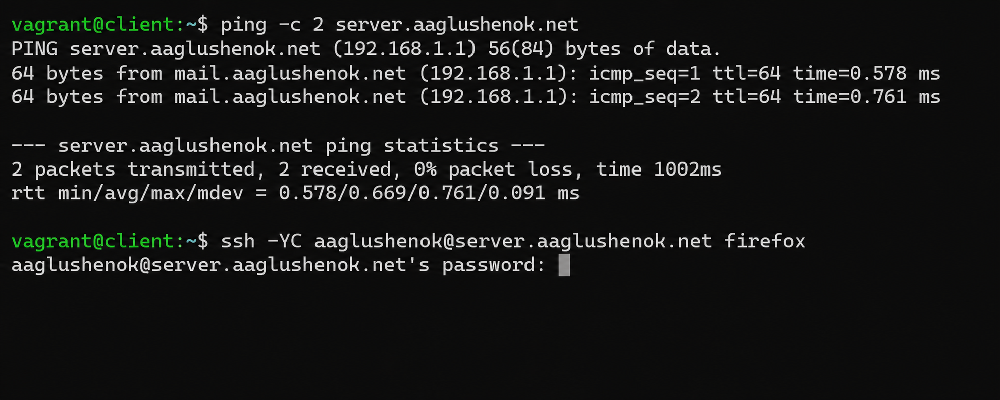{#fig:027
width="60%"}

# Внесение изменений в настройки внутреннего окружения виртуальной машины

## Внесение изменений в настройки внутреннего окружения виртуальной машины

1.  На ВМ server переходим в каталог /vagrant/provision/server/ для
    внесения изменений в настройки внутреннего окружения.

{#fig:028 width="80%"}

## Внесение изменений в настройки внутреннего окружения виртуальной машины

2.  В каталоге /vagrant/provision/server создаем исполняемый файл
    ssh.sh, прописываем в нем скрипт из материалов.

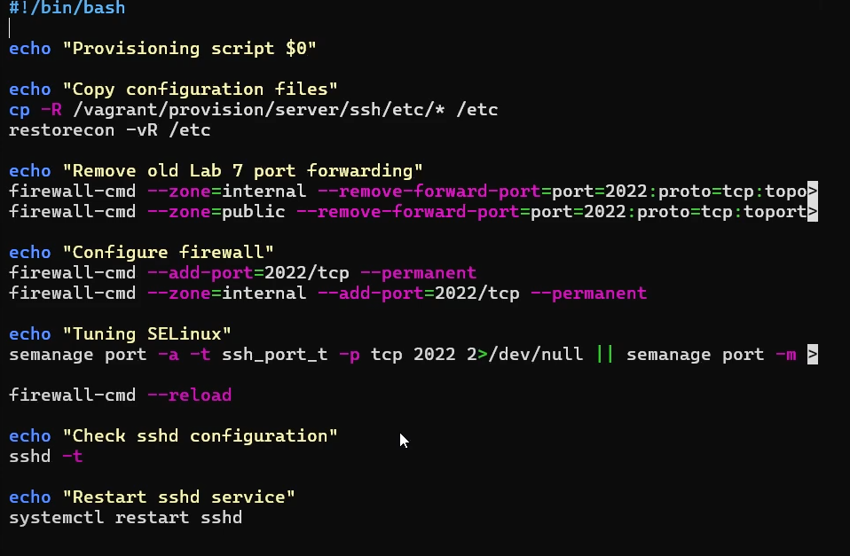{#fig:029
width="60%"}

## Внесение изменений в настройки внутреннего окружения виртуальной машины

Настраиваем права доступа к файлу.

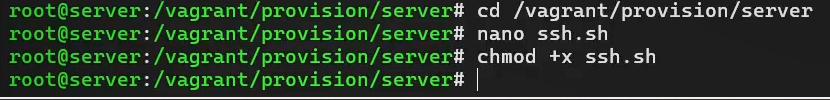{#fig:030
width="80%"}

## Внесение изменений в настройки внутреннего окружения виртуальной машины

3.  Для отработки созданного скрипта во время загрузки ВМ server в
    конфигурационном файле Vagrantfile обновляем конфигурации для
    сервера.

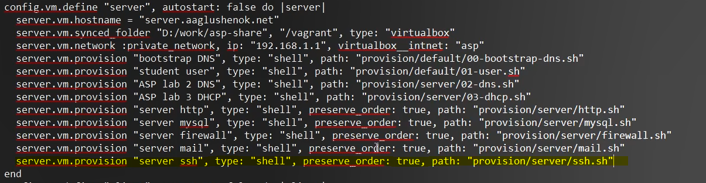{#fig:031
width="80%"}

# Выводы

## Выводы

В ходе выполнения лабораторной работы № 11 мне удалось приобрести
практические навыки по настройке удалённого доступа к серверу с помощью
SSH.

# Список литературы

## Список литературы

1.  OpenBSD Project. sshd_config(5) --- OpenSSH SSH daemon configuration
    file. --- URL: https://man.openbsd.org/sshd_config.5 (дата
    обращения: 13/11/2026).

2.  Red Hat. semanage(8) --- SELinux Policy Management tool. --- URL:
    https://man7.org/linux/man-pages/man8/semanage.8.html (дата
    обращения: 13/11/2026).

3.  HashiCorp. Provisioning: Basic Usage --- Vagrant Documentation. ---
    URL:
    https://developer.hashicorp.com/vagrant/docs/provisioning/basic_usage
    (дата обращения: 13/11/2026).
