---
## Front matter
title: "Лабораторная работа № 11. Настройка безопасного удалённого доступа по протоколу SSH"
subtitle: "Отчет"
author: "Анна Александровна Глушенок"

## Generic options
lang: ru-RU
toc-title: "Содержание"

## Pdf output format
toc: true
toc-depth: 2
lof: false
lot: false
fontsize: 12pt
linestretch: 1.5
papersize: a4
documentclass: scrreprt

## I18n babel
babel-lang: russian
babel-otherlangs: english

## Fonts
mainfont: Liberation Serif
sansfont: Liberation Sans
monofont: Liberation Mono

## Pandoc-crossref LaTeX customization
figureTitle: "Рис."
tableTitle: "Таблица"

## Misc options
indent: true
header-includes:
  - \usepackage{indentfirst}
  - \usepackage{float}
  - \floatplacement{figure}{H}
---

# Цель работы

Приобретение практических навыков по настройке удалённого доступа к серверу с помощью SSH.

# Задание

1. Настройте запрет удалённого доступа на сервер по SSH для пользователя root.
2. Настройте разрешение удалённого доступа к серверу по SSH только для пользователей группы vagrant и вашего пользователя.
3. Настройте удалённый доступ к серверу по SSH через порт 2022.
4. Настройте удалённый доступ к серверу по SSH по ключу.
5. Организуйте SSH-туннель с клиента на сервер, перенаправив локальное соединение с TCP-порта 80 на порт 8080.
6. Используя удалённое SSH-соединение, выполните с клиента несколько команд на сервере.
7. Используя удалённое SSH-соединение, запустите с клиента графическое приложение на сервере.
8. Напишите скрипт для Vagrant, фиксирующий действия по настройке SSH-сервера во внутреннем окружении виртуальной машины server. Соответствующим образом внесите изменения в Vagrantfile.

# Выполнение лабораторной работы

## Запрет удалённого доступа по SSH для пользователя root

1. На server задаем пароль для root.

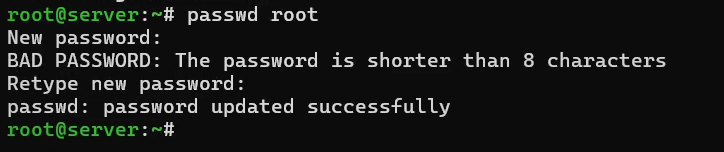{#fig:001 width=60%}

2. На server в дополнительном терминале запускаем мониторинг системных событий.

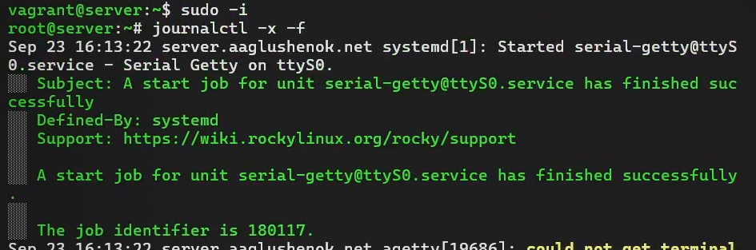{#fig:002 width=60%}

3. С client пытаемся получить доступ к server посредством SSH-соединения через root.

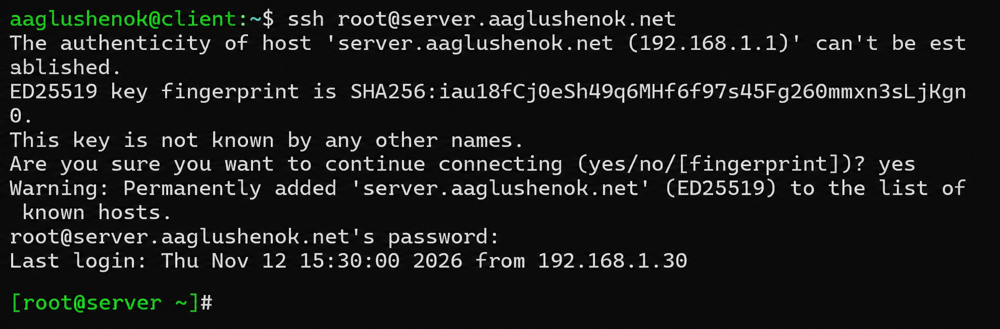{#fig:003 width=60%}

При попытке подключения с client к server посредством SSH через пользователя root система выдала предупреждение об отсутствии ключа хоста в списке известных и запросила подтверждение отпечатка. После подтверждения (yes) сервер запросил пароль, и после его ввода соединение было **успешно установлено**. Прямой удалённый доступ по SSH для пользователя root разрешён, что демонстрирует уязвимость стандартных настроек.

В системном журнале зафиксирована успешная аутентификация пользователя root, что подтверждает открытый доступ на текущем этапе конфигурации.

4. На server открываем файл /etc/ssh/sshd_config и запрещаем вход на сервер пользователю root.

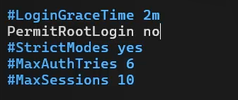{#fig:004 width=60%}

5. Сохраняем изменения в файле конфигурации, перезапускаем sshd.

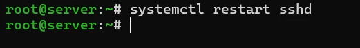{#fig:005 width=60%}

6. Повторяем попытку получения доступа с client к серверу посредством SSH-соединения через пользователя root.

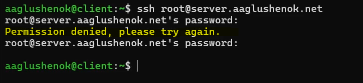{#fig:006 width=60%}

После установки параметра PermitRootLogin no и перезапуска службы sshd, попытка подключения с client завершилась **отказом**. Сервер запросил пароль, однако после его ввода выдал сообщение Permission denied, please try again. и разорвал соединение. Прямой удалённый доступ по SSH для пользователя root заблокирован.

В системном журнале зафиксирована неудачная попытка аутентификации пользователя root, что подтверждает применение настройки.

## Ограничение списка пользователей для удалённого доступа по SSH

1. С client пытаемся получить доступ к серверу посредством SSH-соединения через пользователя.

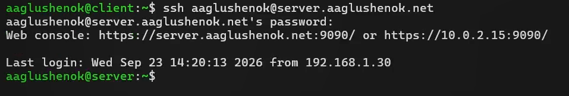{#fig:007 width=60%}

При попытке подключения с client под пользователем aaglushenok сервер запросил пароль. После успешного ввода пароля соединение было установлено, и предоставлен доступ к командной оболочке сервера. Вход **выполнен успешно**, так как на данном этапе список разрешенных пользователей (AllowUsers) ещё НЕ настроен.

В системном журнале зафиксирована успешная аутентификация пользователя aaglushenok и открытие сессии SSH, что подтверждает беспрепятственный доступ на текущем этапе настройки.

2. На server открываем файл /etc/ssh/sshd_config и обновляем список разрешенных пользователей.

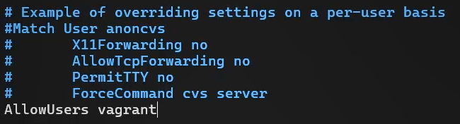{#fig:008 width=60%}

3. Сохраняем изменения в файле конфигурации, перезапускаем sshd.
4. Повторяем попытку получения доступа с client к серверу посредством SSH-соединения через пользователя.

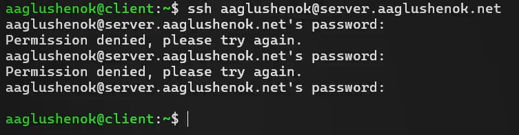{#fig:009 width=60%}

После добавления в конфигурацию строки AllowUsers vagrant и перезапуска службы sshd, повторная попытка подключения с client под пользователем aaglushenok завершилась **отказом**. Сервер запросил пароль трижды, однако после каждого ввода выдавал сообщение Permission denied, please try again., после чего разорвал соединение. Прямой удалённый доступ по SSH для пользователя aaglushenok заблокирован, так как он НЕ входит в список разрешённых пользователей.

В системном журнале зафиксирована неудачная попытка аутентификации пользователя aaglushenok с указанием на то, что доступ запрещён конфигурацией, что подтверждает корректное применение настройки AllowUsers.

5. На server открываем файл /etc/ssh/sshd_config и обновляем список разрешенных пользователей.

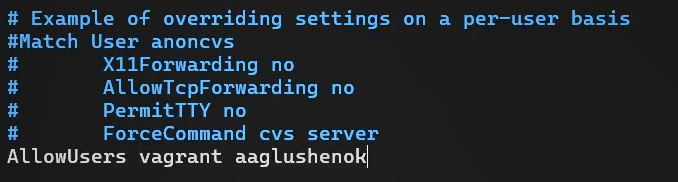{#fig:010 width=60%}

6. Сохраняем изменения в файле конфигурации, перезапускаем sshd. Вновь пытаемся получить доступ с client к серверу посредством SSH-соединения через пользователя.

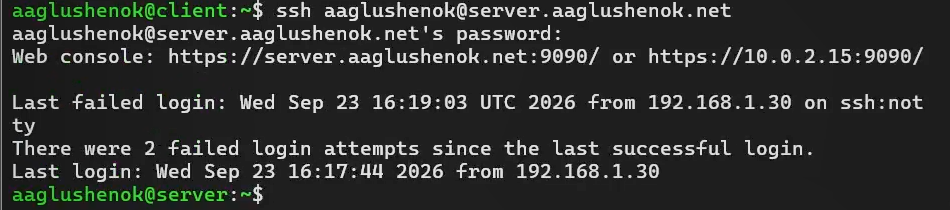{#fig:011 width=60%}

После добавления пользователя aaglushenok в параметр AllowUsers vagrant aaglushenok и перезапуска службы sshd, повторная попытка подключения с client завершилась **успешно**. Сервер запросил пароль, и после его ввода был предоставлен доступ к командной оболочке. При входе система вывела информационное сообщение о двух неудачных попытках входа (сделанных на предыдущем шаге) и времени последнего успешного входа. Пользователь aaglushenok получил доступ, так как теперь явно указан в списке разрешённых.

В системном журнале зафиксирована успешная аутентификация пользователя, что подтверждает корректное применение новой настройки.

## Настройка дополнительных портов для удалённого доступа по SSH

1. На server в файле /etc/ssh/sshd_config добавляем порты 22 и 2022.

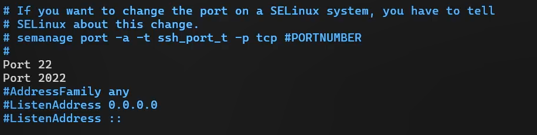{#fig:012 width=60%}

2. Сохраняем изменения в файле конфигурации, перезапускаем sshd.
3. Смотрим расширенный статус работы sshd (служба запустилась, но видим отказ в работе через порт 2022, вызванный ограничениями безопасности SELinux, поэтому прослушивается только стандартный порт - 22)

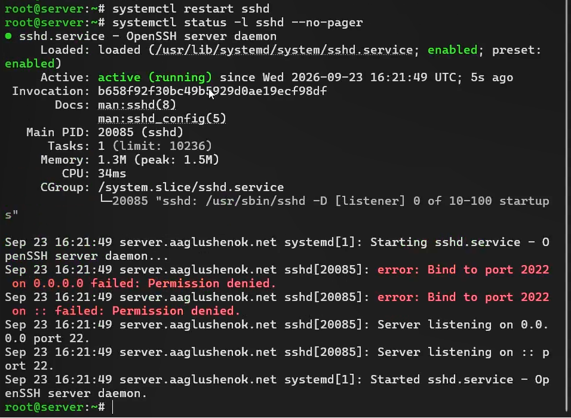{#fig:013 width=60%}

4. Исправляем на server метки SELinux к порту 2022.
5. В настройках межсетевого экрана открываем порт 2022 протокола TCP.

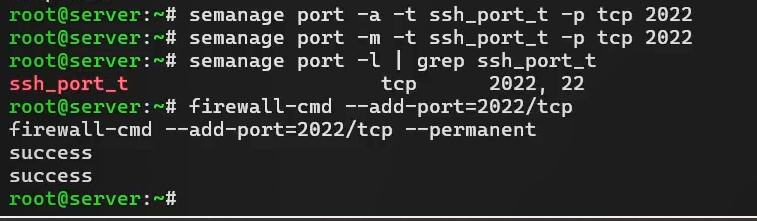{#fig:014 width=60%}

6. Вновь перезапускаем sshd и смотрим расширенный статус его работы (видим, что теперь прослушиваются оба порта).

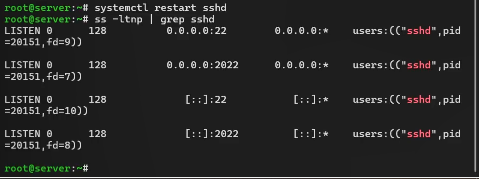{#fig:015 width=60%}

7. С client пытаемся получить доступ к серверу посредством SSH-соединения через пользователя, после открытия оболочки пользователя получаем доступ root.

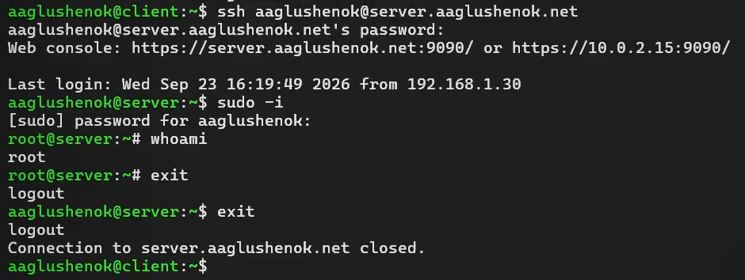{#fig:016 width=60%}

8. Повторяем попытку получения доступа с client к серверу посредством SSH-соединения через пользователя, указав порт 2022, после открытия оболочки пользователя получаем доступ root.

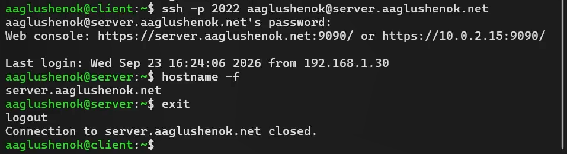{#fig:017 width=60%}

## Настройка удалённого доступа по SSH по ключу

1. На server в файле /etc/ssh/sshd_config задаем параметр, разрешающий аутентификацию по ключу.

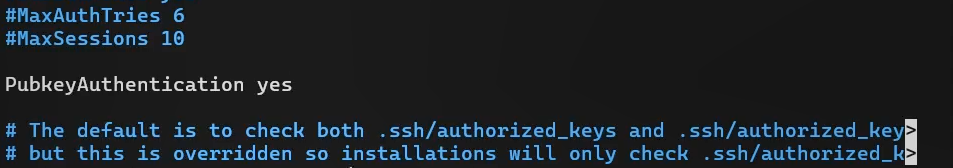{#fig:018 width=60%}

2. Сохраняем изменения в файле конфигурации, перезапускаем sshd.
3. На client формируем SSH-ключ.

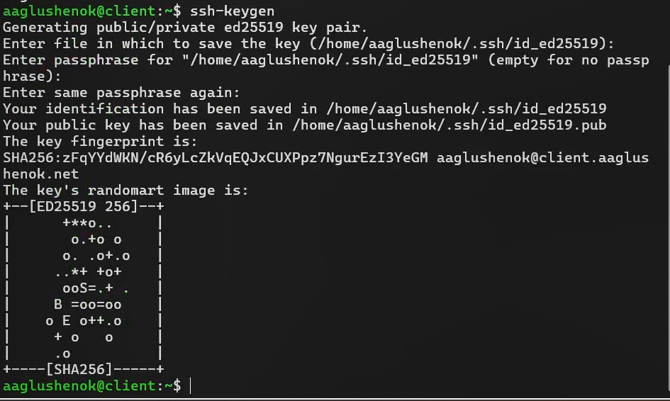{#fig:019 width=60%}

4. Закрытый ключ записан в файл ~/.ssh/id_rsa, открытый ключ - в файл ~/.ssh/id_rsa.**pub**.
5. Копируем открытый ключ на сервер.

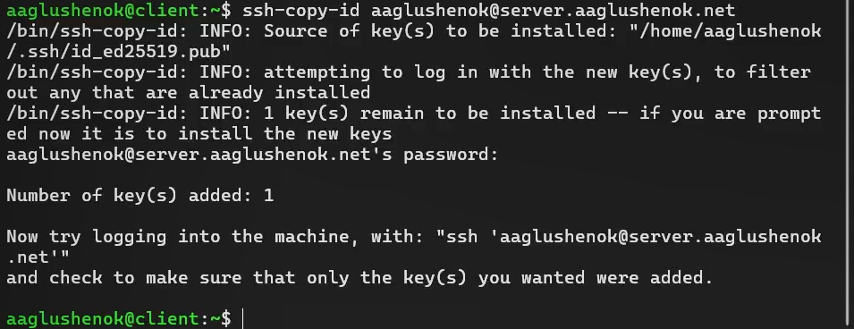{#fig:020 width=60%}

6. Пробуем получить доступ с client к серверу посредством SSH-соединения (видим, что аутентификацию теперь проходит без ввода пароля).

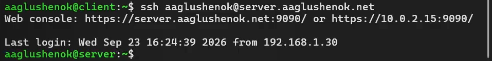{#fig:021 width=60%}

## Организация туннелей SSH, перенаправление TCP-портов

1. На client смотрим, запущены ли какие-то службы с протоколом TCP (видим, что локальный порт 8080 свободен).
2. Перенаправляем порт 80 на server.user.net на порт 8080 на локальной машине.
3. Вновь на client смотрим, запущены ли какие-то службы с протоколом TCP (видим, что туннель создался успешно: в системе появился процесс ssh, который прослушивает локальный порт 8080).

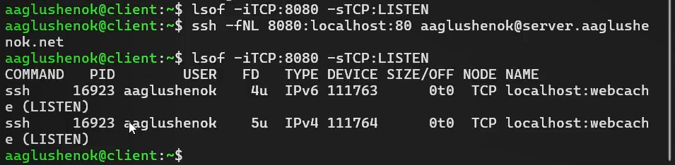{#fig:022 width=60%}

4. На client запускаем браузер, и в адресной строке вводим localhost:8080. Видим страницу с приветствием.

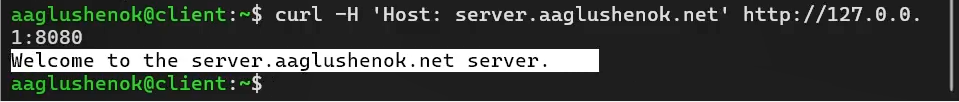{#fig:023 width=60%}

## Запуск консольных приложений через SSH

1. На client открываем терминал под пользователем.
2. Смотрим с client имя узла сервера.
3. Смотрим с client список файлов на сервере.

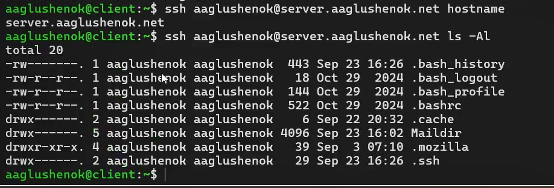{#fig:024 width=60%}

4. Смотрим с client почту на сервере.

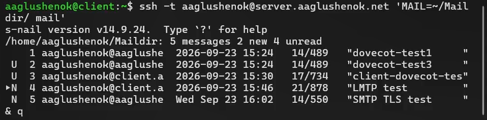{#fig:025 width=60%}

## Запуск графических приложений через SSH (X11Forwarding)

1. На server в файле /etc/ssh/sshd_config разрешаем отображать на локальном клиентском компьютере графические интерфейсы X11.

{#fig:026 width=60%}

2. Сохраняем изменения в файле конфигурации, перезапускаем sshd.
3. Пробуем с client удалённо подключиться к серверу и запустить графическое приложение, например, firefox. Видим, что после ввода пароля поверх терминла открывается окно браузера Firefox.

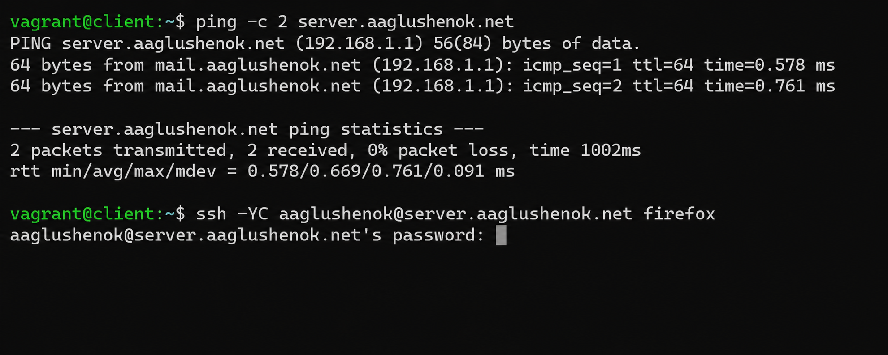{#fig:027 width=60%}

## Внесение изменений в настройки внутреннего окружения виртуальной машины

1. На ВМ server переходим в каталог /vagrant/provision/server/ для внесения изменений в настройки внутреннего окружения.

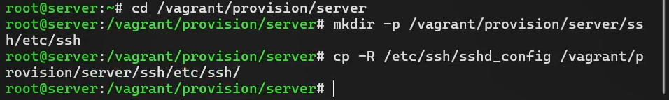{#fig:028 width=60%}

2. В каталоге /vagrant/provision/server создаем исполняемый файл ssh.sh, прописываем в нем скрипт из материалов, настраиваем права доступа к файлу.

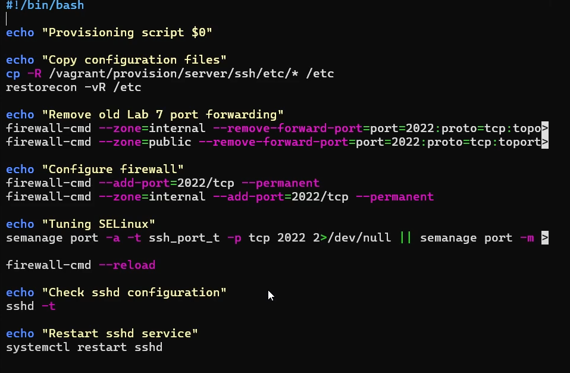{#fig:029 width=60%}

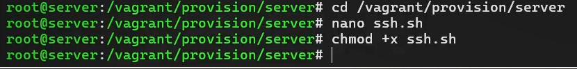{#fig:030 width=60%}

3. Для отработки созданного скрипта во время загрузки ВМ server в конфигурационном файле Vagrantfile обновляем конфигурации для сервера.

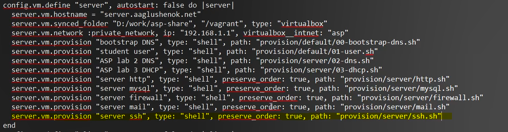{#fig:031 width=60%}

# Контрольные вопросы

1. **Вы хотите запретить удалённый доступ по SSH на сервер пользователю root и разрешить доступ пользователю alice. Как это сделать?**
Для этого в файле `/etc/ssh/sshd_config` нужно указать параметры `PermitRootLogin no` и `AllowUsers alice`, после чего перезапустить службу sshd.

2. **Как настроить удалённый доступ по SSH через несколько портов? Для чего это может потребоваться?**
В файле `/etc/ssh/sshd_config` необходимо добавить строки `Port 22` и `Port 2022`. Это может потребоваться как гарантия возможности открыть сеансы SSH, даже если была сделана ошибка в конфигурации одного из портов.

3. **Какие параметры используются для создания туннеля SSH, когда команда ssh устанавливает фоновое соединение и не ожидает какой-либо конкретной команды?**
Для установки фонового соединения используется параметр `-f`, а для указания того, что команда не должна выполняться (ожидание только туннеля) — параметр `-N`.

4. **Как настроить локальную переадресацию с локального порта 5555 на порт 80 сервера server2.example.com?**
Для этого используется параметр `-L` со следующим синтаксисом: `ssh -L 5555:server2.example.com:80 пользователь@хост`.

5. **Как настроить SELinux, чтобы позволить SSH связываться с портом 2022?**
Необходимо добавить метку SELinux для нового порта, выполнив команду: `semanage port -a -t ssh_port_t -p tcp 2022`.

6. **Как настроить межсетевой экран на сервере, чтобы разрешить входящие подключения по SSH через порт 2022?**
Нужно открыть порт 2022 протокола TCP в настройках межсетевого экрана, выполнив команды: `firewall-cmd --add-port=2022/tcp` и `firewall-cmd --add-port=2022/tcp --permanent`.

# Выводы

В ходе выполнения лабораторной работы № 11 мне удалось приобрести практические навыки по настройке удалённого доступа к серверу с помощью SSH.

# Список литературы 

1. OpenBSD Project. sshd_config(5) — OpenSSH SSH daemon configuration file. — URL: https://man.openbsd.org/sshd_config.5 (дата обращения: 13/11/2026).

2. Red Hat. semanage(8) — SELinux Policy Management tool. — URL: https://man7.org/linux/man-pages/man8/semanage.8.html (дата обращения: 13/11/2026).

3. HashiCorp. Provisioning: Basic Usage — Vagrant Documentation. — URL: https://developer.hashicorp.com/vagrant/docs/provisioning/basic_usage (дата обращения: 13/11/2026).