---
## Front matter
lang: ru-RU
title: Лабораторная работа № 12. Синхронизация времени
subtitle: Презентация
author:
  - Глушенок А. А.
institute:
  - Российский университет дружбы народов, Москва, Россия
date: 21 ноября 2026

## Formatting pdf
toc: false
slide_level: 2
aspectratio: 169
section-titles: true
theme: metropolis
header-includes:
 - \metroset{progressbar=frametitle,sectionpage=progressbar,numbering=fraction}
 - \usepackage{graphicx}
 - \usepackage{caption}
 - \captionsetup{labelformat=empty, labelsep=none}
 
## Fonts
mainfont: Liberation Serif
sansfont: PT Sans
monofont: Liberation Mono
---

# Информация

## Докладчик

:::::::::::::: {.columns align=center}
::: {.column width="70%"}

  * Глушенок Анна Александровна
  * Российский университет дружбы народов
  * Группа: НПИбд-01-24
  * Студенческий билет: 1132246844

:::
::: {.column width="30%"}

:::
::::::::::::::

## Цель работы

Получение навыков по управлению системным временем и настройке синхронизации времени.

## Задание

1. Изучите команды по настройке параметров времени.
2. Настройте сервер в качестве сервера синхронизации времени для локальной сети.
3. Напишите скрипты для Vagrant, фиксирующие действия по установке и настройке NTP-сервера и клиента.

# Выполнение лабораторной работы

# Настройка параметров времени

## Настройка параметров времени

1. На server и client смотрим параметры настройки даты и времени (видим, что оба узла находятся в часовом поясе UTC, служба синхронизации времени (NTP) активна, системные часы успешно синхронизированы (System clock synchronized: yes). 
2. На server и client смотрим текущее системное время (видим, что вывод команды date подтверждает системное время, показанное в timedatectl; небольшое расхождение связано с последовательным вводом команд).
3. На server и client смотрим аппаратное время (видим, что вывод команды hwclock подтверждает аппаратное время, показанное в timedatectl; небольшое расхождение связано с последовательным вводом команд).

## Настройка параметров времени

Выполняем для server:

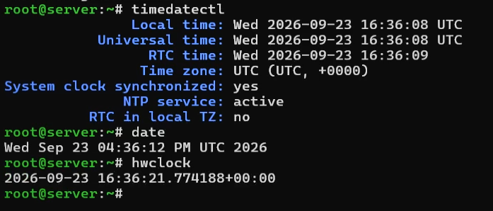{#fig:001 width=60%}

## Настройка параметров времени

Выполняем для client:

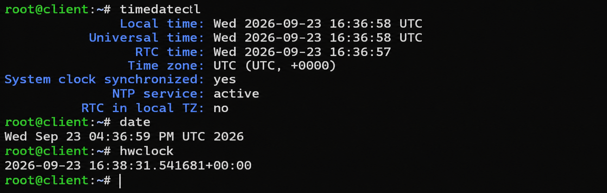{#fig:002 width=60%}

# Управление синхронизацией времени

## Управление синхронизацией времени

1. Устанавливаем на server и client ПО chrony.
2. Проверяем источники времени на server и client (видим, что и servsr, и client находятся в конфигурации "по умолчанию"; они НЕ связаны друг с другом, и независимо синхронизируют часы с публичными NTP-серверами).

Выполняем для server:

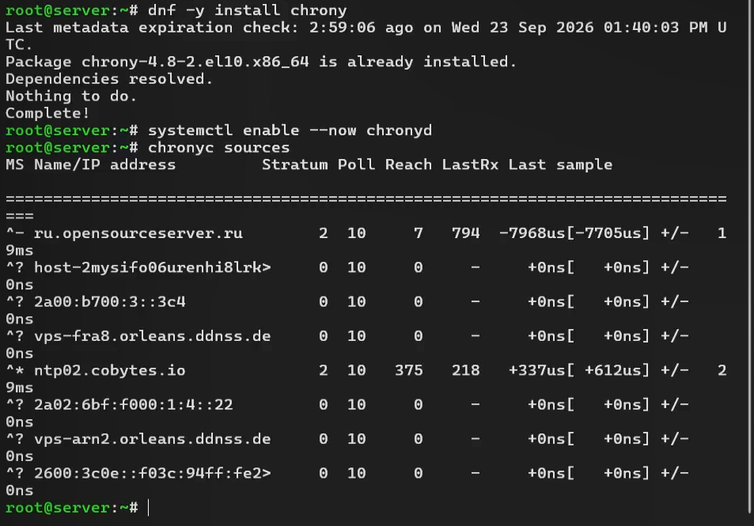{#fig:003 width=35%}

## Управление синхронизацией времени

Выполняем для client:

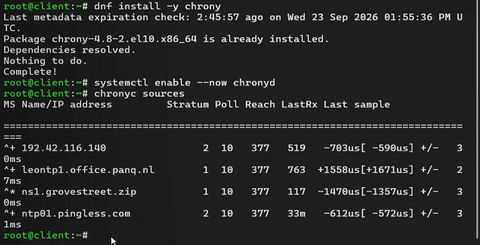{#fig:004 width=60%}

## Управление синхронизацией времени

3. На server вносим изменения в файл /etc/chrony.conf.

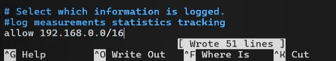{#fig:005 width=60%}

## Управление синхронизацией времени

4. На server перезапускаем службу chronyd.

{#fig:006 width=60%}

## Управление синхронизацией времени

5. На server настраиваем межсетевой экран.

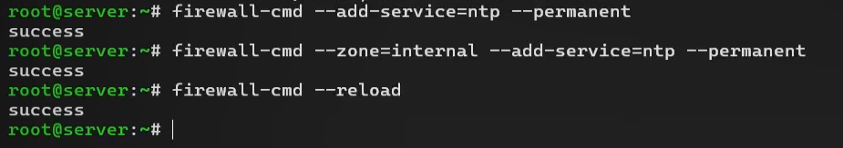{#fig:007 width=60%}

## Управление синхронизацией времени

6. На client вносим изменения в файл /etc/chrony.conf.

{#fig:008 width=60%}

## Управление синхронизацией времени

7. На client перезапускаем службу chronyd.

{#fig:009 width=60%}

## Управление синхронизацией времени

8. Проверяем источники времени на server и client (видим, что после внесения изменений в конфигурацию, иерархия синхронизации успешно выстроилась; server продолжает синхронизировать часы с публичными NTP-серверами, а client теперь синхронизирует часы с локальным сервером www.aaglushenok.net).

Выполняем для server:

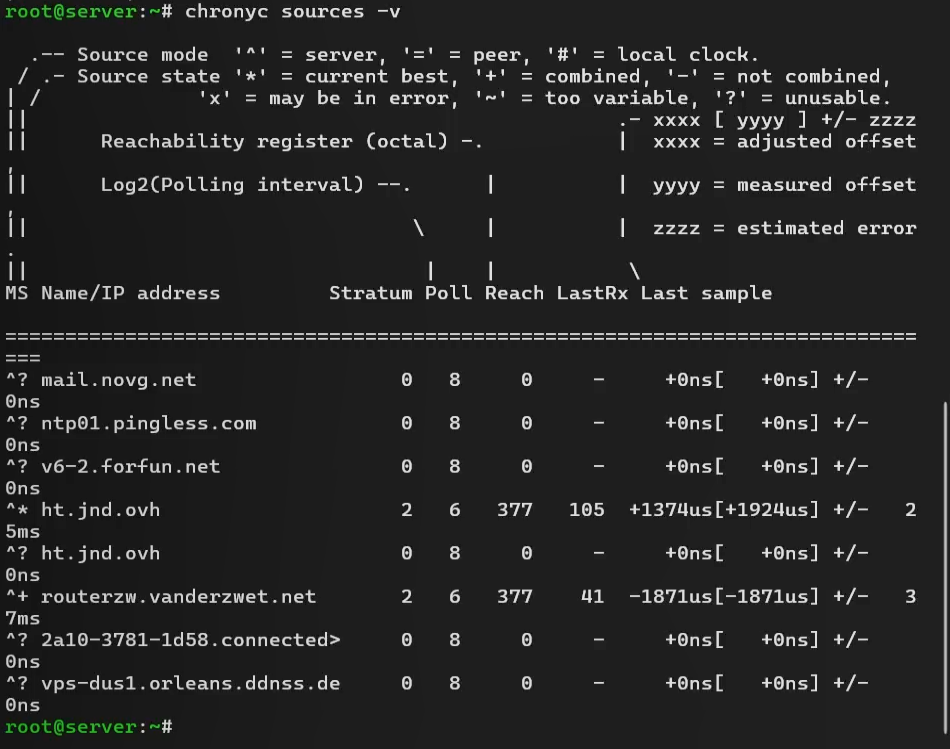{#fig:010 width=30%}

## Управление синхронизацией времени

Выполняем для client:

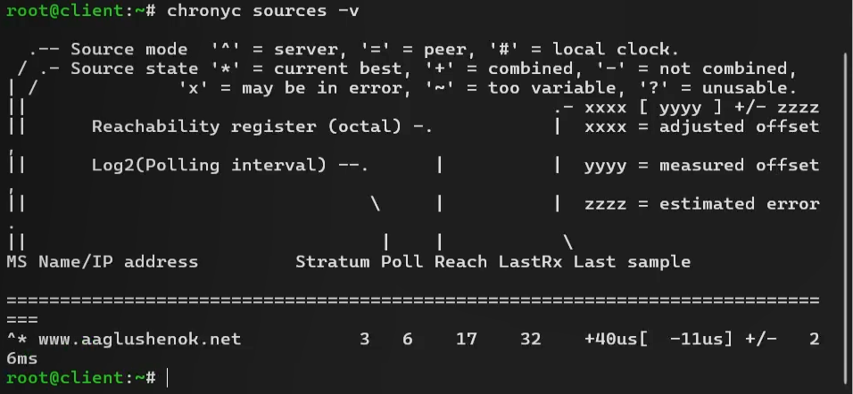{#fig:011 width=60%}

## Управление синхронизацией времени

9. Смотрим подробную информацию о синхронизации.

- Через tracking (видим, что узлы успешно синхронизированы; server получает время из публичных NTP-серверов, и является источником синхронизации для client). 

Выполняем для server:

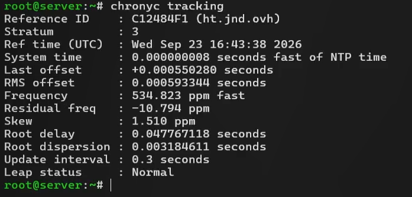{#fig:012 width=50%}

## Управление синхронизацией времени

Выполняем для client:

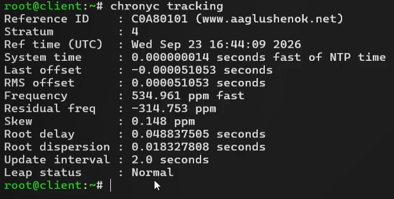{#fig:013 width=60%}

## Управление синхронизацией времени

9. Смотрим подробную информацию о синхронизации.

- Через sourcestats и clients (источник и клиент) (видим, что узлы успешно синхронизированы; server является для client источником, а client для server - клиентом).

Выполняем для server:

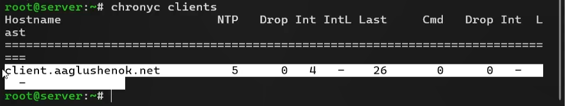{#fig:014 width=60%}

## Управление синхронизацией времени

Выполняем для client:

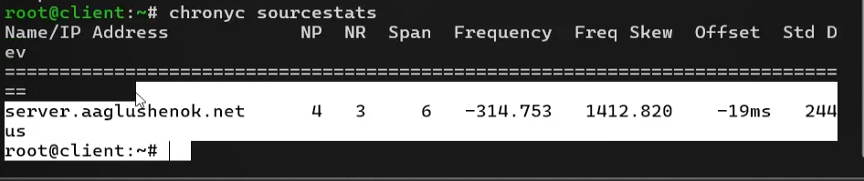{#fig:015 width=60%}

# Внесение изменений в настройки внутреннего окружения виртуальных машин

## Внесение изменений в настройки внутреннего окружения виртуальных машин

1. На ВМ server переходим в каталог /vagrant/provision/server/ для внесения изменений в настройки внутреннего окружения, создаем необходимые каталоги и подкаталоги.

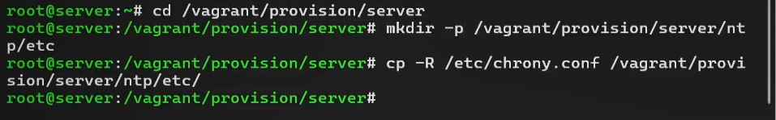{#fig:016 width=60%}

## Внесение изменений в настройки внутреннего окружения виртуальных машин

2. Создаем исполняемый файл ntp.sh в каталоге /vagrant/provision/**server**, прописываем в нем скрипт. 

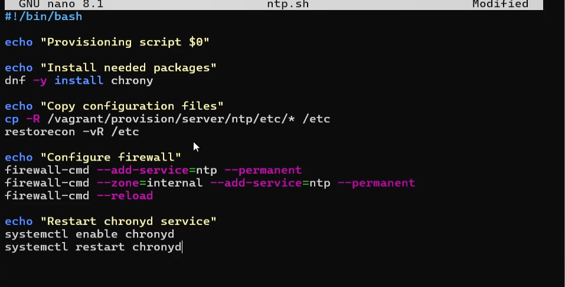{#fig:017 width=60%}

## Внесение изменений в настройки внутреннего окружения виртуальных машин

3. На ВМ client переходим в каталог /vagrant/provision/client/ для внесения изменений в настройки внутреннего окружения, создаем необходимые каталоги и подкаталоги.

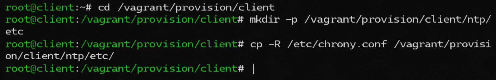{#fig:018 width=60%}

## Внесение изменений в настройки внутреннего окружения виртуальных машин

4. Создаем исполняемый файл ntp.sh в каталоге /vagrant/provision/**client**, прописываем в нем скрипт. 

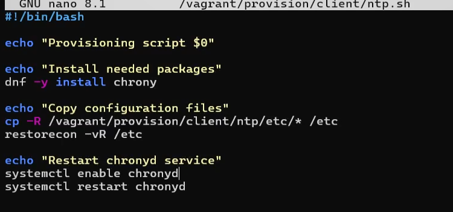{#fig:019 width=60%}

## Внесение изменений в настройки внутреннего окружения виртуальных машин

5. Для отработки созданных скриптов во время загрузки ВМ server и client в конфигурационном файле Vagrantfile обновляем конфигурации  для server и client. 

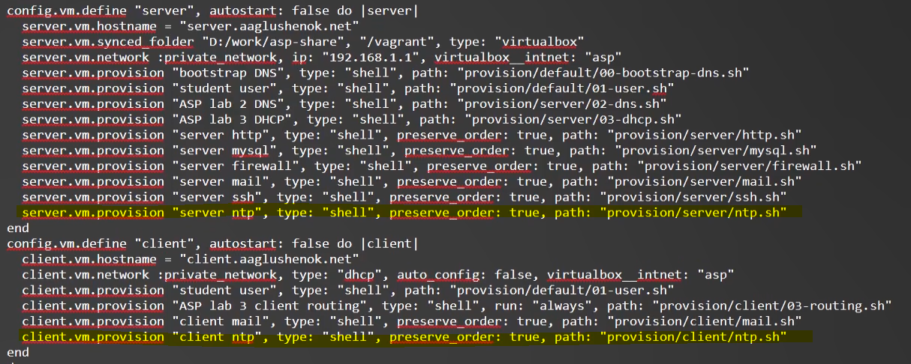{#fig:020 width=60%}

## Внесение изменений в настройки внутреннего окружения виртуальных машин

Проверяем Vagrantfile на отсутствие синтаксических ошибок.

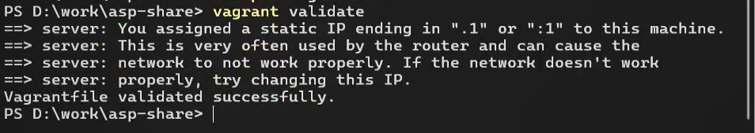{#fig:021 width=60%}

# Выводы

## Выводы

В ходе выполнения лабораторной работы № 12 мне удалось приобрести навыки по управлению системным временем и настройке синхронизации времени.

# Список литературы 

## Список литературы 

1. IETF. RFC 5905: Network Time Protocol Version 4: Protocol and Algorithms Specification [Электронный ресурс]. — URL: https://datatracker.ietf.org/doc/html/rfc5905 (дата обращения: 21.11.2026).
2. Chrony Project. chrony.conf(5) Manual Page [Электронный ресурс]. — URL: https://chrony-project.org/doc/4.9/chrony.conf.html (дата обращения: 21.11.2026).
3. Chrony Project. chronyc(1) Manual Page [Электронный ресурс]. — URL: https://chrony-project.org/doc/4.9/chronyc.html (дата обращения: 21.11.2026).
4. Red Hat. Configuring NTP Using the chrony Suite [Электронный ресурс]. — URL: https://docs.redhat.com/en/documentation/red_hat_enterprise_linux/9/html/configuring_basic_system_settings/configuring-ntp-using-the-chrony-suite_configuring-basic-system-settings (дата обращения: 21.11.2026).
5. Oracle. Configuring a Kerberos Client [Электронный ресурс]. — URL: https://docs.oracle.com/en/operating-systems/oracle-linux/6/admin/ol_cfgcli_krb.html (дата обращения: 21.11.2026).

