---
## Front matter
title: "Лабораторная работа № 12. Синхронизация времени"
subtitle: "Отчет"
author: "Анна Александровна Глушенок"

## Generic options
lang: ru-RU
toc-title: "Содержание"

## Pdf output format
toc: true
toc-depth: 2
lof: false
lot: false
fontsize: 12pt
linestretch: 1.5
papersize: a4
documentclass: scrreprt

## I18n babel
babel-lang: russian
babel-otherlangs: english

## Fonts
mainfont: Liberation Serif
sansfont: Liberation Sans
monofont: Liberation Mono

## Pandoc-crossref LaTeX customization
figureTitle: "Рис."
tableTitle: "Таблица"

## Misc options
indent: true
header-includes:
  - \usepackage{indentfirst}
  - \usepackage{float}
  - \floatplacement{figure}{H}
---

# Цель работы

Получение навыков по управлению системным временем и настройке синхронизации времени.

# Задание

1. Изучите команды по настройке параметров времени.
2. Настройте сервер в качестве сервера синхронизации времени для локальной сети.
3. Напишите скрипты для Vagrant, фиксирующие действия по установке и настройке NTP-сервера и клиента.

# Выполнение лабораторной работы

## Настройка параметров времени

1. На server и client смотрим параметры настройки даты и времени (видим, что оба узла находятся в часовом поясе UTC, служба синхронизации времени (NTP) активна, системные часы успешно синхронизированы (System clock synchronized: yes). 
2. На server и client смотрим текущее системное время (видим, что вывод команды date подтверждает системное время, показанное в timedatectl; небольшое расхождение связано с последовательным вводом команд).
3. На server и client смотрим аппаратное время (видим, что вывод команды hwclock подтверждает аппаратное время, показанное в timedatectl; небольшое расхождение связано с последовательным вводом команд).

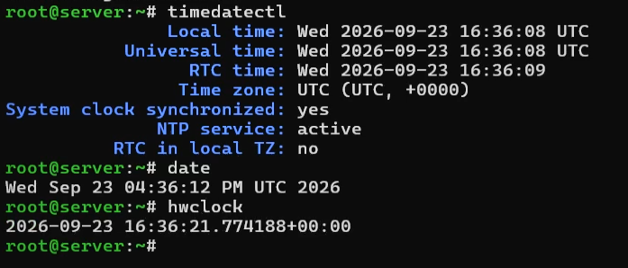{#fig:001 width=60%}

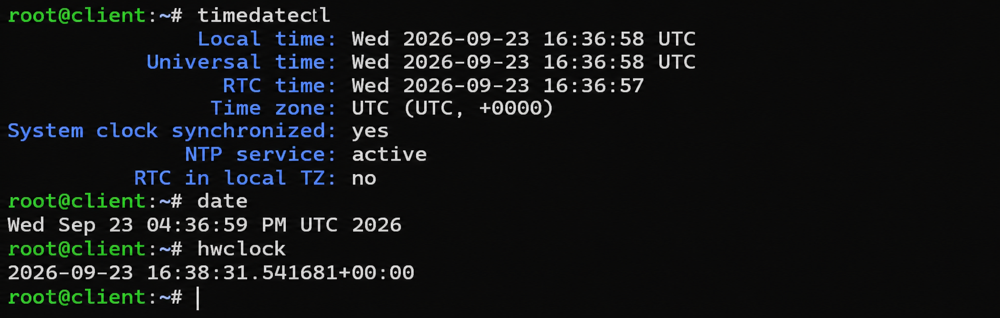{#fig:002 width=60%}

## Управление синхронизацией времени

1. Устанавливаем на server и client ПО chrony.
2. Проверяем источники времени на server и client (видим, что и servsr, и client находятся в конфигурации "по умолчанию"; они НЕ связаны друг с другом, и независимо синхронизируют часы с публичными NTP-серверами).

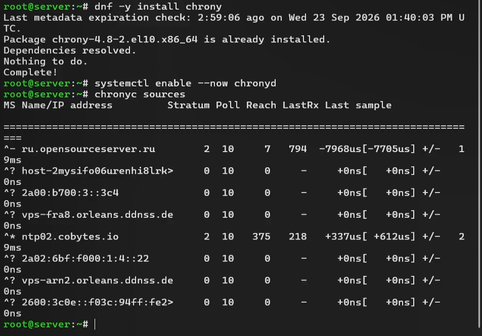{#fig:003 width=60%}

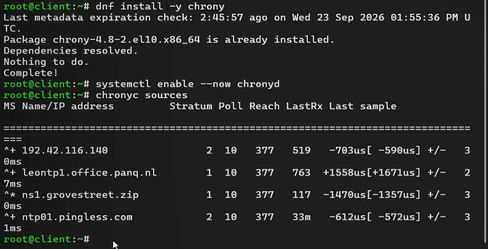{#fig:004 width=60%}

3. На server вносим изменения в файл /etc/chrony.conf.

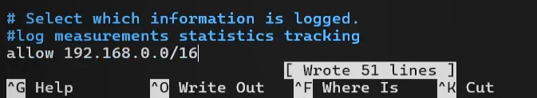{#fig:005 width=60%}

4. На server перезапускаем службу chronyd.

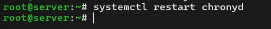{#fig:006 width=60%}

5. На server настраиваем межсетевой экран.

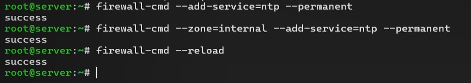{#fig:007 width=60%}

6. На client вносим изменения в файл /etc/chrony.conf.

{#fig:008 width=60%}

7. На client перезапускаем службу chronyd.

{#fig:009 width=60%}

8. Проверяем источники времени на server и client (видим, что после внесения изменений в конфигурацию, иерархия синхронизации успешно выстроилась; server продолжает синхронизировать часы с публичными NTP-серверами, а client теперь синхронизирует часы с локальным сервером www.aaglushenok.net).

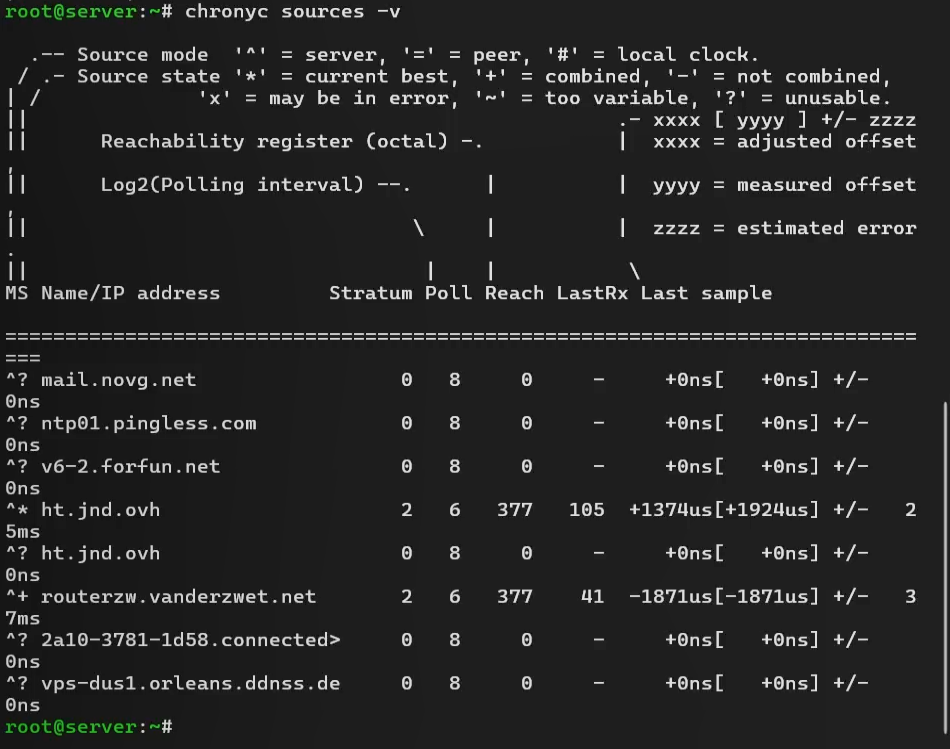{#fig:010 width=60%}

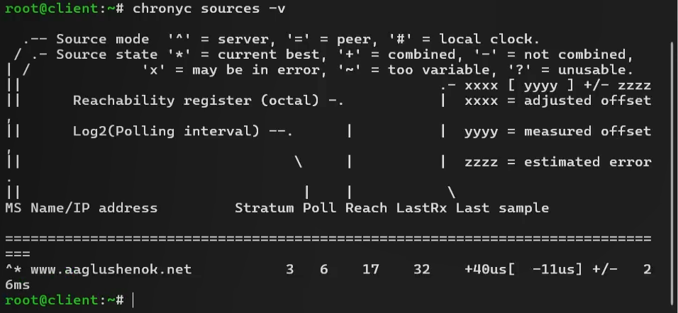{#fig:011 width=60%}

9. Смотрим подробную информацию о синхронизации.

Через tracking (видим, что узлы успешно синхронизированы; server получает точное время из публичных NTP-серверов, и является источником синхронизации для client). 

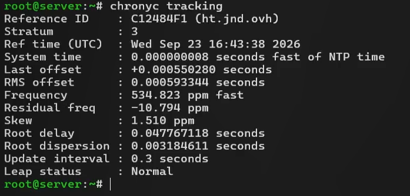{#fig:012 width=60%}

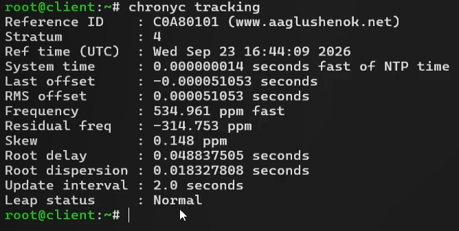{#fig:013 width=60%}

Через sourcestats и clients (источник и клиент) (видим, что узлы успешно синхронизированы; server является для client источником, а client для server - клиентом).

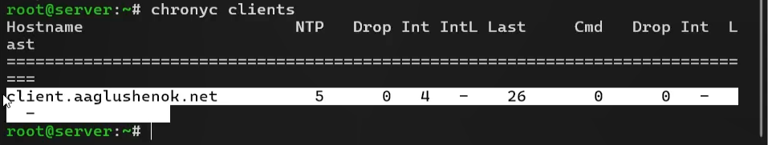{#fig:014 width=60%}

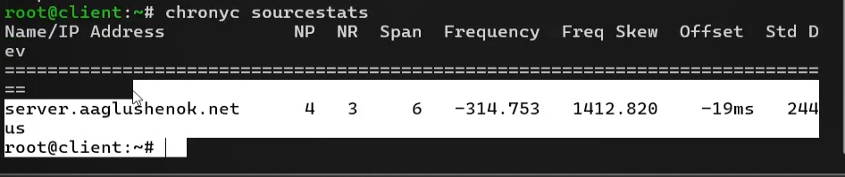{#fig:015 width=60%}

## Внесение изменений в настройки внутреннего окружения виртуальных машин

1. На ВМ server переходим в каталог /vagrant/provision/server/ для внесения изменений в настройки внутреннего окружения, создаем необходимые каталоги и подкаталоги.

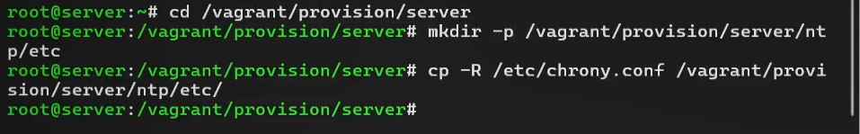{#fig:016 width=60%}

2. Создаем исполняемый файл ntp.sh в каталоге /vagrant/provision/**server**, прописываем в нем скрипт. 

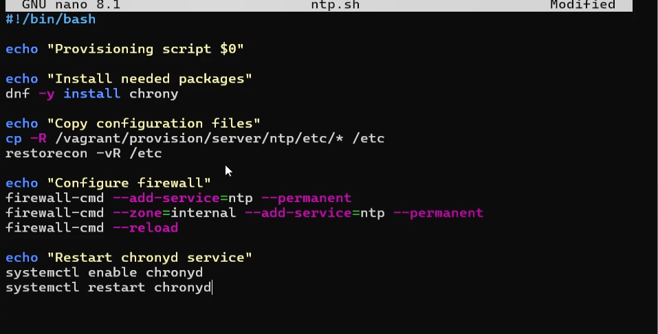{#fig:017 width=60%}

3. На ВМ client переходим в каталог /vagrant/provision/client/ для внесения изменений в настройки внутреннего окружения, создаем необходимые каталоги и подкаталоги.

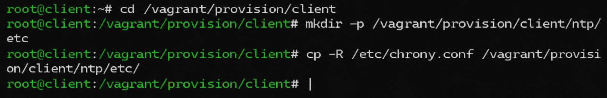{#fig:018 width=60%}

4. Создаем исполняемый файл ntp.sh в каталоге /vagrant/provision/**client**, прописываем в нем скрипт. 

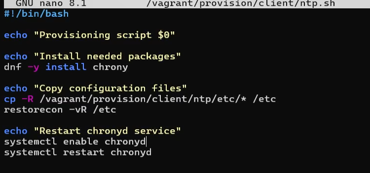{#fig:019 width=60%}

5. Для отработки созданных скриптов во время загрузки ВМ server и client в конфигурационном файле Vagrantfile обновляем конфигурации  для server и client. Проверяем Vagrantfile на отсутствие синтаксических ошибок.

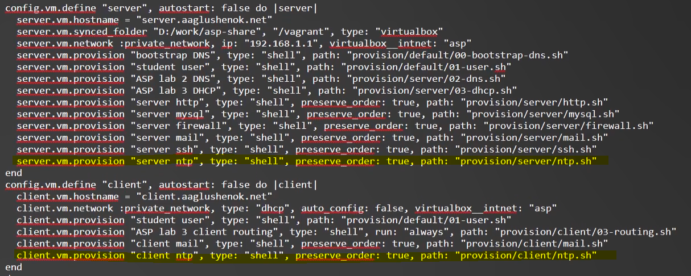{#fig:020 width=60%}

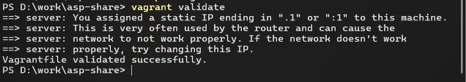{#fig:021 width=60%}

# Контрольные вопросы

1. **Почему важна точная синхронизация времени для служб баз данных?**  
Для распределенных баз данных (особенно с репликацией) точное время критично для определения порядка транзакций. Если часы на разных серверах расходятся, это может привести к нарушению согласованности данных, конфликтам при разрешении коллизий и ошибкам в логах.

2. **Почему служба проверки подлинности Kerberos сильно зависит от правильной синхронизации времени?**  
Протокол Kerberos использует временные метки для предотвращения атак повторного воспроизведения (replay attacks). Если время на клиенте и сервере Kerberos расходится более чем на допустимый интервал (по умолчанию обычно 300 секунд или 5 минут), аутентификация завершится неудачей.

3. **Какая служба используется по умолчанию для синхронизации времени на RHEL 7?**  
В RHEL 7 по умолчанию используется служба **`chronyd`** (демон `chrony`). Хотя в некоторых версиях RHEL 7 можно было выбрать между `ntp` и `chrony`, `chrony` является предпочтительным и устанавливаемым по умолчанию решением.

4. **Какова страта по умолчанию для локальных часов?**  
Если в конфигурации `chrony` используется директива `local` для работы в качестве сервера времени без внешних источников, по умолчанию применяется **страта 10**. Это значение можно изменить, указав его явно (например, `local stratum 8`).

5. **Какой порт брандмауэра должен быть открыт, если вы настраиваете свой сервер как одноранговый узел NTP?**  
Для работы NTP необходимо открыть **UDP-порт 123**. Это стандартный порт, используемый как для клиентских запросов, так и для ответов сервера.

6. **Какую строку вам нужно включить в конфигурационный файл chrony, если вы хотите быть сервером времени, даже если внешние серверы NTP недоступны?**  
В файл `/etc/chrony.conf` необходимо добавить директиву **`local`**. Часто она используется с параметром страты, например: **`local stratum 10`**. Это позволяет `chronyd` продолжать обслуживать клиентов, используя локальные часы в качестве источника, даже при отсутствии синхронизации с интернетом.

7. **Какую страту имеет хост, если нет текущей синхронизации времени NTP?**  
Если хост не синхронизирован ни с одним внешним источником, его страта считается равной **16** (или выше). Страта 16 в терминологии NTP означает «несинхронизирован» (unsynchronized). В выводе `chronyc tracking` в поле `Stratum` может отображаться `0` или `16` в зависимости от контекста, но фактически узел не является надежным источником времени для других.

8. **Какую команду вы бы использовали на сервере с chrony, чтобы узнать, с какими серверами он синхронизируется?**  
Для просмотра списка текущих источников времени и их состояния используется команда **`chronyc sources`**. Для получения более подробной информации можно добавить флаг `-v` (verbose): `chronyc sources -v`.

9. **Как вы можете получить подробную статистику текущих настроек времени для процесса chrony вашего сервера?**  
Для получения подробной информации о параметрах системных часов и текущем источнике синхронизации (смещение, частота, задержка) используется команда **`chronyc tracking`**. Она показывает, с каким сервером идет синхронизация, текущую страту, системное время, частоту дрейфа часов и другие метрики.

# Выводы

В ходе выполнения лабораторной работы № 12 мне удалось приобрести навыки по управлению системным временем и настройке синхронизации времени.

# Список литературы 

1. IETF. RFC 5905: Network Time Protocol Version 4: Protocol and Algorithms Specification [Электронный ресурс]. — URL: https://datatracker.ietf.org/doc/html/rfc5905 (дата обращения: 21.11.2026).

2. Chrony Project. chrony.conf(5) Manual Page [Электронный ресурс]. — URL: https://chrony-project.org/doc/4.9/chrony.conf.html (дата обращения: 21.11.2026).

3. Chrony Project. chronyc(1) Manual Page [Электронный ресурс]. — URL: https://chrony-project.org/doc/4.9/chronyc.html (дата обращения: 21.11.2026).

4. Red Hat. Configuring NTP Using the chrony Suite [Электронный ресурс]. — URL: https://docs.redhat.com/en/documentation/red_hat_enterprise_linux/9/html/configuring_basic_system_settings/configuring-ntp-using-the-chrony-suite_configuring-basic-system-settings (дата обращения: 21.11.2026).

5. Oracle. Configuring a Kerberos Client [Электронный ресурс]. — URL: https://docs.oracle.com/en/operating-systems/oracle-linux/6/admin/ol_cfgcli_krb.html (дата обращения: 21.11.2026).
