---
## Front matter
lang: ru-RU
title: Лабораторная работа № 13. Настройка NFS
subtitle: Презентация
author:
  - Глушенок А. А.
institute:
  - Российский университет дружбы народов, Москва, Россия
date: 27 ноября 2026

## Formatting pdf
toc: false
slide_level: 2
aspectratio: 169
section-titles: true
theme: metropolis
header-includes:
 - \metroset{progressbar=frametitle,sectionpage=progressbar,numbering=fraction}
 - \usepackage{graphicx}
 - \usepackage{caption}
 - \captionsetup{labelformat=empty, labelsep=none}
 
## Fonts
mainfont: Liberation Serif
sansfont: PT Sans
monofont: Liberation Mono
---

# Информация

## Докладчик

:::::::::::::: {.columns align=center}
::: {.column width="70%"}

  * Глушенок Анна Александровна
  * Российский университет дружбы народов
  * Группа: НПИбд-01-24
  * Студенческий билет: 1132246844

:::
::: {.column width="30%"}

:::
::::::::::::::

## Цель работы

Приобретение навыков настройки сервера NFS для удалённого доступа к ресурсам.

## Задание

1. Установите и настройте сервер NFSv4 (см. раздел 13.4.1).
2. Подмонтируйте удалённый ресурс на клиенте (см. раздел 13.4.2).
3. Подключите каталог с контентом веб-сервера к дереву NFS (см. раздел 13.4.3).
4. Подключите каталог для удалённой работы вашего пользователя к дереву NFS (см. раздел 13.4.4).
5. Напишите скрипты для Vagrant, фиксирующие действия по установке и настройке сервера NFSv4 во внутреннем окружении ВМ server и client. Соответствующим образом внесите изменения в Vagrantfile (см. раздел 13.4.5).

# Выполнение лабораторной работы

# Настройка сервера NFSv4

## Настройка сервера NFSv4

1. На сервере устанавливаем необходимое программное обеспечение.

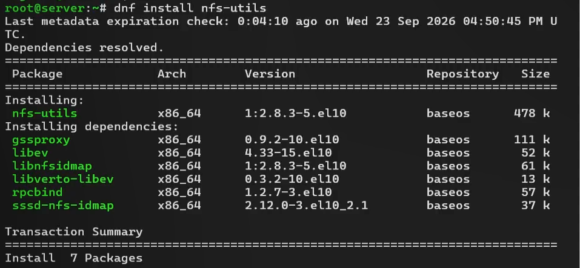{#fig:001 width=60%}

## Настройка сервера NFSv4

2. На сервере создаем каталог, который предполагается сделать доступным всем пользователям сети (корень дерева NFS).

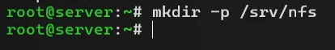{#fig:002 width=60%}

## Настройка сервера NFSv4

3. В файле /etc/exports прописываем подключаемый через NFS общий каталог с доступом только на чтение.

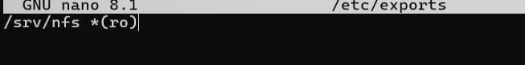{#fig:003 width=60%}

## Настройка сервера NFSv4

4. Для общего каталога задаем контекст безопасности NFS.
5. Применяем измененную настройку SELinux к файловой системе.

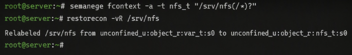{#fig:004 width=60%}

## Настройка сервера NFSv4

6. Запускаем сервер NFS.

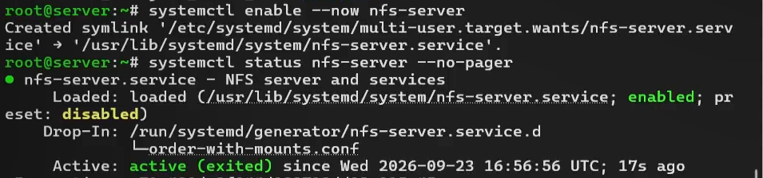{#fig:005 width=60%}

## Настройка сервера NFSv4

7. Настраиваем межсетевой экран для работы сервера NFS.

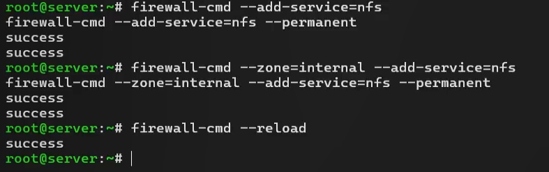{#fig:006 width=60%}

## Настройка сервера NFSv4

8. На клиенте устанавливаем необходимое для работы NFS программное обеспечение.

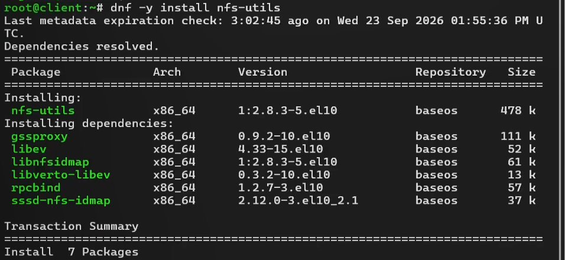{#fig:007 width=60%}

## Настройка сервера NFSv4

9. На клиенте пробуем посмотреть имеющиеся подмонтированные удалённые ресурсы (ошибка: трафик заблокирован межсетевым экраном).

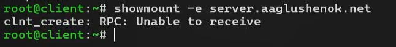{#fig:008 width=60%}

## Настройка сервера NFSv4

10. Пробуем на сервере остановить сервис межсетевого экрана. 

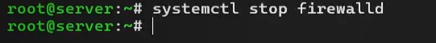{#fig:009 width=60%}

## Настройка сервера NFSv4

Затем на клиенте вновь пробуем подключиться к удаленно смонтированному ресурсу (сервер ответил, что экспортирует директорию /srv/nfs абсолютно для всех клиентов).

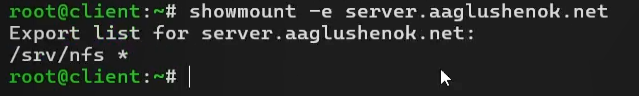{#fig:010 width=60%}

## Настройка сервера NFSv4

11. На сервере запускаем сервис межсетевого экрана.

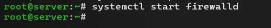{#fig:011 width=60%}

## Настройка сервера NFSv4

12. На сервере смотрим, какие службы задействованы при удалённом монтировании.

TCP:

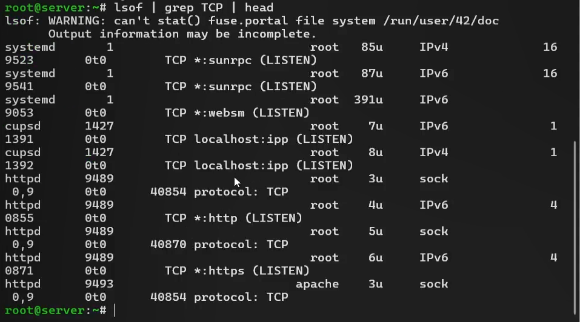{#fig:012 width=60%}

## Настройка сервера NFSv4

UDP:

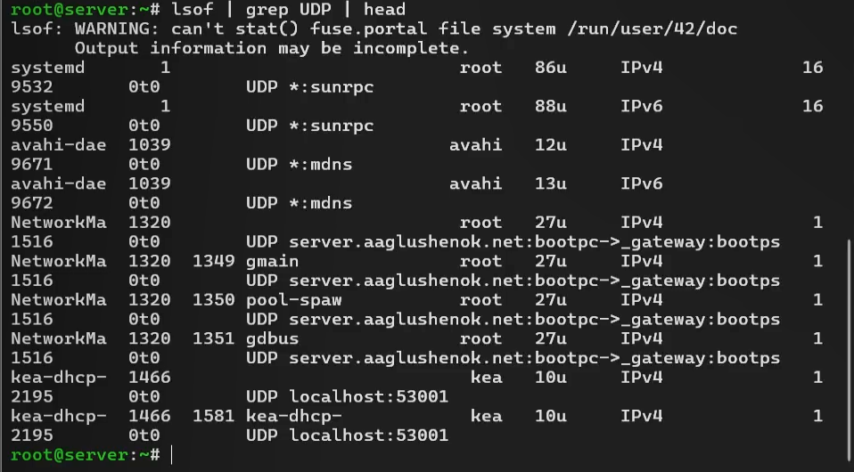{#fig:013 width=60%}

## Настройка сервера NFSv4

13. Добавляем службы rpc-bind и mountd в настройки межсетевого экрана на сервере.

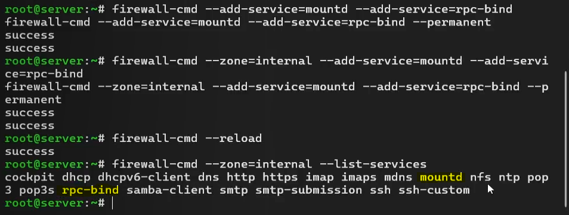{#fig:014 width=60%}

## Настройка сервера NFSv4

14. На клиенте проверяем подключение удалённого ресурса (теперь запрос успешно проходит, несмотря на запущенный сервис межсетевого экрана).

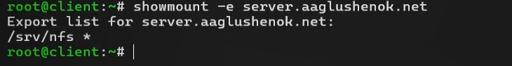{#fig:015 width=60%}

# Монтирование NFS на клиенте

## Монтирование NFS на клиенте

1. На клиенте создаем каталог, в который будет монтироваться удалённый ресурс, и монтируем дерево NFS.

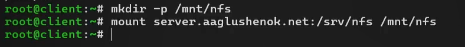{#fig:016 width=60%}

## Монтирование NFS на клиенте

2. Проверяем, что общий ресурс NFS подключён правильно.

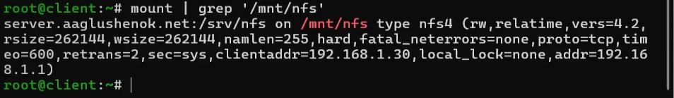{#fig:017 width=60%}

## Монтирование NFS на клиенте

3. На клиенте в конце файла /etc/fstab вносим изменения (автоматическое монтирование удаленного NFS-каталога). 

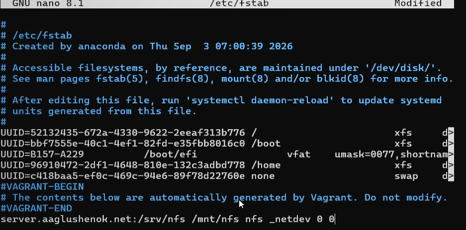{#fig:018 width=60%}

## Монтирование NFS на клиенте

4. На клиенте проверяем наличие автоматического монтирования удалённых ресурсов при запуске операционной системы.
5. Перезапускаем клиента и убеждаемся, что удаленный ресурс подключается автоматически.

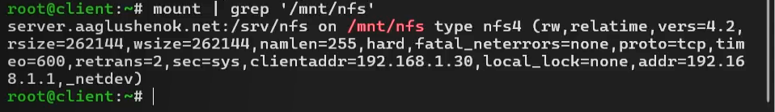{#fig:019 width=60%}

# Подключение каталогов к дереву NFS

## Подключение каталогов к дереву NFS

1. На сервере создаем общий каталог, в который затем будет подмонтирован каталог с контентом веб-сервера.
2. Монтируем каталог web-сервера.

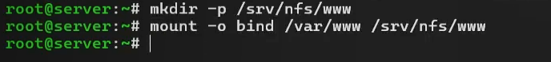{#fig:020 width=60%}

## Подключение каталогов к дереву NFS

3. На сервере проверяем, что отображается в каталоге /srv/nfs.

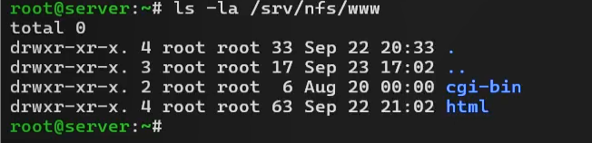{#fig:021 width=60%}

## Подключение каталогов к дереву NFS

4. На клиенте смотрим, что отображается в каталоге /mnt/nfs.

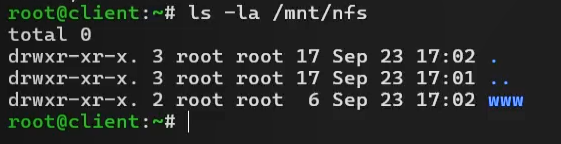{#fig:022 width=60%}

## Подключение каталогов к дереву NFS

5. На сервере в файле /etc/exports добавляем экспорт каталога веб-сервера с удаленного ресурса.

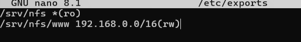{#fig:023 width=60%}

## Подключение каталогов к дереву NFS

6. Экспортируем все каталоги, упомянутые в файле /etc/exports.

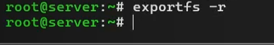{#fig:024 width=60%}

## Подключение каталогов к дереву NFS

7. На сервере в конце файла /etc/fstab вносим изменения.

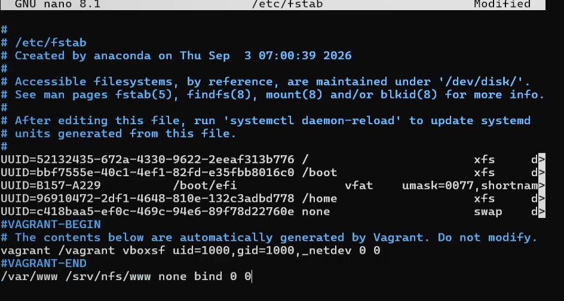{#fig:025 width=60%}

## Подключение каталогов к дереву NFS

8. Экспортируем каталоги, указанные в файле /etc/exports.
9. На клиенте проверяем каталог /mnt/nfs (сетевой экспорт и связывание каталогов bind mount работают).

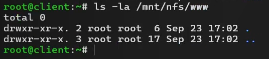{#fig:026 width=60%}

# Подключение каталогов для работы пользователей

## Подключение каталогов для работы пользователей

1. На сервере под пользователем в его домашнем каталоге создаем каталог common с полными правами доступа только для этого пользователя, и в нем файл aaglushenok@server.txt.

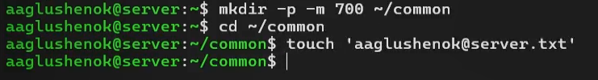{#fig:027 width=60%}

## Подключение каталогов для работы пользователей

2. На сервере создем общий каталог для работы пользователя по сети.
3. Монтируем каталог common пользователя в NFS.

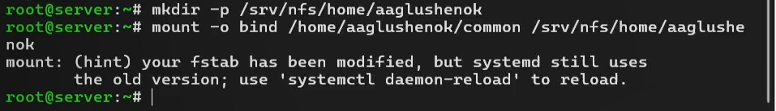{#fig:028 width=60%}

## Подключение каталогов для работы пользователей

проверка прав доступа: владелец каталога имеет права на чтение, запись и выполнение, группа и остальные пользователи не имеют никаких прав на этот каталог.

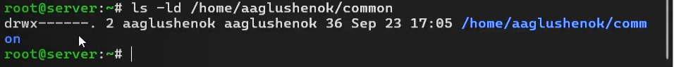{#fig:029 width=60%}

## Подключение каталогов для работы пользователей

4. Подключаем каталог пользователя в файле /etc/exports.

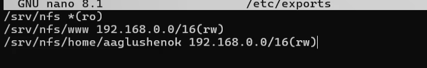{#fig:030 width=60%}

## Подключение каталогов для работы пользователей

5. Вносим изменения в файл /etc/fstab.

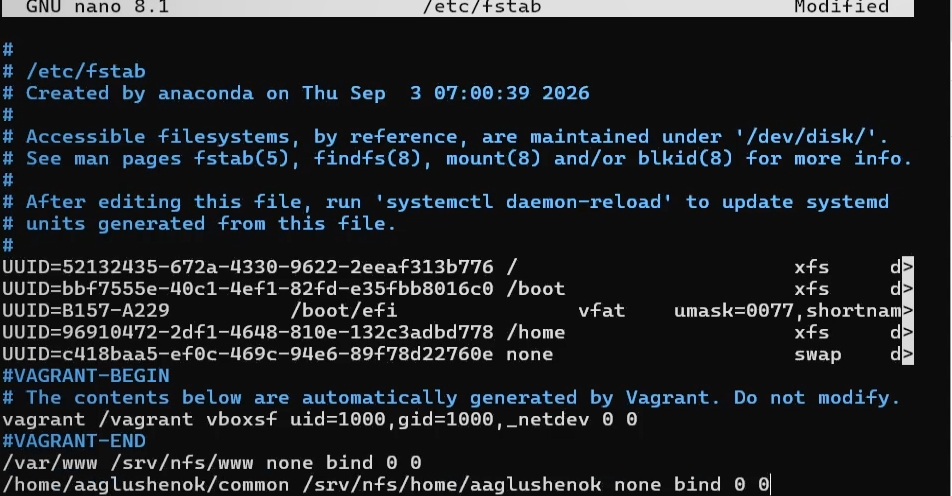{#fig:031 width=60%}

## Подключение каталогов для работы пользователей

6. Повторно экспортируем каталоги.
7. На клиенте проверяем каталог /mnt/nfs (файл aaglushenok@server.txt - появился).

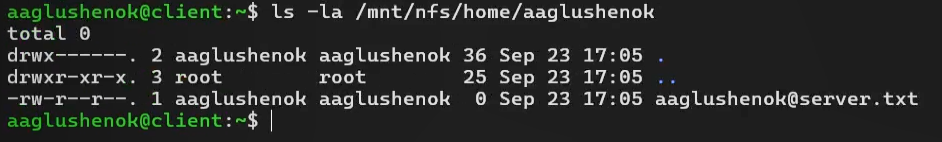{#fig:032 width=60%}

## Подключение каталогов для работы пользователей

8. На клиенте под пользователем переходим в каталог /mnt/nfs/home/user и пробуем создать в нём файл aaglushenok@client.txt и внести в него какие-либо изменения (успешно).

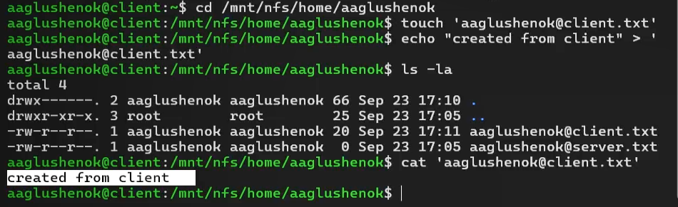{#fig:033 width=60%}

## Подключение каталогов для работы пользователей

Далее пробуем проделать это под пользователем root (НЕ успешно, ограничено правами доступа).

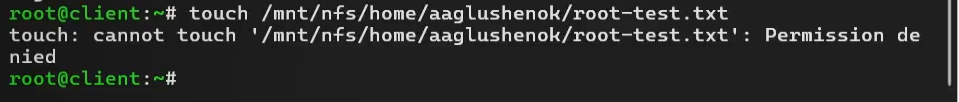{#fig:034 width=60%}

## Подключение каталогов для работы пользователей

9. На сервере смотрим, появились ли изменения в каталоге пользователя /home/user/common (да, появились).

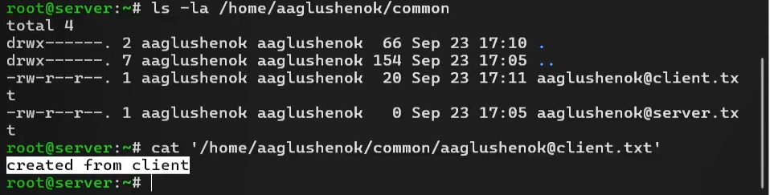{#fig:035 width=60%}

# Внесение изменений в настройки внутреннего окружения виртуальных машин

## Внесение изменений в настройки внутреннего окружения виртуальных машин

1. На ВМ server переходим в каталог /vagrant/provision/server/ для внесения изменений в настройки внутреннего окружения, создаем в нем каталог nfs, в подкаталоги помещаем конфигурационные файлы.

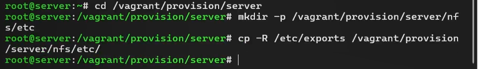{#fig:036 width=60%}

## Внесение изменений в настройки внутреннего окружения виртуальных машин

2. В каталоге /vagrant/provision/server создаем исполняемый файл nfs.sh. Открыв его на редактирование, прописываем в нем скрипт.

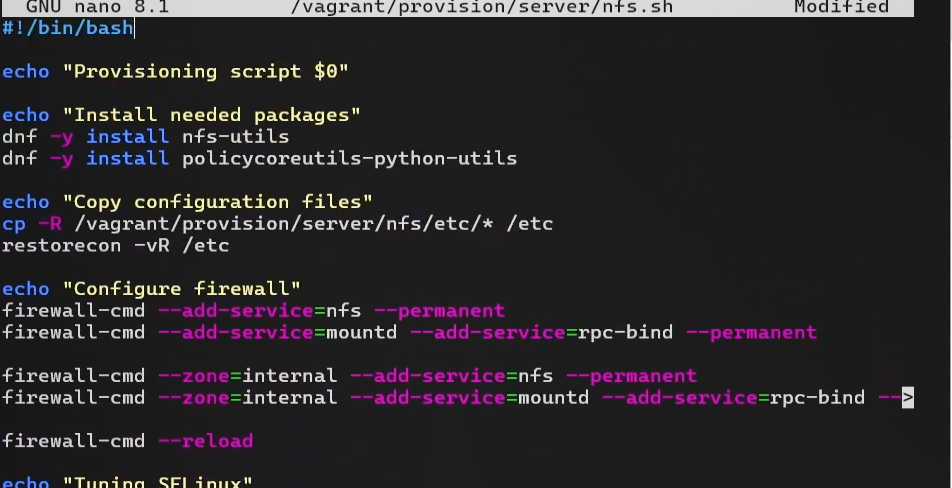{#fig:037 width=60%}

## Внесение изменений в настройки внутреннего окружения виртуальных машин

3. На ВМ client переходим в каталог /vagrant/provision/client/ для внесения изменений в настройки внутреннего окружения. 
4. В каталоге /vagrant/provision/client создаем исполняемый файл nfs.sh. Открыв его на редактирование, прописываем в нем скрипт.

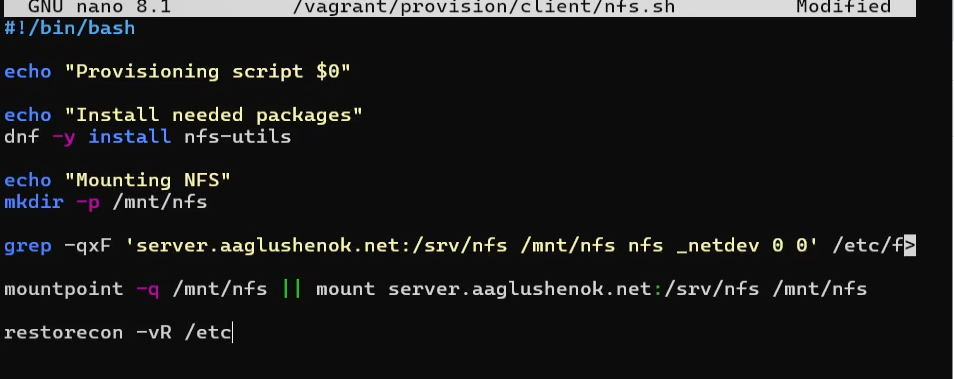{#fig:038 width=60%}

## Внесение изменений в настройки внутреннего окружения виртуальных машин

5. Для отработки созданных скриптов во время загрузки ВМ server и client в  Vagrantfile обновляем конфигурации в соответствующих разделах.

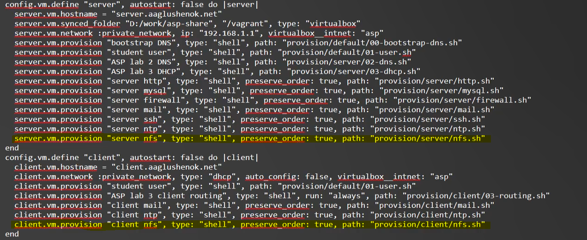{#fig:039 width=60%}

# Выводы

## Выводы

В ходе выполнения лабораторной работы № 13 мне удалось приобрести навыки настройки сервера NFS для удалённого доступа к ресурсам.

# Список литературы 

## Список литературы 

1. IETF. RFC 8881: Network File System (NFS) Version 4 Minor Version 1 Protocol [Электронный ресурс]. — URL: https://datatracker.ietf.org/doc/html/rfc8881 (дата обращения: 27.11.2026).

2. IETF. RFC 7530: Network File System (NFS) Version 4 Protocol [Электронный ресурс]. — URL: https://datatracker.ietf.org/doc/html/rfc7530 (дата обращения: 27.11.2026).

3. Red Hat. Configuring and Using Network File Services [Электронный ресурс]. — URL: https://access.redhat.com/documentation/zh-cn/red_hat_enterprise_linux/9/pdf/configuring_and_using_network_file_services/red_hat_enterprise_linux-9-configuring_and_using_network_file_services-zh-cn.pdf (дата обращения: 27.11.2026).

4. Debian Manpages. exports(5) — nfs-kernel-server [Электронный ресурс]. — URL: https://manpages.debian.org/bookworm/nfs-kernel-server/exports.5.en.html (дата обращения: 27.11.2026).

5. Red Hat. SELinux Users and Administrators Guide: NFS and SELinux [Электронный ресурс]. — URL: https://docs.redhat.com/zh-cn/documentation/red_hat_enterprise_linux/7/pdf/selinux_users_and_administrators_guide/ (дата обращения: 27.11.2026).

