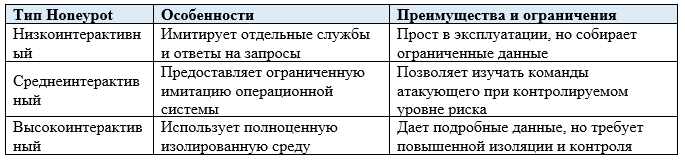

## Докладчик

::::: {.columns align="center"}
::: {.column width="70%"}
- Глушенок Анна Александровна
- Учебная группа: НПИбд-01-24
- Студенческий билет: 1132246844
:::

::: {.column width="30%"}
:::
:::::

# НАУЧНЫЙ АППАРАТ ИССЛЕДОВАНИЯ

## НАУЧНЫЙ АППАРАТ ИССЛЕДОВАНИЯ

**Актуальность:** - Рост числа сетевых сервисов, доступных из
Интернета. - Увеличение автоматизированных попыток подбора учетных
данных. - Необходимость своевременного обнаружения Brute Force атак.

**Проблема:** попытки подбора паролей могут оставаться незамеченными
традиционными средствами контроля доступа.

## НАУЧНЫЙ АППАРАТ ИССЛЕДОВАНИЯ

**Объект:** процессы передачи, обработки и защиты информации в IP-сетях.

**Предмет:** Brute Force атаки на сетевые сервисы и применение Honeypot
для их обнаружения и анализа.

**Научная новизна:** систематизация способов подбора учетных данных и
обобщение подхода к применению Honeypot.

**Практическая значимость:** возможность использовать рекомендации при
проектировании и администрировании корпоративных IP-сетей.

# МЕТОДОЛОГИЧЕСКИЙ АППАРАТ ИССЛЕДОВАНИЯ

## МЕТОДОЛОГИЧЕСКИЙ АППАРАТ ИССЛЕДОВАНИЯ

**Цель:** изучить Brute Force атаки, проанализировать принцип работы
Honeypot и разработать подход к его применению.

**Гипотеза:** Honeypot повышает возможности обнаружения атак при
использовании в составе комплекса мер защиты.

**Задачи:** - рассмотреть механизм и разновидности Brute Force атак; -
изучить назначение и классификацию Honeypot; - проанализировать
обнаружение атак с помощью ловушек; - сформировать комплексный подход и
критерии его оценки.

## МЕТОДОЛОГИЧЕСКИЙ АППАРАТ ИССЛЕДОВАНИЯ

**Методы:** анализ литературы, сравнение средств обнаружения,
классификация угроз, системный подход и моделирование корпоративной
IP-сети.

**Основные понятия:** - **Brute Force** --- многократная проверка
вариантов учетных данных. - **Honeypot** --- специально созданный ресурс
для привлечения злоумышленников и регистрации их действий. -
**Информационная безопасность** --- защищенность информации и
инфраструктуры от угроз.

# 1. ОСНОВНЫЕ УГРОЗЫ, СВЯЗАННЫЕ С BRUTE FORCE АТАКАМИ

## Механизм и разновидности атак

- Автоматизированная проверка большого количества паролей.
- Цели: SSH, FTP, RDP, веб-панели и другие службы удаленного доступа.
- Основные разновидности:
  - Password Guessing;
  - Password Spraying;
  - Credential Stuffing;
  - Password Cracking.

{width="75%"}

## Причины уязвимости и последствия атак

**Причины:** - короткие и распространенные пароли; - повторное
использование учетных данных; - отсутствие MFA; - отсутствие ограничения
числа попыток входа.

**Последствия:** - захват учетной записи; - утечка информации; -
изменение настроек сервиса; - дальнейшее проникновение во внутреннюю
сеть.

## Обнаружение попыток подбора паролей

- Анализ журналов аутентификации.
- Признаки: множество неудачных входов, перебор разных учетных записей,
  успешный вход после серии ошибок.
- Ограничение: большой объем обычных событий затрудняет выявление атак.

# 2. HONEYPOT КАК СРЕДСТВО ОБНАРУЖЕНИЯ И АНАЛИЗА АТАК

## Понятие и назначение Honeypot

- Имитация реальной системы или сетевой службы.
- Не используется для выполнения рабочих задач организации.
- Фиксирует обращения и действия потенциального злоумышленника.
- Может имитировать SSH-сервер, веб-панель или другую службу
  аутентификации.

## Классификация Honeypot

- **Низкое взаимодействие:** имитация ограниченного набора служб.
- **Среднее взаимодействие:** ограниченные действия в имитируемой среде.
- **Высокое взаимодействие:** реалистичная среда для подробного
  наблюдения.

{width="75%"}

## Принцип работы при обнаружении Brute Force

1.  Размещение ловушки в отдельном сетевом сегменте.
2.  Регистрация подключений и попыток аутентификации.
3.  Сохранение адресов, времени, логинов и паролей.
4.  Анализ команд и дальнейших действий атакующего.

## Программные средства: Cowrie

- Honeypot для SSH и Telnet.
- Регистрирует Brute Force атаки и команды.
- Имитирует файловую систему и ограниченную оболочку.
- Сохраняет журналы сеансов и загружаемые файлы.

## Преимущества и ограничения Honeypot

**Преимущества:** - выделение подозрительной активности; - сбор сведений
о методах атакующего; - потенциально меньше ложных срабатываний.

**Ограничения:** - не гарантирует обнаружение всех атак; - не защищает
реальные учетные записи самостоятельно; - требует изоляции и безопасного
сопровождения.

# 3. КОМПЛЕКСНЫЙ ПОДХОД К ИСПОЛЬЗОВАНИЮ HONEYPOT

## Выбор конфигурации

- Определение наиболее атакуемых сетевых служб.
- Выделенный SSH Honeypot на базе Cowrie.
- Размещение в изолированном сегменте.
- Отсутствие реальных учетных данных и конфиденциальной информации.

## Многоуровневая система защиты

**1. Размещение:** изолированный сегмент и контроль межсетевым экраном.

**2. Регистрация:** фиксация подключений, попыток входа и действий.

**3. Анализ:** централизованный сбор журналов и оповещение
администратора.

**4. Противодействие:** MFA, надежные пароли, ограничение запросов и
блокировка подозрительных подключений.

{width="72%"}

## Организационные меры и оценка эффективности

**Организационные меры:** - назначение ответственных сотрудников; -
защищенное хранение журналов; - план реагирования на инциденты; -
контроль сетевой изоляции.

**Критерии оценки:** - число обнаруженных попыток подбора; - время до
формирования оповещения; - полнота журналирования; - корректность
оповещений.

{width="72%"}

# АНАЛИЗ И ПРАКТИЧЕСКАЯ ЗНАЧИМОСТЬ ДОСТИГНУТЫХ РЕЗУЛЬТАТОВ

## АНАЛИЗ И ПРАКТИЧЕСКАЯ ЗНАЧИМОСТЬ

- Рассмотрены основные разновидности Brute Force атак.
- Проанализированы возможности Honeypot и Cowrie.
- Сформирован подход: изоляция, регистрация, анализ, оповещение и
  противодействие.
- Гипотеза подтверждена на теоретическом уровне: Honeypot повышает
  обнаруживаемость атак в составе комплекса защиты.

# ОБЩЕЕ ЗАКЛЮЧЕНИЕ И ВЫВОДЫ

## ОБЩЕЕ ЗАКЛЮЧЕНИЕ И ВЫВОДЫ

- Изучены механизмы подбора учетных данных.
- Рассмотрены виды и принцип работы Honeypot.
- Предложена многоуровневая схема его применения.
- Цель достигнута, задачи решены.

**Вывод:** Honeypot --- дополнительный инструмент обнаружения и анализа
атак. Его эффективность зависит от изоляции, настройки и интеграции с
общей системой мониторинга.

# СПИСОК ИСПОЛЬЗОВАННЫХ ИСТОЧНИКОВ

## СПИСОК ИСПОЛЬЗОВАННЫХ ИСТОЧНИКОВ

1.  NIST. Honeypot --- Glossary. URL:
    https://csrc.nist.gov/glossary/term/honeypot
2.  MITRE. Brute Force, Technique T1110. URL:
    https://attack.mitre.org/techniques/T1110/
3.  Oosterhof, M. Cowrie --- SSH and Telnet Honeypot Documentation. URL:
    https://docs.cowrie.org/en/stable/README.html
4.  ENISA. Proactive Detection of Security Incidents: Honeypots. URL:
    https://www.enisa.europa.eu/sites/default/files/publications/ENISA_Honeypots_study.pdf
