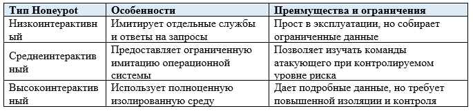
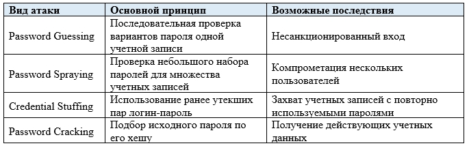
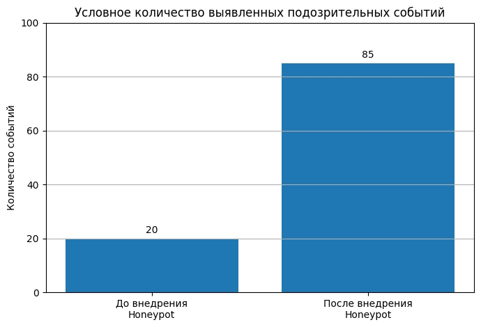

\renewcommand{\figurename}{Рисунок}

# ОГЛАВЛЕНИЕ

1. [Научный аппарат исследования](#1-научный-аппарат-исследования)
   - [1.1. Актуальность темы исследования](#11-актуальность-темы-исследования)
   - [1.2. Проблема исследования](#12-проблема-исследования)
   - [1.3. Объект и предмет исследования](#13-объект-и-предмет-исследования)
   - [1.4. Научная новизна исследования](#14-научная-новизна-исследования)
   - [1.5. Практическая значимость работы](#15-практическая-значимость-работы)
2. [Методологический аппарат исследования](#2-методологический-аппарат-исследования)
   - [2.1. Цель исследования](#21-цель-исследования)
   - [2.2. Гипотеза исследования](#22-гипотеза-исследования)
   - [2.3. Задачи исследования](#23-задачи-исследования)
   - [2.4. Методы и материалы исследования](#24-методы-и-материалы-исследования)
   - [2.5. Теоретическая база исследования](#25-теоретическая-база-исследования)
3. [Основные угрозы, связанные с Brute Force атаками](#3-основные-угрозы-связанные-с-brute-force-атаками)
   - [3.1. Особенности и механизм Brute Force атак](#31-особенности-и-механизм-brute-force-атак)
   - [3.2. Классификация атак на учетные записи](#32-классификация-атак-на-учетные-записи)
   - [3.3. Причины уязвимости систем и последствия атак](#33-причины-уязвимости-систем-и-последствия-атак)
   - [3.4. Анализ способов обнаружения попыток подбора паролей](#34-анализ-способов-обнаружения-попыток-подбора-паролей)
4. [Honeypot как средство обнаружения и анализа Brute Force атак](#4-honeypot-как-средство-обнаружения-и-анализа-brute-force-атак)
   - [4.1. Понятие и назначение Honeypot](#41-понятие-и-назначение-honeypot)
   - [4.2. Классификация Honeypot](#42-классификация-honeypot)
   - [4.3. Принцип работы Honeypot при обнаружении Brute Force атак](#43-принцип-работы-honeypot-при-обнаружении-brute-force-атак)
   - [4.4. Программные средства реализации Honeypot](#44-программные-средства-реализации-honeypot)
   - [4.5. Преимущества и ограничения применения Honeypot](#45-преимущества-и-ограничения-применения-honeypot)
5. [Разработка комплексного подхода к использованию Honeypot](#5-разработка-комплексного-подхода-к-использованию-honeypot)
   - [5.1. Определение требований к системе обнаружения атак](#51-определение-требований-к-системе-обнаружения-атак)
   - [5.2. Выбор и обоснование конфигурации Honeypot](#52-выбор-и-обоснование-конфигурации-honeypot)
   - [5.3. Организация многоуровневой системы защиты](#53-организация-многоуровневой-системы-защиты)
   - [5.4. Организационные меры эксплуатации Honeypot](#54-организационные-меры-эксплуатации-honeypot)
   - [5.5. Оценка эффективности и ограничения предложенного комплекса](#55-оценка-эффективности-и-ограничения-предложенного-комплекса)
6. [Анализ и практическая значимость достигнутых результатов](#6-анализ-и-практическая-значимость-достигнутых-результатов)
7. [Общее заключение и выводы](#7-общее-заключение-и-выводы)
8. [Список использованных источников](#8-список-использованных-источников)

\newpage

```{=openxml}
<w:p><w:r><w:br w:type="page"/></w:r></w:p>
```

# 1. НАУЧНЫЙ АППАРАТ ИССЛЕДОВАНИЯ

## 1.1. Актуальность темы исследования

IP-сети являются основой современной цифровой инфраструктуры. На их базе функционируют корпоративные информационные системы, государственные и образовательные ресурсы, облачные платформы, системы промышленной автоматизации и средства связи.

Актуальность темы обусловлена ростом числа сетевых сервисов, доступных из Интернета, и увеличением количества автоматизированных попыток получения несанкционированного доступа к учетным записям.

## 1.2. Проблема исследования

Проблема исследования заключается в противоречии между необходимостью обеспечивать надежную защиту сетевых сервисов и наличием многочисленных попыток подбора паролей, которые могут оставаться незамеченными традиционными средствами контроля доступа.

## 1.3. Объект и предмет исследования

Объект исследования — процессы передачи, обработки и защиты информации в IP-сетях.

Предмет исследования — Brute Force атаки на сетевые сервисы, а также технология Honeypot и методы ее применения для обнаружения и анализа попыток несанкционированного доступа.

## 1.4. Научная новизна исследования

Научная новизна работы состоит в систематизации способов подбора учетных данных и обобщении подхода к применению Honeypot как дополнительного механизма обнаружения атак на основе контролируемого взаимодействия с потенциальным злоумышленником.

## 1.5. Практическая значимость работы

Практическая значимость заключается в возможности использовать рекомендации при проектировании, модернизации и администрировании локальных и корпоративных IP-сетей.

\newpage

```{=openxml}
<w:p><w:r><w:br w:type="page"/></w:r></w:p>
```

# 2. МЕТОДОЛОГИЧЕСКИЙ АППАРАТ ИССЛЕДОВАНИЯ

## 2.1. Цель исследования

Цель исследования — изучить особенности Brute Force атак, проанализировать принцип работы Honeypot и разработать обоснованный подход к применению данной технологии для обнаружения и анализа попыток подбора учетных данных в IP-сетях.

## 2.2. Гипотеза исследования

Предполагается, что уровень защищенности IP-сети может быть повышен, если использовать Honeypot в составе согласованного комплекса мер, включающего контроль доступа, ограничение частоты запросов, многофакторную аутентификацию, регистрацию событий и анализ подозрительной активности.

## 2.3. Задачи исследования

- рассмотреть механизм и основные разновидности Brute Force атак;
- выявить причины уязвимости учетных записей и последствия успешного подбора паролей;
- изучить понятие, назначение и классификацию Honeypot;
- проанализировать принцип обнаружения Brute Force атак с помощью Honeypot;
- рассмотреть программные средства реализации ловушек;
- сформировать комплексный подход к внедрению Honeypot и определить критерии оценки эффективности.

## 2.4. Методы и материалы исследования

В работе применяются анализ и обобщение научно-технической литературы, сравнительный анализ средств обнаружения атак, классификация угроз, системный подход и моделирование типовой корпоративной IP-сети с выделенным Honeypot.

## 2.5. Теоретическая база исследования

Brute Force атака — способ получения доступа, при котором злоумышленник многократно проверяет варианты паролей или учетных данных до обнаружения подходящего значения.

Honeypot — специально созданная система или ресурс, предназначенный для привлечения потенциальных злоумышленников и регистрации их действий [1].

Информационная безопасность — состояние защищенности информации и поддерживающей ее инфраструктуры от угроз, способных привести к ущербу.

Теоретическую основу также составляют принципы эшелонированной защиты, минимальных привилегий, безопасной конфигурации по умолчанию, регулярного обновления и непрерывного контроля.

\newpage

```{=openxml}
<w:p><w:r><w:br w:type="page"/></w:r></w:p>
```

# 3. ОСНОВНЫЕ УГРОЗЫ, СВЯЗАННЫЕ С BRUTE FORCE АТАКАМИ

## 3.1. Особенности и механизм Brute Force атак

Brute Force представляет собой метод подбора учетных данных путем последовательной проверки различных комбинаций паролей. Атака может выполняться вручную, однако чаще используется автоматизированное программное обеспечение, способное отправлять большое количество запросов к сетевому сервису.

Для проведения атаки злоумышленник может использовать известные имена пользователей, распространенные пароли, словари и ранее утекшие базы учетных данных. Подбор может быть направлен на SSH, FTP, RDP, веб-панели управления и другие службы удаленного доступа.

## 3.2. Классификация атак на учетные записи

К основным разновидностям относятся Password Guessing, при котором проверяются отдельные варианты паролей, и Password Spraying, при котором один или несколько распространенных паролей проверяются для большого числа учетных записей.

Credential Stuffing основан на использовании пар логин-пароль, ранее раскрытых в результате утечек. Password Cracking предполагает восстановление пароля по имеющемуся хешу. Данные способы относятся к технике Brute Force T1110 в классификации MITRE ATT&CK [2].

Сравнение основных разновидностей атак и их особенностей приведено на рисунке 1.

{width=70%}

## 3.3. Причины уязвимости систем и последствия атак

Основными причинами успешного подбора являются использование коротких и распространенных паролей, повторное применение одних и тех же учетных данных, отсутствие многофакторной аутентификации и недостаточное ограничение числа попыток входа.

Последствия реализации угроз различаются по характеру и масштабу. Успешная атака может привести к захвату учетной записи, утечке конфиденциальной информации, изменению настроек сервиса, установке вредоносного программного обеспечения и дальнейшему перемещению злоумышленника по внутренней сети.

## 3.4. Анализ способов обнаружения попыток подбора паролей

Традиционное обнаружение Brute Force атак основывается на анализе журналов аутентификации. Признаками подозрительной активности являются большое количество неудачных входов за короткий промежуток времени, попытки входа с одного адреса к разным учетным записям и успешная авторизация после серии ошибок [2].

Однако обычные журналы могут содержать большое количество событий от легитимных пользователей. Honeypot позволяет выделить отдельный ресурс, не предназначенный для реальной работы сотрудников: любое обращение к нему рассматривается как подозрительное и подлежит анализу [1].

\newpage

```{=openxml}
<w:p><w:r><w:br w:type="page"/></w:r></w:p>
```

# 4. HONEYPOT КАК СРЕДСТВО ОБНАРУЖЕНИЯ И АНАЛИЗА BRUTE FORCE АТАК

## 4.1. Понятие и назначение Honeypot

Honeypot — это специально подготовленный сетевой ресурс, который имитирует реальную систему или службу и предназначен для привлечения потенциальных злоумышленников. В отличие от обычного сервера, он не должен выполнять рабочие функции организации. Его основная задача заключается в регистрации и анализе действий посетителей [1]. Подобные системы относятся к средствам проактивного обнаружения инцидентов и позволяют изучать действия потенциальных нарушителей [4].

При использовании против Brute Force атак Honeypot может имитировать SSH-сервер, веб-панель или другую службу аутентификации. Злоумышленник воспринимает такой ресурс как возможную цель и начинает проверять учетные данные, а система фиксирует адрес источника, время попыток, используемые логины и пароли, а также дальнейшие команды.

## 4.2. Классификация Honeypot

По уровню взаимодействия выделяют Honeypot низкого, среднего и высокого взаимодействия. Низкоинтерактивные решения имитируют ограниченный набор сетевых служб и фиксируют обращения к ним. Они проще в настройке и имеют меньший риск, однако предоставляют ограниченные сведения о поведении атакующего.

Среднеинтерактивные Honeypot позволяют злоумышленнику выполнять ограниченный набор действий в имитируемой среде. Высокоинтерактивные решения предоставляют более реалистичную среду для наблюдения, но требуют строгой изоляции и более сложного сопровождения.

Сравнение типов Honeypot представлено на рисунке 2.

{width=70%}

## 4.3. Принцип работы Honeypot при обнаружении Brute Force атак

Работа Honeypot начинается с размещения имитируемого сервиса в отдельном сетевом сегменте. Для SSH-ловушки открывается порт, доступный для внешних подключений, а сам сервис настроен на регистрацию всех попыток аутентификации.

Когда злоумышленник начинает подбирать пароль, Honeypot сохраняет каждую попытку входа и связанные с ней параметры. Если атакующий продолжает взаимодействие после условной успешной авторизации, система может записывать команды, передаваемые файлы и последовательность действий. Такой подход позволяет исследовать не только факт подбора, но и дальнейшие намерения атакующего [3].

## 4.4. Программные средства реализации Honeypot

Одним из известных решений является Cowrie — Honeypot для SSH и Telnet, предназначенный для регистрации Brute Force атак и команд, выполняемых злоумышленником. В режиме имитации Cowrie предоставляет поддельную файловую систему и ограниченную оболочку, а также сохраняет журналы сеансов и загружаемые файлы [3].

Полученные события могут передаваться в централизованные системы сбора и анализа журналов. Это позволяет сопоставлять попытки входа с другими событиями информационной безопасности и формировать оповещения для администраторов.

## 4.5. Преимущества и ограничения применения Honeypot

Основным преимуществом Honeypot является возможность получать данные об активности, которая с высокой вероятностью связана с несанкционированным доступом. Поскольку легитимные пользователи не должны обращаться к ловушке, количество ложных срабатываний может быть ниже, чем при анализе общего потока событий.

При этом Honeypot не заменяет межсетевой экран, надежные пароли, многофакторную аутентификацию и ограничение частоты запросов. Он обнаруживает и изучает попытки взаимодействия с ловушкой, но сам по себе не гарантирует защиту реальных учетных записей. Основные возможности и ограничения технологии учитываются при выборе конфигурации и организации мониторинга.

\newpage

```{=openxml}
<w:p><w:r><w:br w:type="page"/></w:r></w:p>
```

# 5. РАЗРАБОТКА КОМПЛЕКСНОГО ПОДХОДА К ИСПОЛЬЗОВАНИЮ HONEYPOT

## 5.1. Определение требований к системе обнаружения атак

Разработка системы начинается с определения защищаемых сетевых сервисов и оценки рисков. Организации необходимо установить, какие службы удаленного доступа используются, какие учетные записи имеют повышенные привилегии и какие ресурсы доступны из внешней сети.

На основе анализа выбираются цели наблюдения. Для обнаружения попыток подбора учетных данных целесообразно имитировать наиболее часто атакуемые службы, например SSH или веб-панель управления. При этом Honeypot не должен содержать реальные учетные данные и конфиденциальную информацию организации.

## 5.2. Выбор и обоснование конфигурации Honeypot

Для типовой корпоративной IP-сети целесообразно использовать отдельный SSH Honeypot, размещенный в изолированном сегменте. Такое решение позволяет регистрировать попытки удаленного подключения, проверяемые имена пользователей, пароли и команды, которые злоумышленник вводит после входа в имитируемую среду.

При выборе программного решения следует учитывать поддерживаемые протоколы, полноту журналирования, возможности экспорта событий, требования к ресурсам и удобство сопровождения. Например, Cowrie поддерживает SSH и Telnet, сохраняет действия атакующего и предоставляет журналы в формате, пригодном для последующей обработки [3].

## 5.3. Организация многоуровневой системы защиты

Предлагаемый комплекс можно представить в виде четырех взаимосвязанных уровней.

Первый уровень — размещение Honeypot. Ловушка располагается в отдельном сетевом сегменте, доступ к которому контролируется межсетевым экраном. Подключение к ней не должно предоставлять прямой доступ к внутренним серверам и рабочим станциям.

Второй уровень — регистрация событий. Honeypot фиксирует адреса источников, время подключений, попытки аутентификации, используемые учетные данные и действия внутри имитируемой системы. Журналы должны сохраняться в защищенном хранилище.

Третий уровень — анализ и оповещение. События передаются в систему централизованного мониторинга. Повторяющиеся попытки входа, большое количество проверяемых паролей и необычные команды могут служить основанием для формирования предупреждения администратору.

Четвертый уровень — противодействие атакам. Для реальных сервисов применяются многофакторная аутентификация, надежная парольная политика, ограничение частоты запросов, блокировка подозрительных подключений и регулярное обновление программного обеспечения [2].

Уровни не должны рассматриваться независимо. Honeypot помогает обнаружить и изучить действия злоумышленника, однако предотвращение доступа к реальным системам обеспечивается дополнительными средствами защиты. Условная последовательность работы комплекса представлена на рисунке 3.

{width=70%}

## 5.4. Организационные меры эксплуатации Honeypot

Организационные меры определяют правила безопасной эксплуатации ловушки. К ним относятся назначение ответственных сотрудников, порядок хранения журналов, контроль доступа к данным мониторинга и регулярная проверка корректности регистрации событий.

Необходимо разработать план реагирования на инциденты. Он должен описывать регистрацию события, первичную оценку, проверку источника активности, блокировку подозрительных подключений к реальным сервисам, сохранение цифровых доказательств и последующий анализ причин.

Отдельное внимание уделяется изоляции Honeypot. Следует запретить несанкционированные соединения из ловушки во внутреннюю сеть, ограничить исходящий трафик и регулярно проверять конфигурацию. При использовании высокоинтерактивной среды необходимо предусмотреть возможность ее быстрого восстановления.

## 5.5. Оценка эффективности и ограничения предложенного комплекса

Эффективность системы следует оценивать не по количеству зарегистрированных событий, а по измеримым показателям. К ним относятся количество обнаруженных попыток подбора, время от начала атаки до формирования оповещения, полнота журналирования и доля событий, требующих дополнительной проверки.

Оценку можно проводить с помощью контролируемых тестовых подключений, проверки сохранения журналов, анализа корректности оповещений и проверки сетевой изоляции Honeypot.

Предложенный комплекс имеет ограничения. Ловушка может не привлечь атакующего, если он использует другие цели или обнаруживает признаки имитации. Кроме того, собранные данные характеризуют активность именно в отношении Honeypot и не дают полной картины всех атак на организацию. Условное изменение количества зарегистрированных подозрительных событий при внедрении мониторинга показано на рисунке 4.

{width=70%}

\newpage

```{=openxml}
<w:p><w:r><w:br w:type="page"/></w:r></w:p>
```

# 6. АНАЛИЗ И ПРАКТИЧЕСКАЯ ЗНАЧИМОСТЬ ДОСТИГНУТЫХ РЕЗУЛЬТАТОВ

В ходе исследования установлено, что одной из распространенных угроз для сетевых сервисов являются попытки подбора учетных данных. Brute Force атаки могут привести к компрометации учетных записей и дальнейшему несанкционированному доступу к ресурсам организации.

Анализ технологии Honeypot показал, что она позволяет регистрировать попытки подключения, используемые учетные данные и действия злоумышленника в имитируемой среде. Программные решения, такие как Cowrie, обеспечивают сбор журналов и сохранение сведений о поведении атакующего.

Практическим результатом работы является сформированный подход к использованию Honeypot: определение атакуемых сервисов, размещение ловушки в изолированном сегменте, сбор событий, централизованный анализ журналов, оповещение администратора и применение дополнительных мер защиты реальных сервисов.

Практическая ценность подхода состоит в возможности обнаруживать подозрительную активность и получать сведения о применяемых злоумышленниками методах. Полученные данные могут использоваться для корректировки правил доступа, усиления парольной политики и совершенствования системы мониторинга.

Таким образом, гипотеза исследования получает теоретическое подтверждение: применение Honeypot в составе комплексной системы защиты повышает возможности обнаружения и анализа Brute Force атак, однако не заменяет превентивные механизмы защиты учетных записей.

\newpage

```{=openxml}
<w:p><w:r><w:br w:type="page"/></w:r></w:p>
```

# 7. ОБЩЕЕ ЗАКЛЮЧЕНИЕ И ВЫВОДЫ

В докладе рассмотрены особенности Brute Force атак, основные способы подбора учетных данных и возможности применения Honeypot для обнаружения подозрительной активности.

В рамках исследования классифицированы основные разновидности атак: Password Guessing, Password Spraying, Credential Stuffing и Password Cracking. Установлено, что их успешность повышается при использовании слабых и повторно применяемых паролей, отсутствии многофакторной аутентификации и недостаточном контроле попыток входа.

На основании анализа предложен комплексный подход, основанный на использовании Honeypot совместно с другими средствами защиты. Он предусматривает изоляцию ловушки, регистрацию попыток аутентификации, централизованный анализ событий, оповещение администраторов, ограничение частоты запросов и применение многофакторной аутентификации на реальных сервисах.

Поставленная цель достигнута, задачи исследования решены. Выдвинутая гипотеза подтверждается на теоретическом уровне: использование Honeypot в сочетании с техническими и организационными мерами позволяет повысить обнаруживаемость Brute Force атак и получить дополнительные сведения о действиях злоумышленников.

Общий вывод заключается в том, что Honeypot является полезным дополнительным инструментом информационной безопасности, эффективность которого зависит от правильной настройки, изоляции и интеграции с общей системой мониторинга.

\newpage

```{=openxml}
<w:p><w:r><w:br w:type="page"/></w:r></w:p>
```

# 8. СПИСОК ИСПОЛЬЗОВАННЫХ ИСТОЧНИКОВ

1. NIST. Honeypot — Glossary. — Computer Security Resource Center. — Текст : электронный. — URL: https://csrc.nist.gov/glossary/term/honeypot (дата обращения: 22.11.2026).

2. MITRE. Brute Force, Technique T1110. — MITRE ATT&CK. — Текст : электронный. — URL: https://attack.mitre.org/techniques/T1110/ (дата обращения: 22.11.2026).

3. Oosterhof, M. Cowrie — SSH and Telnet Honeypot Documentation. — Текст : электронный. — URL: https://docs.cowrie.org/en/stable/README.html (дата обращения: 22.11.2026).

4. ENISA. Proactive Detection of Security Incidents: Honeypots. — European Union Agency for Cybersecurity. — Текст : электронный. — URL: https://www.enisa.europa.eu/sites/default/files/publications/ENISA_Honeypots_study.pdf (дата обращения: 22.11.2026).
