---
## Front matter
lang: ru-RU
title: Лабораторная работа № 4. Адресация IPv4 и IPv6.Двойной стек
subtitle: Презентация
author:
  - Глушенок А. А.
institute:
  - Российский университет дружбы народов, Москва, Россия
date: 24 октября 2026

## Formatting pdf
toc: false
slide_level: 2
aspectratio: 169
section-titles: true
theme: metropolis
header-includes:
 - \metroset{progressbar=frametitle,sectionpage=progressbar,numbering=fraction}
 - \usepackage{graphicx}
 - \usepackage{caption}
 - \captionsetup{labelformat=empty, labelsep=none}
 
## Fonts
mainfont: Liberation Serif
sansfont: PT Sans
monofont: Liberation Mono
---

# Информация

## Докладчик

:::::::::::::: {.columns align=center}
::: {.column width="70%"}

  * Глушенок Анна Александровна
  * Студент НПИбд-01-24
  * Российский университет дружбы народов
  * [1132246844@pfur.ru](mailto:1132246844@pfur.ru)

:::
::: {.column width="30%"}

:::
::::::::::::::

## Цель работы

Изучение принципов распределения и настройки адресного пространства на устройствах сети.

# Выполнение лабораторной работы

# Настройка двойного стека адресации IPv4 и IPv6 в локальной сети

## Настройка двойного стека адресации IPv4 и IPv6 в локальной сети

1. Запустите GNS3 VM и GNS3. Создайте новый проект.
2. В рабочем пространстве разместите и соедините устройства в соответствии с топологией, приведённой на рис. 4.1.
3. Измените отображаемые названия устройств. 

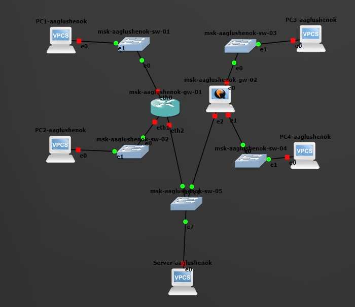{#fig:001 width=30%}

## Настройка двойного стека адресации IPv4 и IPv6 в локальной сети

4. Включите захват трафика на соединении между сервером двойного стека адресации и ближайшим к нему коммутатором.

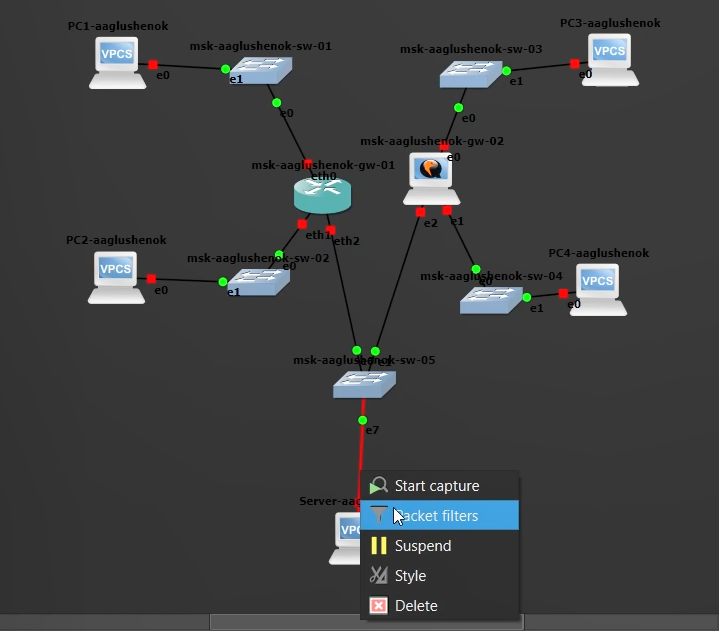{#fig:002 width=40%}

## Настройка двойного стека адресации IPv4 и IPv6 в локальной сети

После включения появляется значок лупы: 

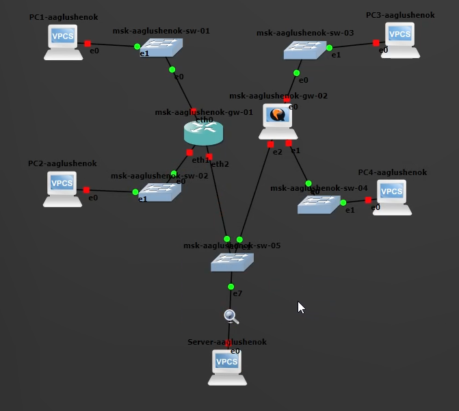{#fig:003 width=40%}

## Настройка двойного стека адресации IPv4 и IPv6 в локальной сети

5. Настройте IPv4-адресацию для интерфейсов узлов PC1, PC2, Server. Посмотрите на PC1 и PC2 конфигурацию IPv4 и IPv6.

## Настройка двойного стека адресации IPv4 и IPv6 в локальной сети

- PC1:  

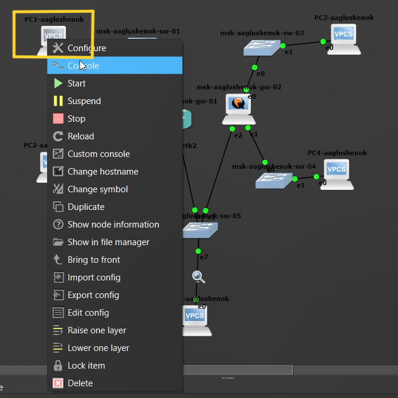{#fig:004 width=40%}

## Настройка двойного стека адресации IPv4 и IPv6 в локальной сети

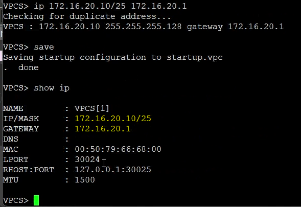{#fig:005 width=60%}

## Настройка двойного стека адресации IPv4 и IPv6 в локальной сети

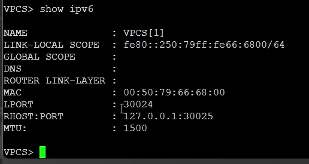{#fig:006 width=60%}

## Настройка двойного стека адресации IPv4 и IPv6 в локальной сети

- PC2:  

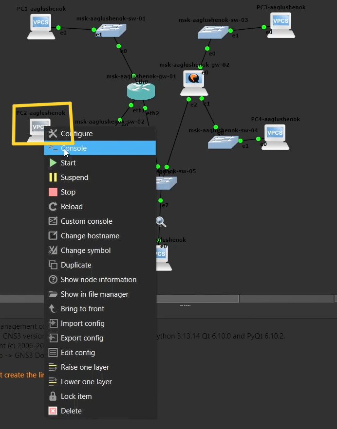{#fig:007 width=30%}

## Настройка двойного стека адресации IPv4 и IPv6 в локальной сети

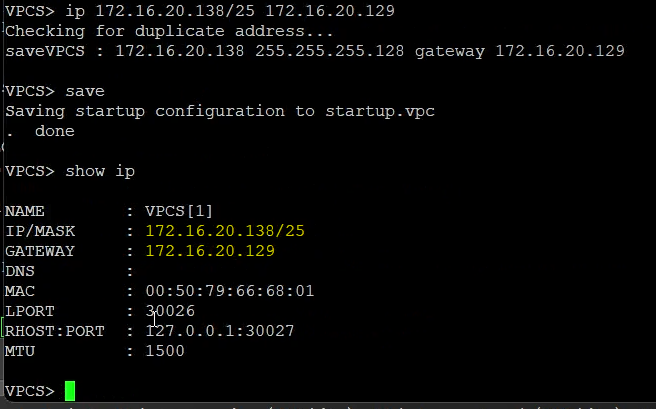{#fig:008 width=60%}

## Настройка двойного стека адресации IPv4 и IPv6 в локальной сети

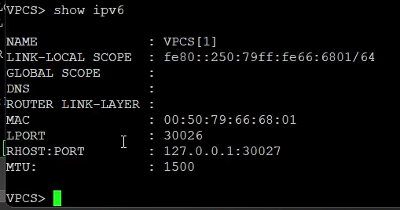{#fig:009 width=60%}

## Настройка двойного стека адресации IPv4 и IPv6 в локальной сети

- Server:  

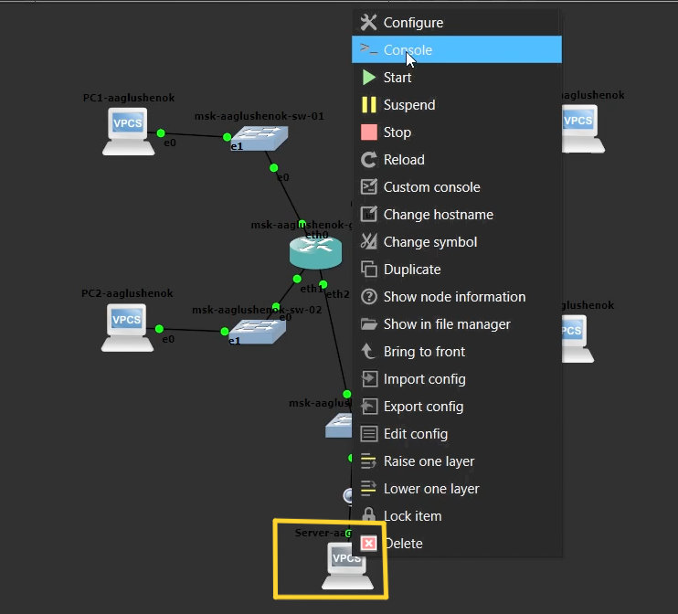{#fig:010 width=30%}

## Настройка двойного стека адресации IPv4 и IPv6 в локальной сети

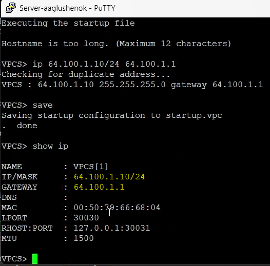{#fig:011 width=30%}

## Настройка двойного стека адресации IPv4 и IPv6 в локальной сети

6. Настройте IPv4-адресацию для интерфейсов локальной сети маршрутизатора FRR msk-user-gw-01.

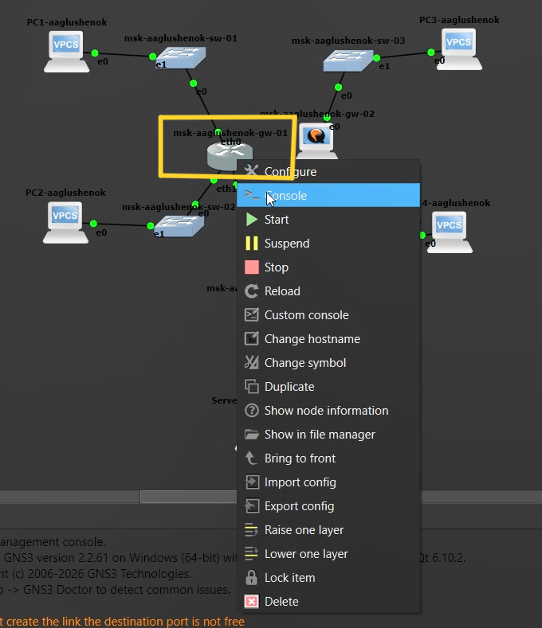{#fig:012 width=40%}

## Настройка двойного стека адресации IPv4 и IPv6 в локальной сети

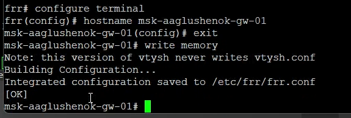{#fig:013 width=60%}

## Настройка двойного стека адресации IPv4 и IPv6 в локальной сети

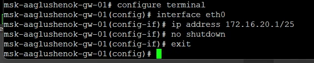{#fig:014 width=60%}

## Настройка двойного стека адресации IPv4 и IPv6 в локальной сети

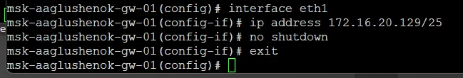{#fig:015 width=60%}

## Настройка двойного стека адресации IPv4 и IPv6 в локальной сети

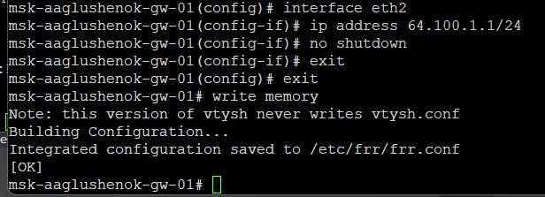{#fig:016 width=60%}

## Настройка двойного стека адресации IPv4 и IPv6 в локальной сети

7. Проверьте конфигурацию маршрутизатора и настройки IPv4-адресации.

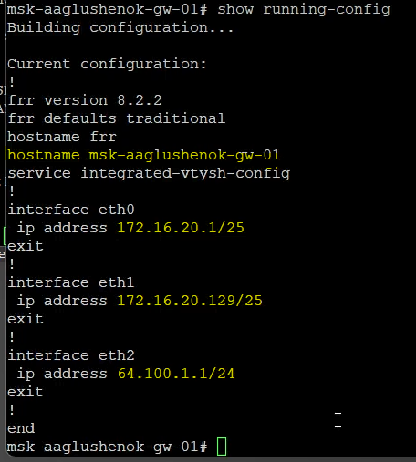{#fig:017 width=40%}

## Настройка двойного стека адресации IPv4 и IPv6 в локальной сети

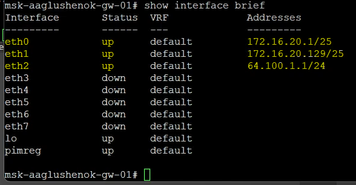{#fig:018 width=60%}

## Настройка двойного стека адресации IPv4 и IPv6 в локальной сети

8. Проверьте подключение с помощью команд ping и trace. Узлы PC1 и PC2 должны успешно отправлять эхо-запросы друг другу и на сервер с двойным стеком (Dual Stack Server).

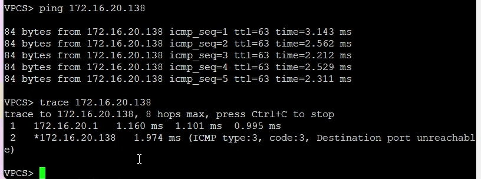{#fig:019 width=60%}

## Настройка двойного стека адресации IPv4 и IPv6 в локальной сети

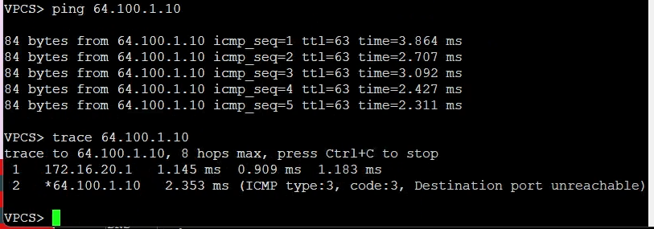{#fig:020 width=60%}

## Настройка двойного стека адресации IPv4 и IPv6 в локальной сети

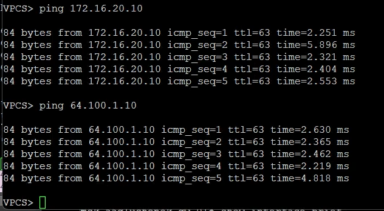{#fig:021 width=60%}

## Настройка двойного стека адресации IPv4 и IPv6 в локальной сети

9. Настройте IPv6-адресацию для интерфейсов узлов PC3, PC4, Server.
10. Посмотрите на PC3 и PC4 конфигурацию IPv4 и IPv6.

## Настройка двойного стека адресации IPv4 и IPv6 в локальной сети

– PC3:  

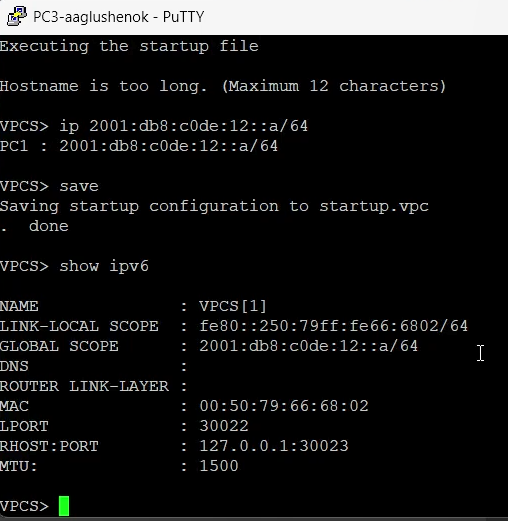{#fig:022 width=40%}

## Настройка двойного стека адресации IPv4 и IPv6 в локальной сети

– PC4:  

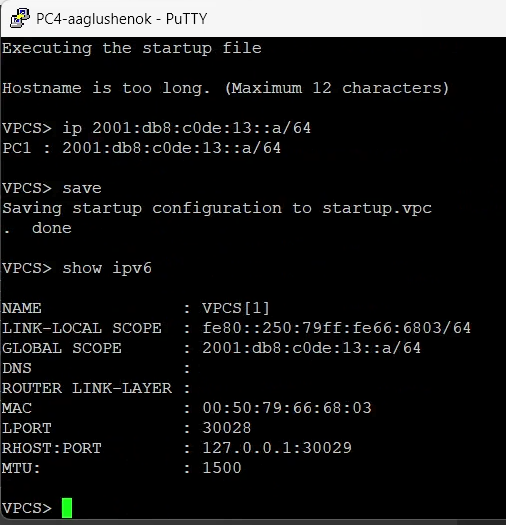{#fig:023 width=40%}

## Настройка двойного стека адресации IPv4 и IPv6 в локальной сети

– Server:  

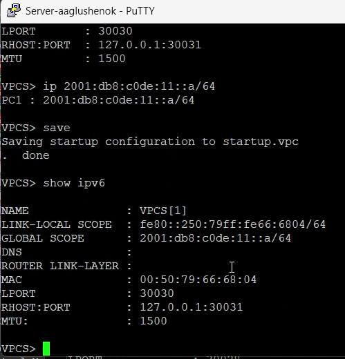{#fig:024 width=40%}

## Настройка двойного стека адресации IPv4 и IPv6 в локальной сети

11. Настройте IPv6-адресацию для интерфейсов локальной сети маршрутизатора VyOS msk-user-gw-02.

- Перейдите в режим конфигурирования, измените имя устройства и удалите указание на назначение ip-адреса по dhcp для интерфейса eth0:  

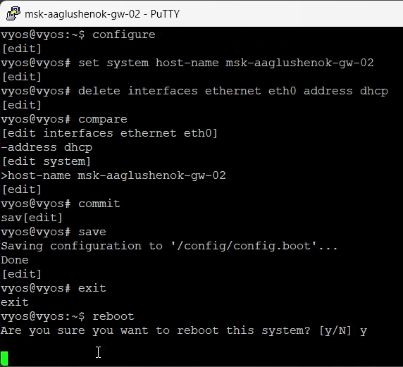{#fig:025 width=40%}

## Настройка двойного стека адресации IPv4 и IPv6 в локальной сети

- Назначьте IPv6-адреса маршрутизатору msk-user-gw-02:  

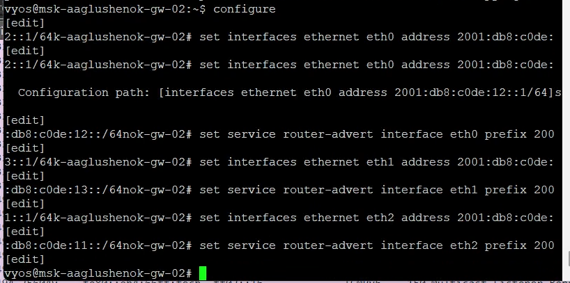{#fig:026 width=60%}

## Настройка двойного стека адресации IPv4 и IPv6 в локальной сети

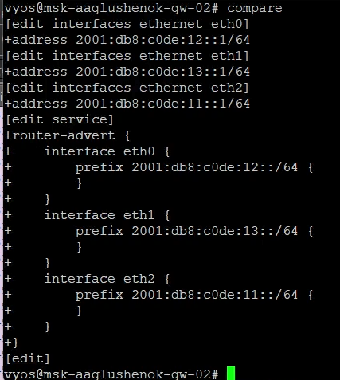{#fig:027 width=40%}

## Настройка двойного стека адресации IPv4 и IPv6 в локальной сети

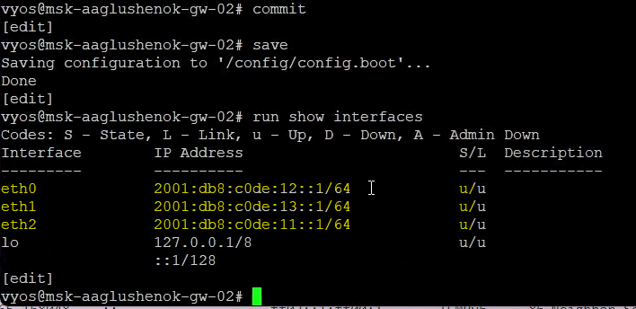{#fig:028 width=60%}

## Настройка двойного стека адресации IPv4 и IPv6 в локальной сети

12. Проверьте подключение с помощью команд ping и trace. Узлы PC3 и PC4 должны успешно отправлять эхо-запросы друг другу и на сервер с двойным стеком (Dual Stack Server).

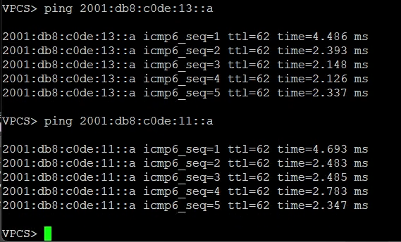{#fig:029 width=60%}

## Настройка двойного стека адресации IPv4 и IPv6 в локальной сети

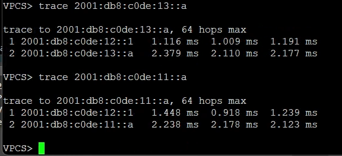{#fig:030 width=60%}

## Настройка двойного стека адресации IPv4 и IPv6 в локальной сети

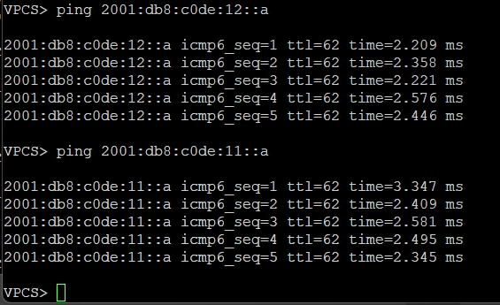{#fig:031 width=60%}

## Настройка двойного стека адресации IPv4 и IPv6 в локальной сети

13. Убедитесь, что устройства из подсети IPv4 не доступны для устройств из подсети IPv6 и наоборот. Только сервер двойного стека может обращаться к устройствам обеих подсетей.

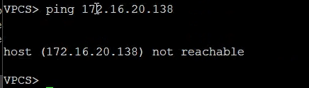{#fig:033 width=60%}

## Настройка двойного стека адресации IPv4 и IPv6 в локальной сети

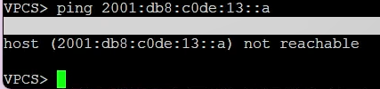{#fig:034 width=60%}

## Настройка двойного стека адресации IPv4 и IPv6 в локальной сети

14. Посмотрите захваченный на соединении сервера двойного стека адресации с коммутатором трафик ARP, ICMP, ICMPv6.

- ARP: Сервер объявляет свой MAC-адрес (Gratuitous ARP) и узнает MAC-адрес шлюза для передачи IPv4-трафика.  

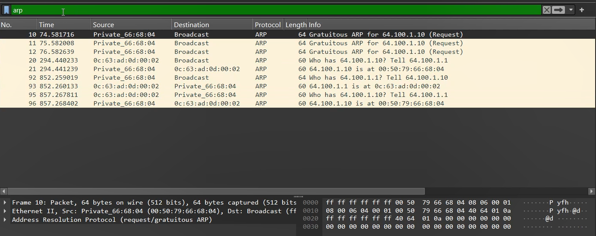{#fig:037 width=60%}

## Настройка двойного стека адресации IPv4 и IPv6 в локальной сети

- ICMP: Успешный ping (Echo request/reply) между сервером и ПК, подтверждающий маршрутизацию.  

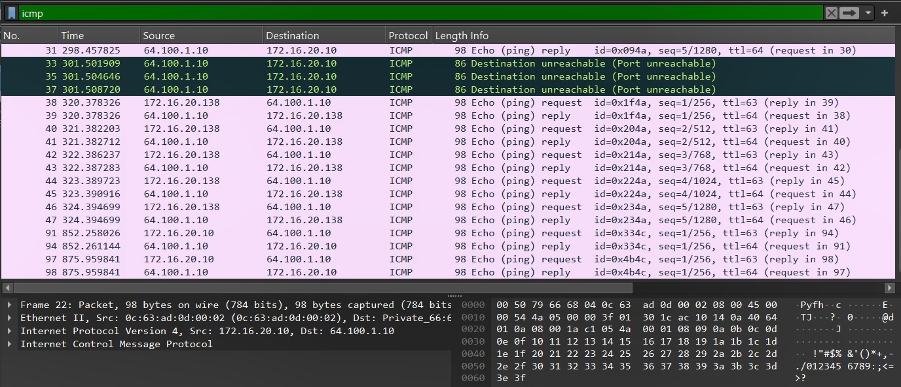{#fig:038 width=60%}

## Настройка двойного стека адресации IPv4 и IPv6 в локальной сети

- ICMPv6: Сервер запрашивает шлюз (Router Solicitation) и настраивает multicast-группы.  

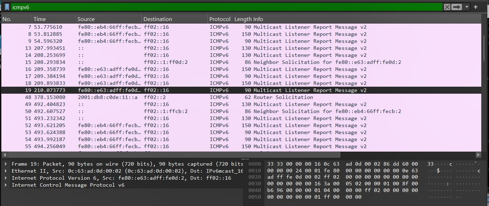{#fig:039 width=60%}

# Задание для самостоятельного выполнения

## Задание для самостоятельного выполнения

1. Охарактеризовать подсети, указать, какие адреса в них входят.

Даны две пары подсетей для IPv4 и IPv6.  
Для первой выделены 10.10.1.96/27 и 2001:DB8:1:1::/64.  
Для второй выделены 10.10.1.16/28 и 2001:DB8:1:4::/64.  

## Задание для самостоятельного выполнения

Характеристики первой подсети (IPv4):  
- Префикс: 27  
- Маска: 255.255.255.224 (в двоичном виде: 11111111.11111111.11111111.11100000).  
- Шаг сети: 32 (2^5 = 32 адреса в блоке).  
- Адрес сети: 10.10.1.96  
- Broadcast: 10.10.1.127  
- Диапазон узлов: 10.10.1.97 – 10.10.1.126 (всего 30 узлов).  

## Задание для самостоятельного выполнения

Характеристики второй подсети (IPv4):  
- Префикс: 28  
- Маска: 255.255.255.240 (в двоичном виде: 11111111.11111111.11111111.11110000).  
- Шаг сети: 16 (2^4 = 16 адресов в блоке).  
- Адрес сети: 10.10.1.16  
- Broadcast-адрес: 10.10.1.31  
- Диапазон узлов: 10.10.1.17 – 10.10.1.30 (всего 14 узлов).  

## Задание для самостоятельного выполнения

IPv6-подсети:  
- Для первой подсети выделена сеть 2001:DB8:1:1::/64.  
- Для второй подсети выделена сеть 2001:DB8:1:4::/64.  
- В IPv6 нет широковещательных адресов, поэтому адреса раздаются начиная с ::1 и заканчиваются ::ffff:ffff:ffff:ffff.  

## Задание для самостоятельного выполнения

2. Предложить вариант таблицы адресации для заданной топологии и адресного пространства, причём для интерфейсов маршрутизатора выбрать наименьший адрес в подсети.

| Устройство | Интерфейс | Адрес | Шлюз по умолчанию |
| :--- | :--- | :--- | :--- |
| PC1-aaglushenok | NIC | 10.10.1.98/27 | 10.10.1.97 |
| PC1-aaglushenok | NIC | 2001:DB8:1:1::2/64 | 2001:DB8:1:1::1 |
| PC2-aaglushenok | NIC | 10.10.1.18/28 | 10.10.1.17 |
| PC2-aaglushenok | NIC | 2001:DB8:1:4::2/64 | 2001:DB8:1:4::1 |
| msk-aaglushenok-gw-01 | Eth0 | 10.10.1.97/27 | — |
| msk-aaglushenok-gw-01 | Eth0 | 2001:DB8:1:1::1/64 | — |
| msk-aaglushenok-gw-01 | Eth1 | 10.10.1.17/28 | — |
| msk-aaglushenok-gw-01 | Eth1 | 2001:DB8:1:4::1/64 | — |

## Задание для самостоятельного выполнения

3. Настроить IP-адресацию на маршрутизаторе VyOS и оконечных устройствах, причём на интерфейсах маршрутизатора установить наименьший адрес в подсети.

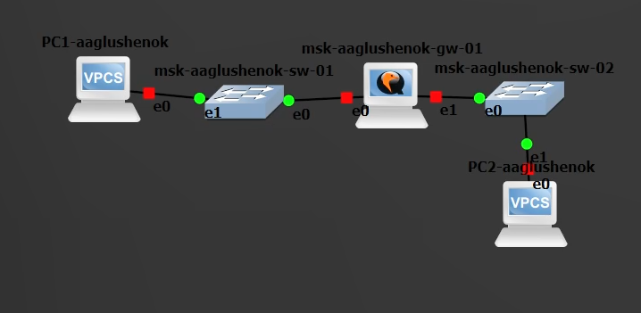{#fig:040 width=60%}

## Задание для самостоятельного выполнения

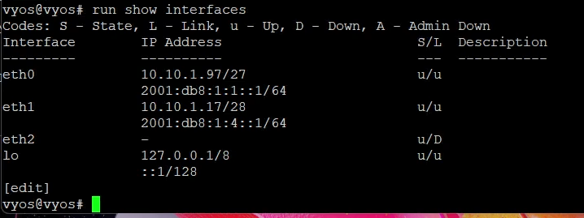{#fig:044 width=60%}

## Задание для самостоятельного выполнения

4. Проверить подключение между устройствами подсети с помощью команд ping и trace.

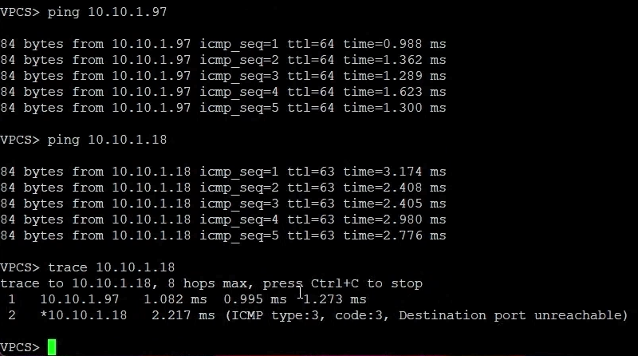{#fig:041 width=60%}

## Задание для самостоятельного выполнения

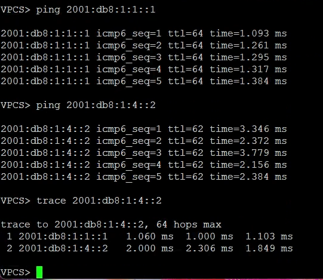{#fig:042 width=50%}

## Задание для самостоятельного выполнения

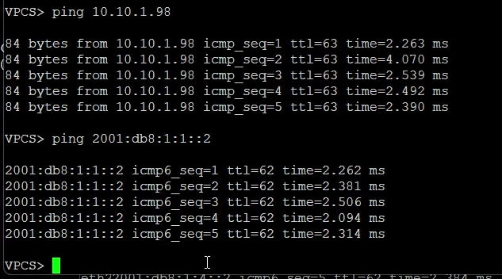{#fig:043 width=60%}

# Выводы

## Выводы

В ходе выполнения лабораторной работы № 4 мне удалось изучить принципов распределения и настройки адресного пространства на устройствах сети.

