# Информация

## Докладчик

::::: {.columns align="center"}
::: {.column width="70%"}
- Глушенок Анна Александровна
- Студент НПИбд-01-24
- Российский университет дружбы народов
- <1132246844@pfur.ru>
:::

::: {.column width="30%"}
:::
:::::

## Цель работы

Получение навыков настройки службы DHCP на сетевом оборудовании для
распределения адресов IPv4 и IPv6.

## Задание

1.  Настроить DHCP в случае IPv4.
2.  Настроить DHCP в случае IPv6.

# Выполнение лабораторной работы

# Настройка DHCP в случае IPv4

## Настройка DHCP в случае IPv4

1.  Запускаем GNS3 VM и GNS3. Создаем новый проект, называем его lab5.

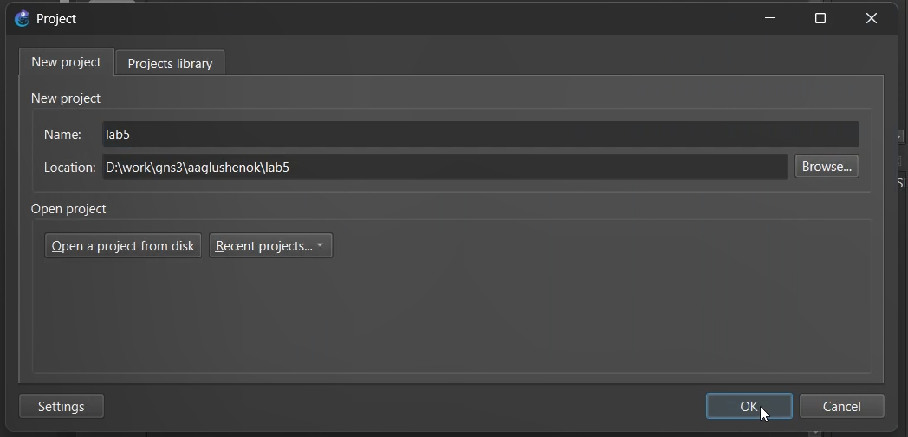{#fig:000 width="60%"}

## Настройка DHCP в случае IPv4

2.  В рабочем пространстве размещаем и соединяем устройства в
    соответствии с первой топологией.
3.  Меняем отображаемые названия устройств.

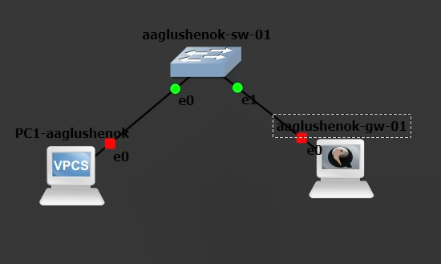{#fig:001 width="60%"}

## Настройка DHCP в случае IPv4

4.  Включаем захват трафика на соединении между коммутатором и
    маршрутизатором.

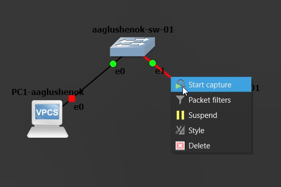{#fig:002
width="60%"}

## Настройка DHCP в случае IPv4

Открываем консоль маршрутизатора.

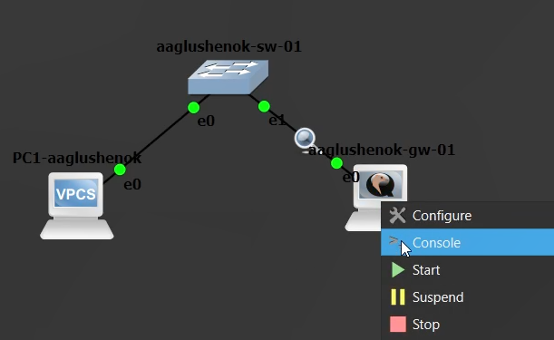{#fig:003
width="60%"}

## Настройка DHCP в случае IPv4

Меняем имя устройства, доменное имя и имя системного пользователя.

{#fig:004 width="60%"}

## Настройка DHCP в случае IPv4

Отключаем dhcp для eth0.

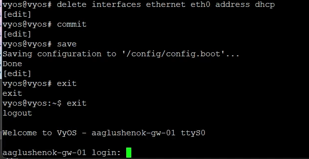{#fig:005 width="60%"}

## Настройка DHCP в случае IPv4

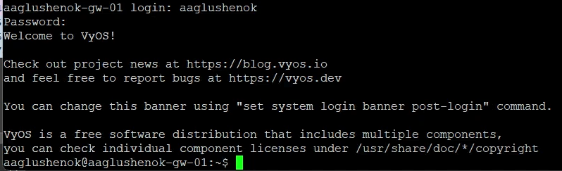{#fig:006 width="60%"}

## Настройка DHCP в случае IPv4

Сохраняем конфигурации.

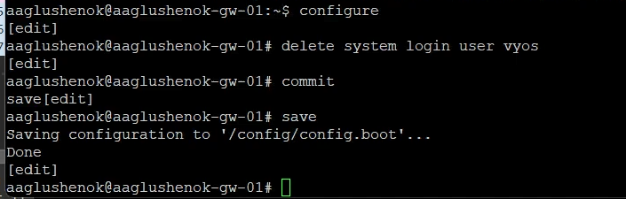{#fig:007 width="60%"}

## Настройка DHCP в случае IPv4

5.  На маршрутизаторе под созданным пользователем настраиваем адресацию
    IPv4.

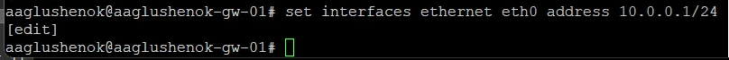{#fig:008 width="60%"}

## Настройка DHCP в случае IPv4

6.  Добавляем конфигурацию DHCP-сервера на маршрутизаторе: создаем
    разделяемую сеть, подсеть с адресом 10.0.0.0/24, задаем диапазон
    адресов.

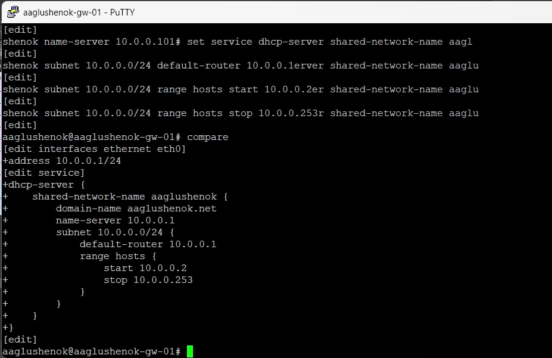{#fig:009
width="60%"}

## Настройка DHCP в случае IPv4

Сохраняем конфигурации.

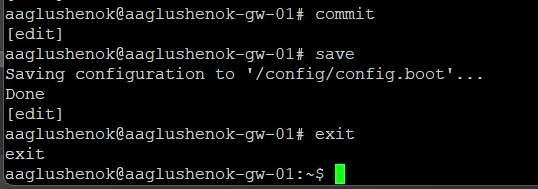{#fig:010
width="60%"}

## Настройка DHCP в случае IPv4

7.  Просматриваем статистику DHCP-сервера и выданные адреса.

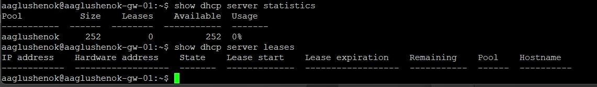{#fig:011
width="60%"}

## Настройка DHCP в случае IPv4

8.  Настраиваем оконечное устройство PC1. Сначала открываем консоль PC1.

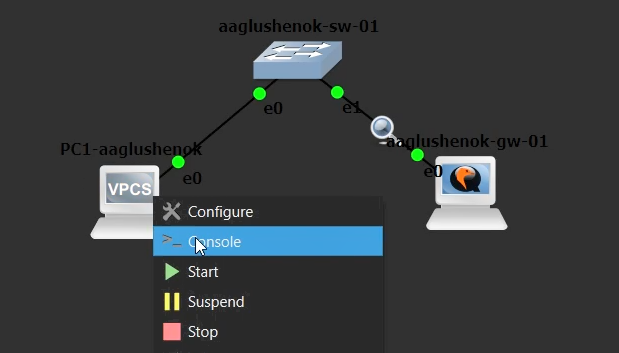{#fig:012 width="60%"}

## Настройка DHCP в случае IPv4

Далее вносим изменения в конфигурации PC1.

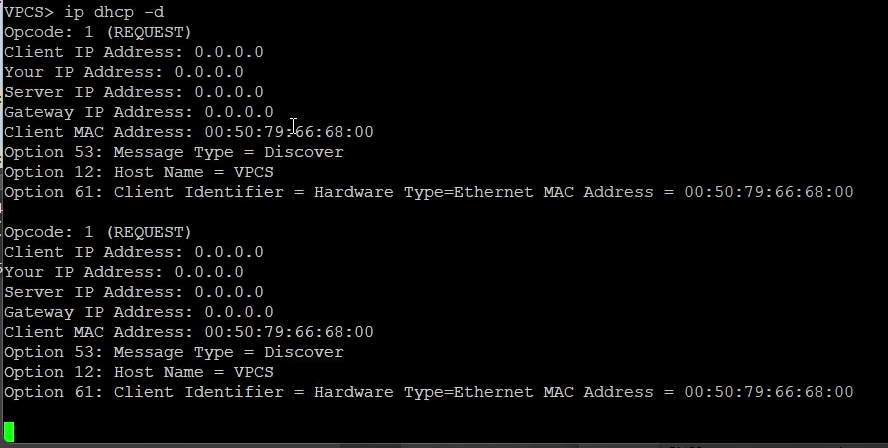{#fig:013 width="60%"}

## Настройка DHCP в случае IPv4

Затем сохраняем конфигурации.

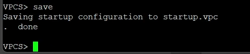{#fig:014
width="50%"}

**Пояснение к полученной на экране PC1 информации:** Видим, что PC1
успешно отправил широковещательный запрос DHCP Discover на поиск
DHCP-сервера. Запрос содержит MAC-адрес и имя устройства. Так как это
только начальная стадия получения адреса, сам IP-адрес еще не получен
(все адресные поля равны 0.0.0.0).

## Настройка DHCP в случае IPv4

9.  Проверяем конфигурацию IPv4 на узле, пингуем маршрутизатор.

{#fig:015 width="60%"}

## Настройка DHCP в случае IPv4

10. На маршрутизаторе вновь просматриваем статистику DHCP-сервера и
    выданные адреса.

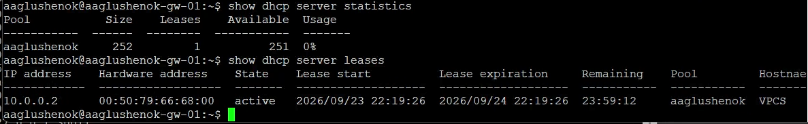{#fig:016
width="50%"}

**Пояснение к полученной информации:** Видим, что после включения
клиента PC1 статистика изменилась: счетчик Leases вырос с 0 до 1, а
Available уменьшился с 252 до 251, при этом в таблице аренд появилась
активная запись для IP 10.0.0.2 с MAC-адресом клиента и сроком аренды на
24 часа. Это произошло потому, что виртуальный ПК успешно отправил
DHCP-запрос, и сервер выделил ему первый свободный адрес из настроенного
пула, зарезервировав его за устройством на заданное время.

## Настройка DHCP в случае IPv4

11. На маршрутизаторе просматриваем журнал работы DHCP-сервера: записи
    подтверждают, что служба DHCP успешно запустилась и обновила файл
    аренд, а также что сервер корректно проигнорировал запросы на
    интерфейсах eth1 и eth2 из-за отсутствия на них настроенных
    IPv4-подсетей.

{#fig:017 width="60%"}

## Настройка DHCP в случае IPv4

12. Анализируем захваченные анализатором трафика пакеты, относящиеся к
    работе DHCP и назначению адреса устройству: захваченный трафик
    наглядно демонстрирует стандартный процесс аренды адреса по
    протоколу DHCP (Discover -\> Offer -\> Request -\> ACK), в
    результате которого устройству PC1 был успешно назначен IP-адрес
    10.0.0.2.

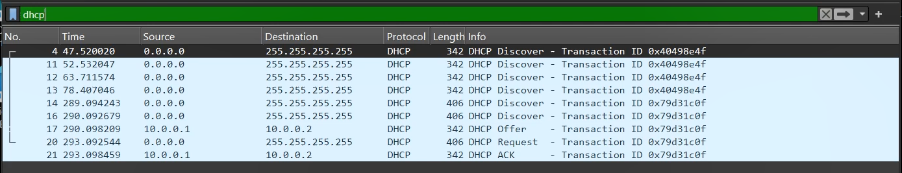{#fig:018 width="60%"}

# Настройка DHCP в случае IPv6

## Настройка DHCP в случае IPv6

1.  Дополняем сеть в соответствии со второй топологией.
2.  Меняем отображаемые названия устройств.

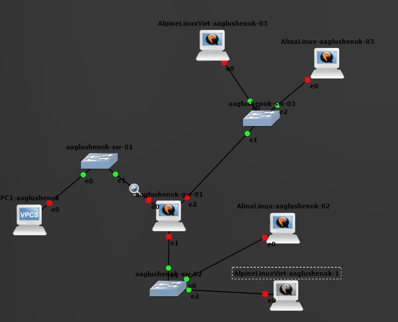{#fig:019 width="40%"}

## Настройка DHCP в случае IPv6

3.  Сначала включаем захват трафика на соединениях между маршрутизатором
    и коммутором sw-03.

{#fig:020 width="40%"}

## Настройка DHCP в случае IPv6

Затем включаем захват трафика на соединениях между маршрутизатором и
коммутором sw-02.

{#fig:021 width="40%"}

## Настройка DHCP в случае IPv6

4.  Настраиваем адресацию IPv6 на маршрутизаторе. Сначала открываем
    консоль маршрутизатора.

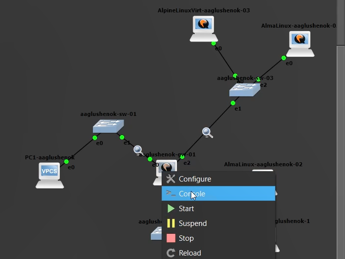{#fig:022
width="40%"}

## Настройка DHCP в случае IPv6

Далее настраиваем адресацию IPv6.

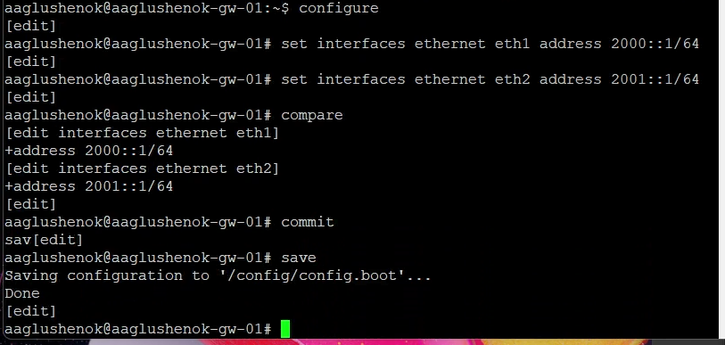{#fig:023
width="60%"}

## Настройка DHCP в случае IPv6

Затем просматриваем текущее состояние интерфейсов и сохраняем изменения.

{#fig:024 width="60%"}

## Настройка DHCP в случае IPv6

5.  На маршрутизаторе настраиваем DHCPv6 без отслеживания состояния:
    сначала настраиваем объявление о маршрутизаторах на интерфейсе eth1.

{#fig:025 width="60%"}

## Настройка DHCP в случае IPv6

Далее добавляем конфигурации DHCP-сервера.

{#fig:026 width="60%"}

## Настройка DHCP в случае IPv6

Далее проверяем внесенные изменения и сохраняем их.

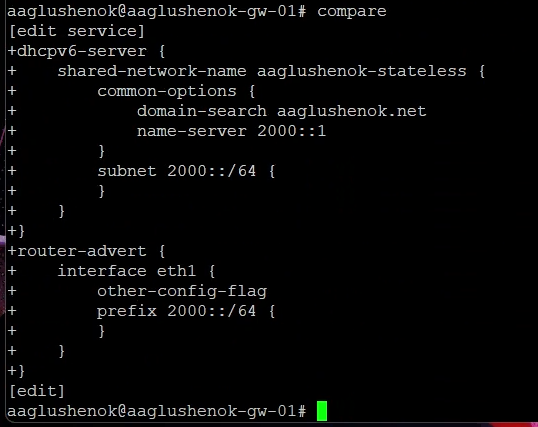{#fig:027
width="40%"}

## Настройка DHCP в случае IPv6

Затем просматриваем итоговую конфигурацию.

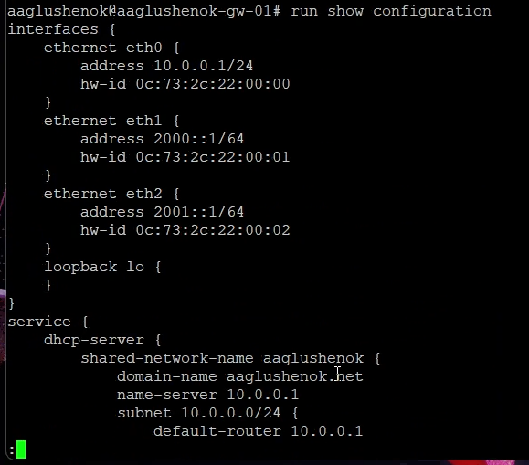{#fig:028
width="40%"}

## Настройка DHCP в случае IPv6

6.  На узлах AlmaLinux и AlpineLinuxVirt PC2 проверяем настройки сети.
    Сначала открываем консоль для AlmaLinux.

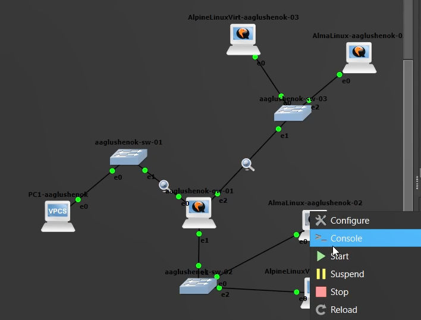{#fig:029
width="40%"}

## Настройка DHCP в случае IPv6

Далее открываем консоль для AlpineLinuxVirt.

{#fig:034 width="40%"}

## Настройка DHCP в случае IPv6

Далее проверяем настройки сети для AlmaLinux.

{#fig:030 width="60%"}

## Настройка DHCP в случае IPv6

Продолжаем проверку настроек.

{#fig:031 width="60%"}

## Настройка DHCP в случае IPv6

Затем проверяем настройки сети для AlpineLinuxVirt.

{#fig:035 width="60%"}

## Настройка DHCP в случае IPv6

7.  На узлах AlmaLinux и AlpineLinuxVirt PC2 пингуем маршрутизатор.
    Сначала для AlmaLinux.

{#fig:032 width="60%"}

## Настройка DHCP в случае IPv6

Затем для AlpineLinuxVirt.

{#fig:036 width="60%"}

## Настройка DHCP в случае IPv6

8.  На узлах AlmaLinux и AlpineLinuxVirt PC2 проверяем настройки DNS.
    Сначала для AlmaLinux.

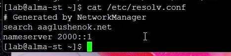{#fig:033
width="60%"}

## Настройка DHCP в случае IPv6

Затем для AlpineLinuxVirt.

{#fig:037 width="60%"}

## Настройка DHCP в случае IPv6

9.  На маршрутизаторе смотрим, выдается ли статистика DHCP-сервера и
    выданные адреса. Видим, что команда выполнилась и выдала статистику
    (сервис DHCPv6 уже поднят для stateless-сети), но список аренд
    пустой, так как, **для первой сети:** настроен режим без выдачи
    адресов (Stateless), а **для второй сети:** сервер выдачи адресов
    (Stateful) еще не настроен, и клиент PC3 пока не отправлял запрос.

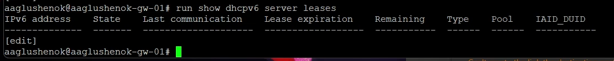{#fig:038
width="60%"}

## Настройка DHCP в случае IPv6

11. На маршрутизаторе настраиваем DHCPv6 с отслеживанием состояния:
    настраиваем объявления о маршрутизаторах, добавляем конфигурацию
    DHCP-сервера на маршрутизаторе.

{#fig:039 width="60%"}

## Настройка DHCP в случае IPv6

Проверяем внесенные изменения и сохраняем их.

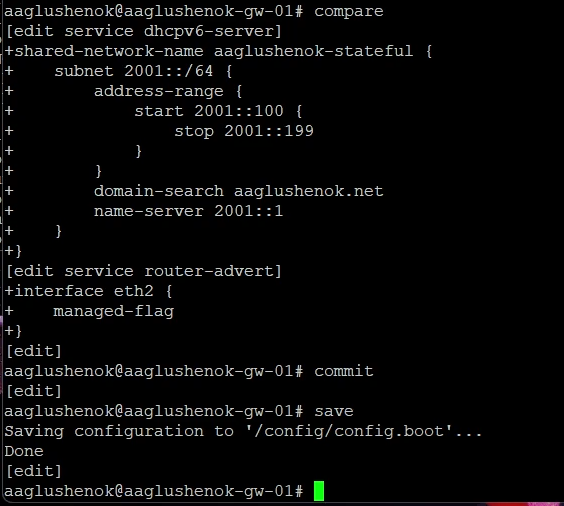{#fig:040
width="40%"}

## Настройка DHCP в случае IPv6

12. На маршрутизаторе смотрим статистику DHCP-сервера и выданные адреса:
    видим, что в таблице появились две активные аренды (2001::193 и
    2001::199).

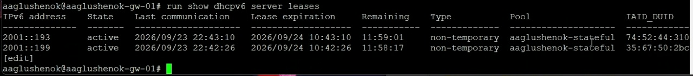{#fig:041
width="60%"}

## Настройка DHCP в случае IPv6

13. Подключаемся к узлу PC3 и проверяем настройки сети.
14. На узлах AlmaLinux и AlpineLinuxVirt PC3 проверяем настройки DNS.

Сначала для AlmaLinux.

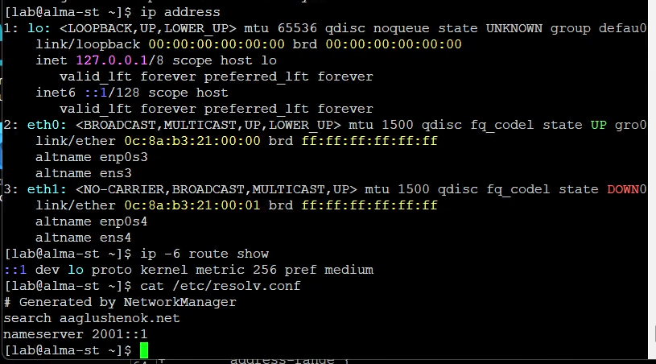{#fig:042
width="60%"}

## Настройка DHCP в случае IPv6

Затем для AlpineLinuxVirt.

{#fig:043 width="60%"}

## Настройка DHCP в случае IPv6

15. На узле AlpineLinuxVirt PC3 получаем адрес по DHCPv6.

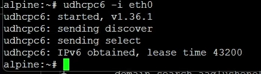{#fig:044
width="60%"}

## Настройка DHCP в случае IPv6

16. Вновь на узлах AlmaLinux и AlpineLinuxVirt PC3 проверяем настройки
    сети.

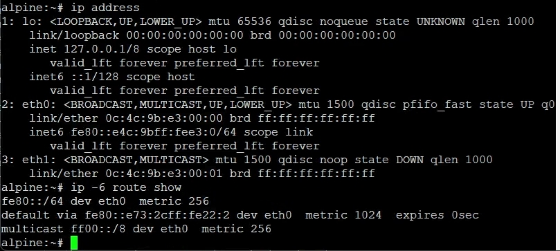{#fig:045 width="60%"}

## Настройка DHCP в случае IPv6

Далее пингуем маршрутизатор.

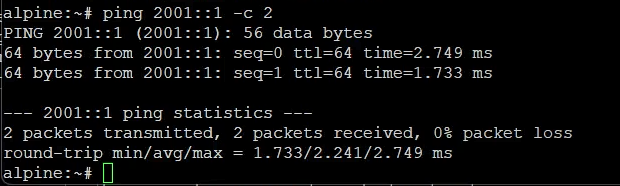{#fig:046
width="60%"}

## Настройка DHCP в случае IPv6

Затем проверяем настройки DNS.

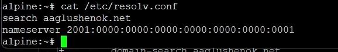{#fig:047 width="60%"}

## Настройка DHCP в случае IPv6

17. На маршрутизаторе смотрим статистику DHCP-сервера и выданные адреса:
    видим, что в таблице появились три активные аренды (2001::190,
    2001::193 и 2001::199).

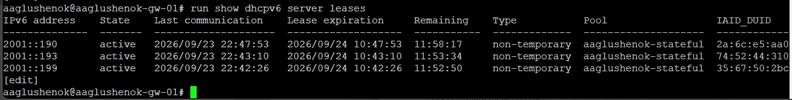{#fig:048
width="60%"}

## Настройка DHCP в случае IPv6

18. Анализируем захваченные анализатором трафика пакеты, относящиеся к
    работе DHCPv6 и назначению адреса устройству. Видим
    последовательность Solicit → Advertise → Request → Reply (и
    Information-request/Reply), подтверждающую работу DHCPv6 с
    отслеживанием состояния.

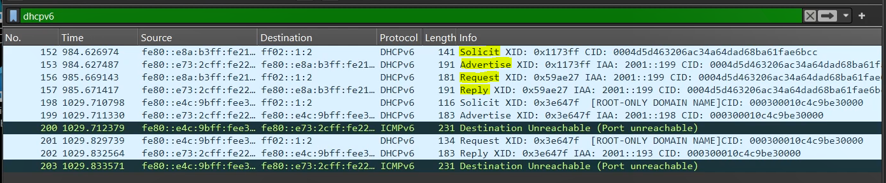{#fig:049
width="60%"}

# Выводы

## Выводы

В ходе выполнения лабораторной работы № 5 мне удалось получить навыки
настройки службы DHCP на сетевом оборудовании для распределения адресов
IPv4 и IPv6.

# Список литературы

## Список литературы

1.  IETF. RFC 2131: Dynamic Host Configuration Protocol \[Электронный
    ресурс\]. --- URL: https://datatracker.ietf.org/doc/html/rfc2131
    (дата обращения: 07.11.2026).

2.  IETF. RFC 3315: Dynamic Host Configuration Protocol for IPv6
    (DHCPv6) \[Электронный ресурс\]. --- URL:
    https://datatracker.ietf.org/doc/html/rfc3315 (дата обращения:
    07.11.2026).

3.  IETF. RFC 8415: Dynamic Host Configuration Protocol for IPv6
    (DHCPv6bis) \[Электронный ресурс\]. --- URL:
    https://datatracker.ietf.org/doc/html/rfc8415 (дата обращения:
    07.11.2026).

4.  IETF. RFC 4862: IPv6 Stateless Address Autoconfiguration
    \[Электронный ресурс\]. --- URL:
    https://datatracker.ietf.org/doc/html/rfc4862 (дата обращения:
    07.11.2026).

5.  IETF. RFC 4861: Neighbor Discovery for IP version 6 (IPv6)
    \[Электронный ресурс\]. --- URL:
    https://datatracker.ietf.org/doc/html/rfc4861 (дата обращения:
    07.11.2026).

6.  VyOS Documentation \[Электронный ресурс\]. --- URL:
    https://docs.vyos.io/ (дата обращения: 07.11.2026).
