---
## Front matter
title: "Лабораторная работа № 5. Адресация IPv4 и IPv6. Настройка DHCP"
subtitle: "Отчет"
author: "Анна Александровна Глушенок"

## Generic options
lang: ru-RU
toc-title: "Содержание"

## Pdf output format
toc: true
toc-depth: 2
lof: false
lot: false
fontsize: 12pt
linestretch: 1.5
papersize: a4
documentclass: scrreprt

## I18n babel
babel-lang: russian
babel-otherlangs: english

## Fonts
mainfont: Liberation Serif
sansfont: Liberation Sans
monofont: Liberation Mono

## Pandoc-crossref LaTeX customization
figureTitle: "Рис."
tableTitle: "Таблица"

## Misc options
indent: true
header-includes:
  - \usepackage{indentfirst}
  - \usepackage{float}
  - \floatplacement{figure}{H}
---

# Цель работы

Получение навыков настройки службы DHCP на сетевом оборудовании для распределения адресов IPv4 и IPv6.

# Задание

1. Настроить DHCP в случае IPv4.
2. Настроить DHCP в случае IPv6.

# Выполнение лабораторной работы

## Настройка DHCP в случае IPv4

1. Запускаем GNS3 VM и GNS3. Создаем новый проект, называем его lab5.

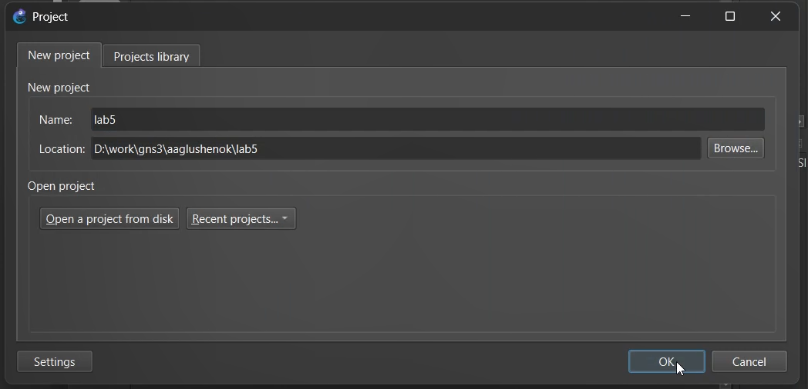{#fig:000 width=60%}

2. В рабочем пространстве размещаем и соединяем устройства в соответствии с первой топологией.
3. Меняем отображаемые названия устройств. 

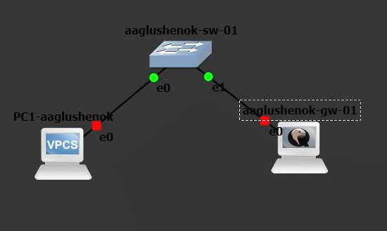{#fig:001 width=60%}

4. Включаем захват трафика на соединении между коммутатором и маршрутизатором. На маршрутизаторе меняем имя устройства, доменное имя и системного пользователя, отключаем dhcp для  eth0.

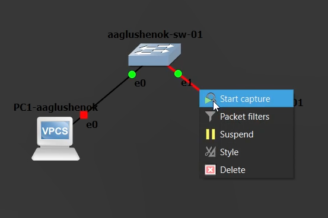{#fig:002 width=60%}

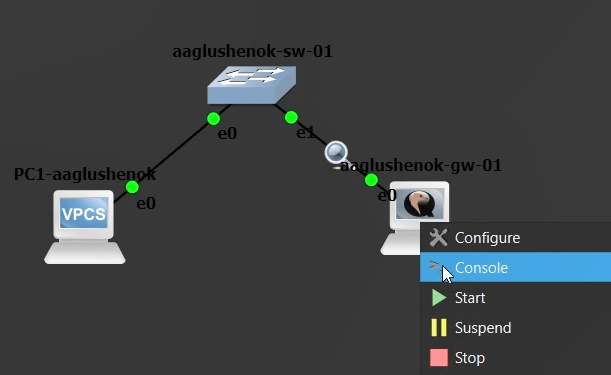{#fig:003 width=60%}

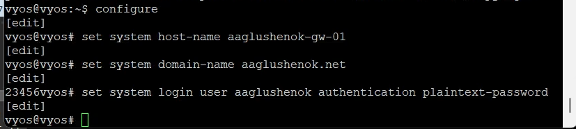{#fig:004 width=60%}

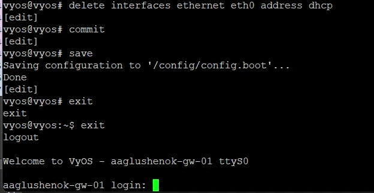{#fig:005 width=60%}

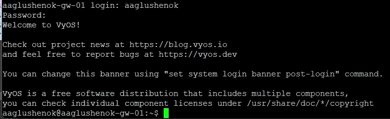{#fig:006 width=60%}

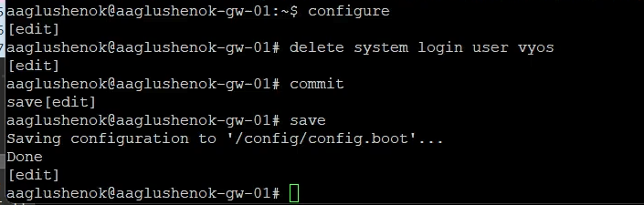{#fig:007 width=60%}

5. На маршрутизаторе под созданным пользователем настраиваем адресацию IPv4.

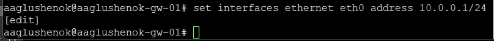{#fig:008 width=60%}

6. Добавляем конфигурацию DHCP-сервера на маршрутизаторе: создаем разделяемую сеть, подсеть с адресом 10.0.0.0/24, задаем диапазон адресов.

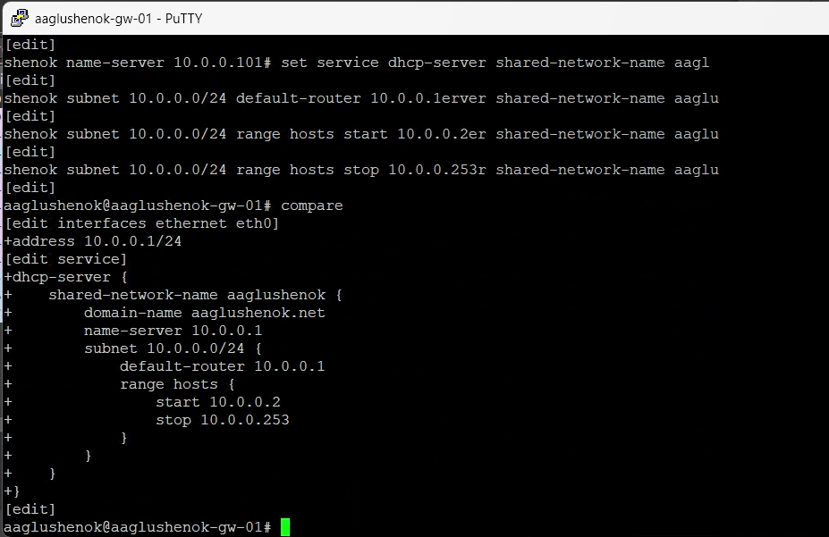{#fig:009 width=60%}

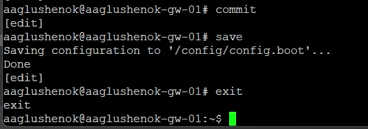{#fig:010 width=60%}

7. Просматриваем статистику DHCP-сервера и выданные адреса.

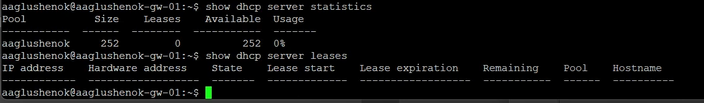{#fig:011 width=60%}

8. Настраиваем оконечное устройство PC1.

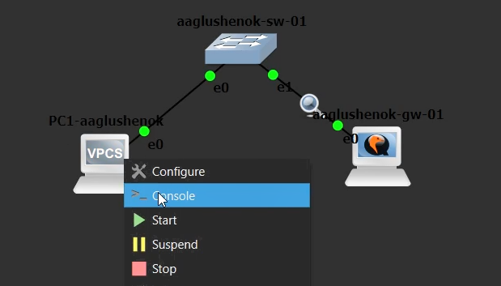{#fig:012 width=60%}

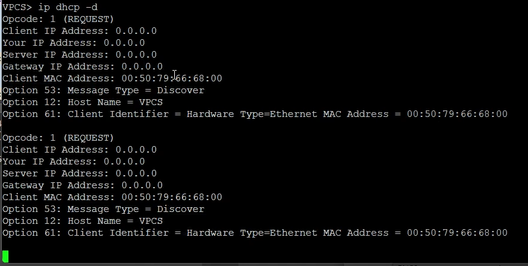{#fig:013 width=60%}

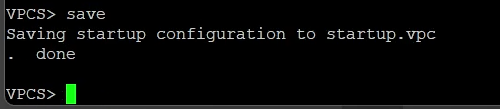{#fig:014 width=60%}

**Пояснение к полученной на экране PC1 информации:** Видим, что PC1 успешно отправил широковещательный запрос DHCP Discover на поиск DHCP-сервера. Запрос содержит MAC-адрес и имя устройства. Так как это только начальная стадия получения адреса, сам IP-адрес еще не получен (все адресные поля равны 0.0.0.0).

9. Проверяем конфигурацию IPv4 на узле, пингуем маршрутизатор.

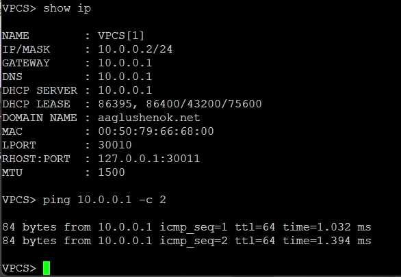{#fig:015 width=60%}

10. На маршрутизаторе вновь просматриваем статистику DHCP-сервера и выданные адреса.

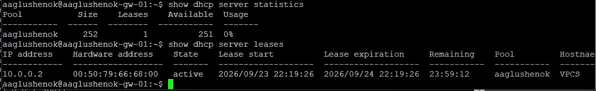{#fig:016 width=60%}

**Пояснение к полученной информации:** Видим, что после включения клиента PC1 статистика изменилась: счетчик Leases вырос с 0 до 1, а Available уменьшился с 252 до 251, при этом в таблице аренд появилась активная запись для IP 10.0.0.2 с MAC-адресом клиента и сроком аренды на 24 часа. Это произошло потому, что виртуальный ПК успешно отправил DHCP-запрос, и сервер выделил ему первый свободный адрес из настроенного пула, зарезервировав его за устройством на заданное время.

11. На маршрутизаторе просматриваем журнал работы DHCP-сервера: записи подтверждают, что служба DHCP успешно запустилась и обновила файл аренд, а также что сервер корректно проигнорировал запросы на интерфейсах eth1 и eth2 из-за отсутствия на них настроенных IPv4-подсетей.

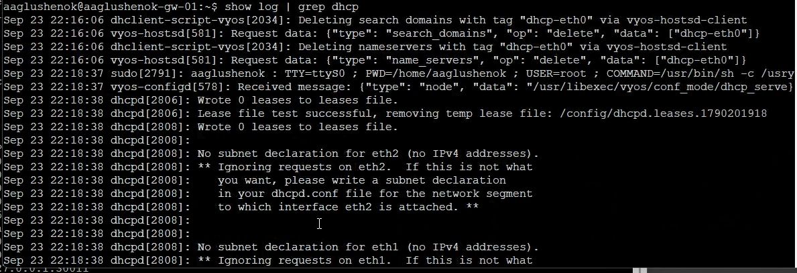{#fig:017 width=60%}

12. Анализируем захваченные анализатором трафика пакеты, относящиеся к работе DHCP и назначению адреса устройству: захваченный трафик наглядно демонстрирует стандартный процесс аренды адреса по протоколу DHCP (Discover -> Offer -> Request -> ACK), в результате которого устройству PC1 был успешно назначен IP-адрес 10.0.0.2.

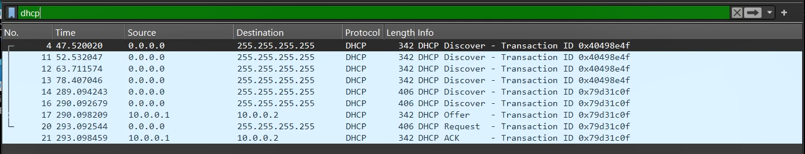{#fig:018 width=60%}

## Настройка DHCP в случае IPv6

1. Дополняем сеть в соответствии со второй топологией.
2. Меняем отображаемые названия устройств. 

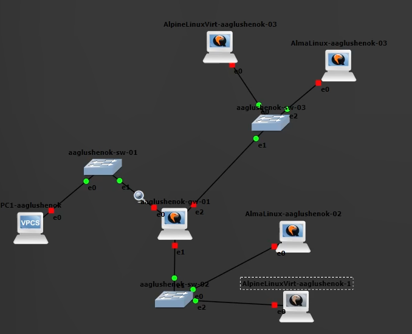{#fig:019 width=60%}

3. Включаем захват трафика на соединениях между маршрутизатором и коммутаторами.

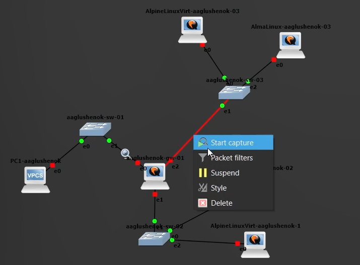{#fig:020 width=60%}

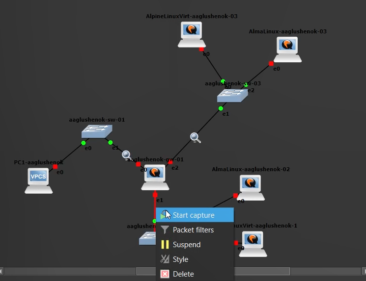{#fig:021 width=60%}

4. Настраиваем адресацию IPv6 на маршрутизаторе.

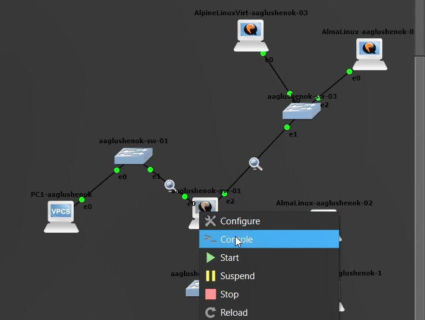{#fig:022 width=60%}

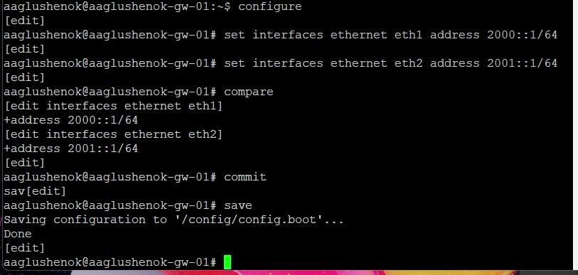{#fig:023 width=60%}

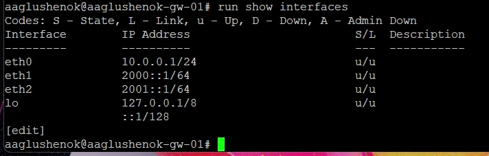{#fig:024 width=60%}

5. На маршрутизаторе настраиваем DHCPv6 без отслеживания состояния.

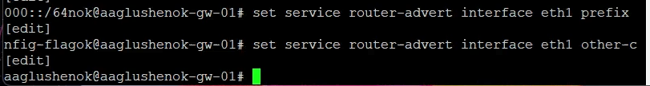{#fig:025 width=60%}

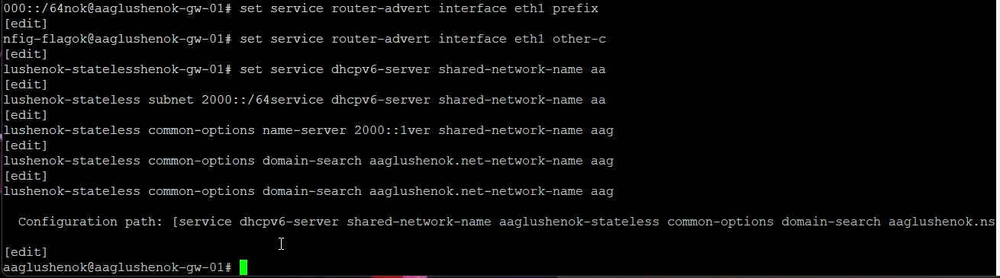{#fig:026 width=60%}

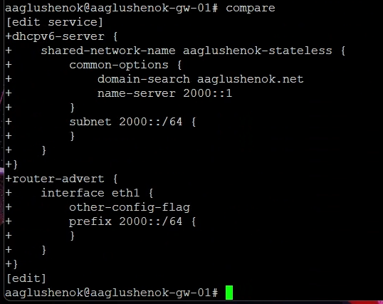{#fig:027 width=60%}

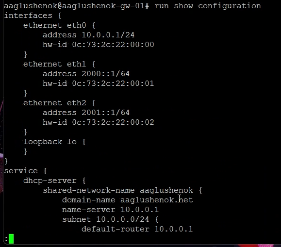{#fig:028 width=60%}

6. На узлах AlmaLinux и AlpineLinuxVirt PC2 проверяем настройки сети.
7. На узлах AlmaLinux и AlpineLinuxVirt PC2 пингуем маршрутизатор.
8. На узлах AlmaLinux и AlpineLinuxVirt PC2 проверяем настройки DNS.

**Для AlmaLinux:**

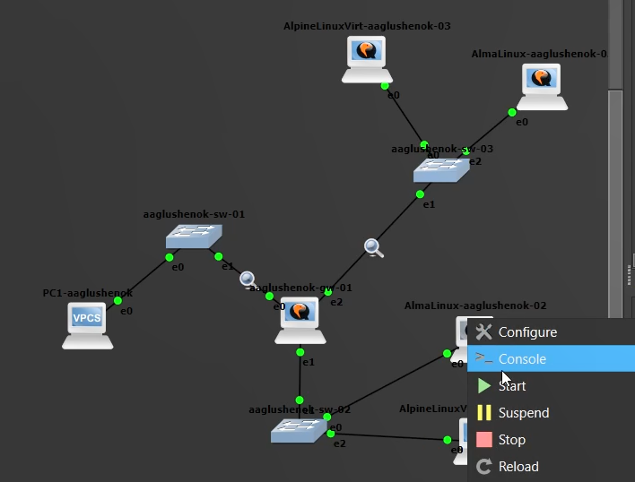{#fig:029 width=60%}

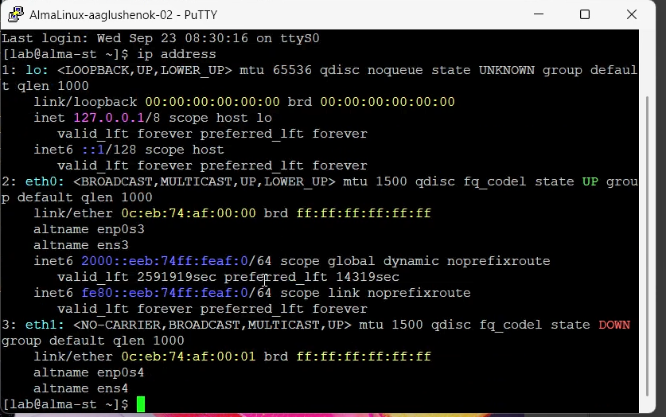{#fig:030 width=60%}

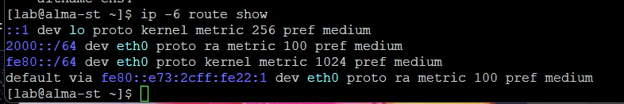{#fig:031 width=60%}

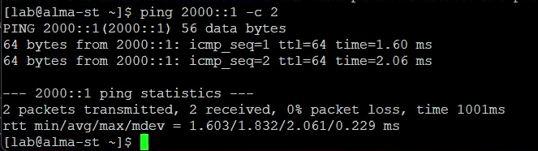{#fig:032 width=60%}

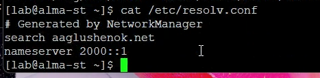{#fig:033 width=60%}

**Для AlpineLinuxVirt:**

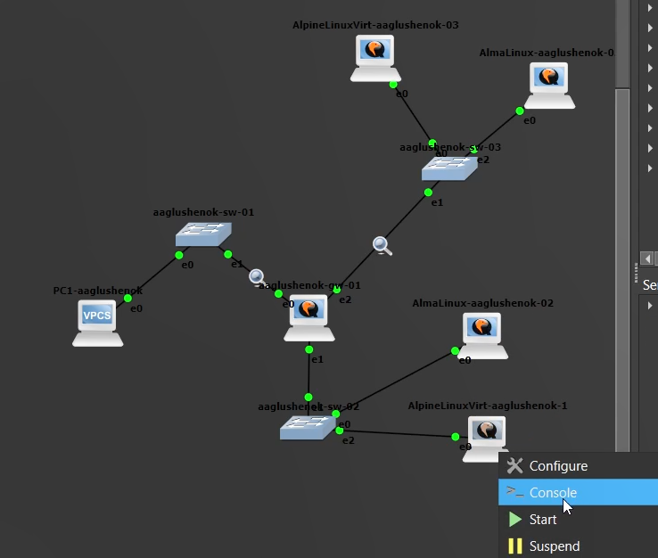{#fig:034 width=60%}

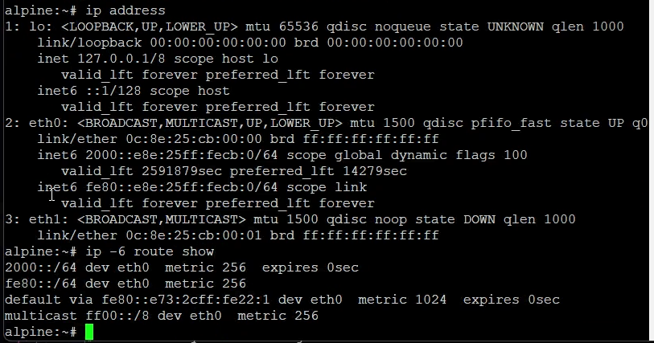{#fig:035 width=60%}

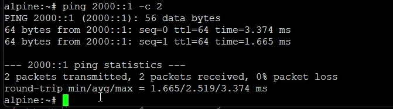{#fig:036 width=60%}

{#fig:037 width=60%}

9. На маршрутизаторе смотрим, выдается ли статистика DHCP-сервера и выданные адреса. Видим, что команда выполнилась и выдала статистику (сервис DHCPv6 уже поднят для stateless-сети), но список аренд пустой, так как, **для первой сети:** настроен режим без выдачи адресов (Stateless), а **для второй сети:** сервер выдачи адресов (Stateful) еще не настроен, и клиент PC3 пока не отправлял запрос.

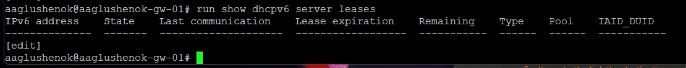{#fig:038 width=60%}

11. На маршрутизаторе настраиваем DHCPv6 с отслеживанием состояния: настраиваем объявления о маршрутизаторах, добавляем конфигурацию DHCP-сервера на маршрутизаторе.

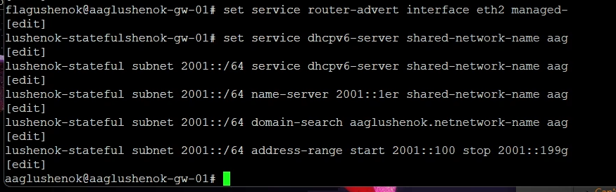{#fig:039 width=60%}

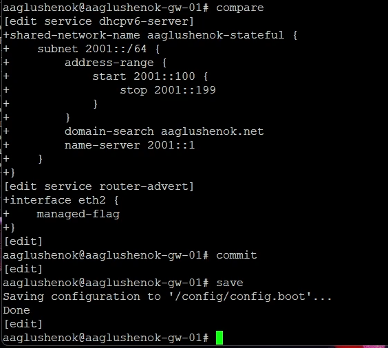{#fig:040 width=60%}

12. На маршрутизаторе смотрим статистику DHCP-сервера и выданные адреса: видим, что в таблице появились две активные аренды (2001::193 и 2001::199).

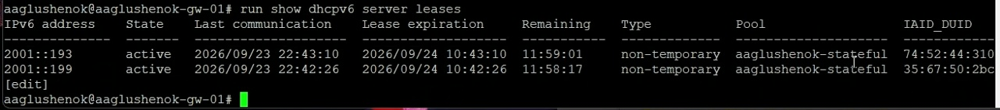{#fig:041 width=60%}

13. Подключаемся к узлу PC3 и проверяем настройки сети.
14. На узлах AlmaLinux и AlpineLinuxVirt PC3 проверяем настройки DNS.

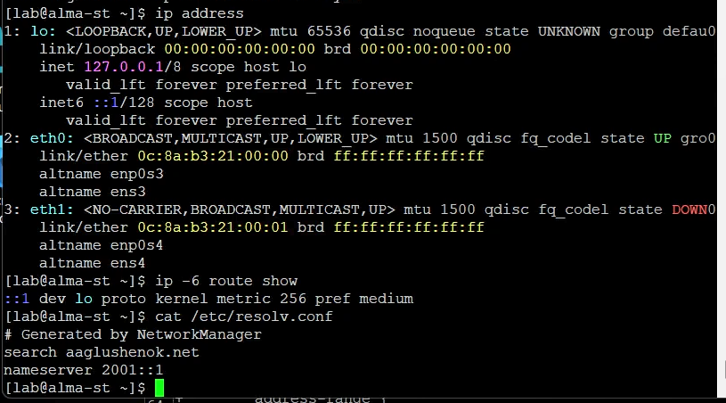{#fig:042 width=60%}

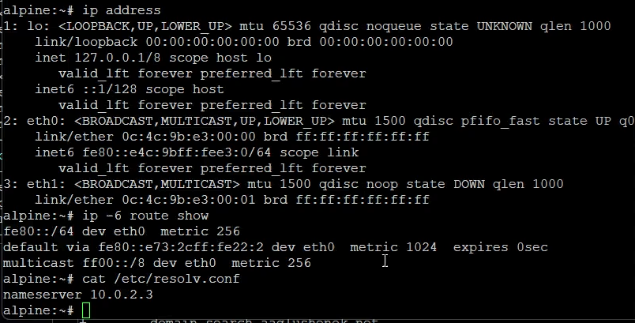{#fig:043 width=60%}

15. На узле AlpineLinuxVirt PC3 получаем адрес по DHCPv6.

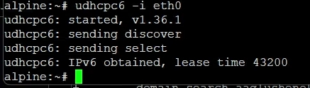{#fig:044 width=60%}

16. Вновь на узлах AlmaLinux и AlpineLinuxVirt PC3 проверяем настройки сети, пингуем маршрутизатор, проверяем настройки DNS.

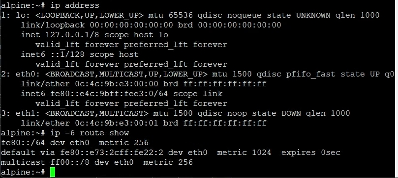{#fig:045 width=60%}

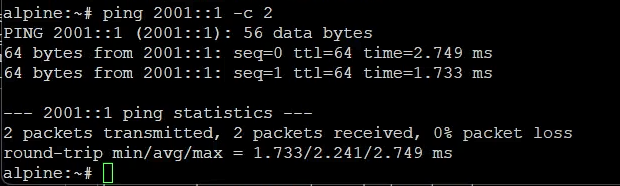{#fig:046 width=60%}

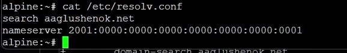{#fig:047 width=60%}

17. На маршрутизаторе смотрим статистику DHCP-сервера и выданные адреса: видим, что в таблице появились три активные аренды (2001::190, 2001::193 и 2001::199). 

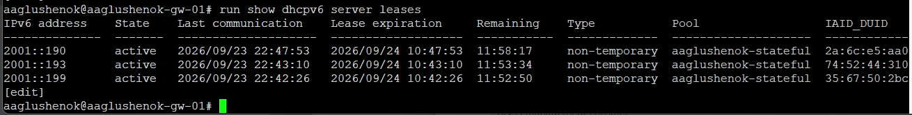{#fig:048 width=60%}

18. Анализируем захваченные анализатором трафика пакеты, относящиеся к работе DHCPv6 и назначению адреса устройству. Видим последовательность Solicit → Advertise → Request → Reply (и Information-request/Reply), подтверждающую работу DHCPv6 с отслеживанием состояния.

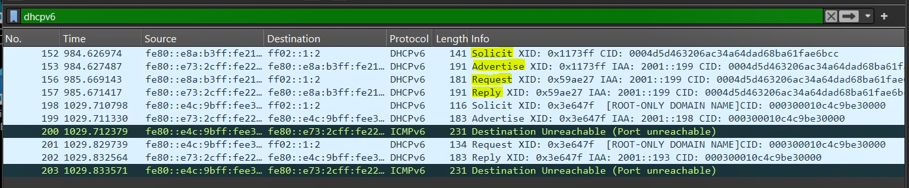{#fig:049 width=60%}

# Выводы

В ходе выполнения лабораторной работы № 5 мне удалось получить навыки настройки службы DHCP на сетевом оборудовании для распределения адресов IPv4 и IPv6.

# Список литературы 

1. IETF. RFC 2131: Dynamic Host Configuration Protocol [Электронный ресурс]. — URL: https://datatracker.ietf.org/doc/html/rfc2131 (дата обращения: 07.11.2026).

2. IETF. RFC 3315: Dynamic Host Configuration Protocol for IPv6 (DHCPv6) [Электронный ресурс]. — URL: https://datatracker.ietf.org/doc/html/rfc3315 (дата обращения: 07.11.2026).

3. IETF. RFC 8415: Dynamic Host Configuration Protocol for IPv6 (DHCPv6bis) [Электронный ресурс]. — URL: https://datatracker.ietf.org/doc/html/rfc8415 (дата обращения: 07.11.2026).

4. IETF. RFC 4862: IPv6 Stateless Address Autoconfiguration [Электронный ресурс]. — URL: https://datatracker.ietf.org/doc/html/rfc4862 (дата обращения: 07.11.2026).

5. IETF. RFC 4861: Neighbor Discovery for IP version 6 (IPv6) [Электронный ресурс]. — URL: https://datatracker.ietf.org/doc/html/rfc4861 (дата обращения: 07.11.2026).

6. VyOS Documentation [Электронный ресурс]. — URL: https://docs.vyos.io/ (дата обращения: 07.11.2026).

