---
## Front matter
lang: ru-RU
title: Лабораторная работа № 6. Адресация IPv4 и IPv6. Настройка маршрутизации по протоколу RIP
subtitle: Презентация
author:
  - Глушенок А. А.
institute:
  - Российский университет дружбы народов, Москва, Россия
date: 20 ноября 2026

## Formatting pdf
toc: false
slide_level: 2
aspectratio: 169
section-titles: true
theme: metropolis
header-includes:
 - \metroset{progressbar=frametitle,sectionpage=progressbar,numbering=fraction}
 - \usepackage{graphicx}
 - \usepackage{caption}
 - \captionsetup{labelformat=empty, labelsep=none}
 
## Fonts
mainfont: Liberation Serif
sansfont: PT Sans
monofont: Liberation Mono
---

# Информация

## Докладчик

:::::::::::::: {.columns align=center}
::: {.column width="70%"}

  * Глушенок Анна Александровна
  * Российский университет дружбы народов
  * Группа: НПИбд-01-24
  * Студенческий билет: 1132246844

:::
::: {.column width="30%"}

:::
::::::::::::::

## Цель работы

Изучение принципов маршрутизации по протоколу RIP в IPv4- и IPv6-сетях и принципов настройки сетевого оборудования.

## Задание

- Требуется настроить динамическую маршрутизацию по протоколу RIP, для заданной сети (рис. 6.1), адресов сегментов сети (табл. 6.1), и адресов назначаемых интерфейсам устройств (рис. 6.1).
- Выполнить задание для самостоятельной работы.

# Выполнение лабораторной работы

# Топология моделируемой сети

## Топология моделируемой сети

1. Запускаем GNS3 VM и GNS3. Создаем новый проект, называем lab6.

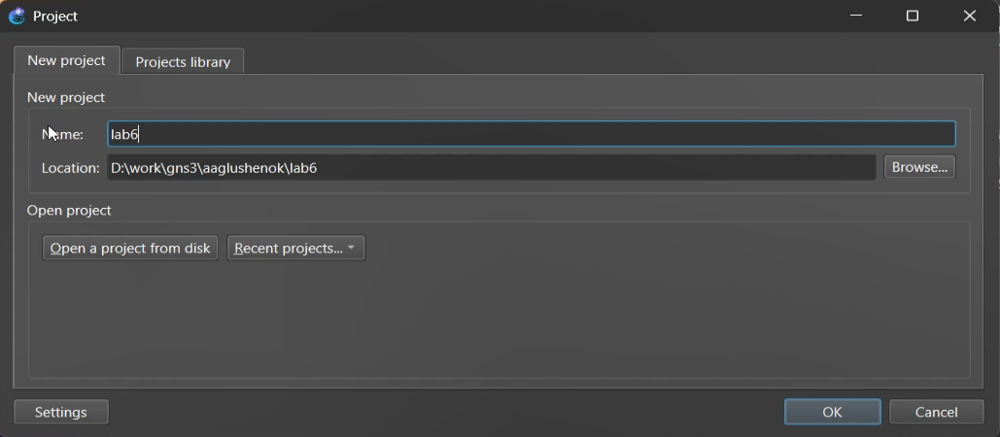{#fig:000 width=60%}

## Топология моделируемой сети

2. Размещаем устройства в соответствии с топологией, приведённой на рис. 6.1.
3. Меняем отображаемые названия устройств.

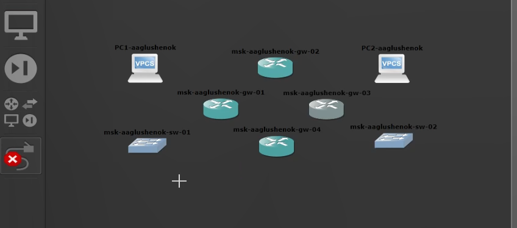{#fig:001 width=60%}

## Топология моделируемой сети

4. Соединяем устройства в соответствии с топологией, приведённой на рис. 6.1. Включаем захват трафика на соединении между коммутатором sw-01 и маршрутизатором gw-01, между коммутатором sw-02 и маршрутизатором gw-03.

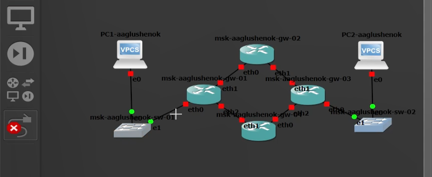{#fig:002 width=60%}

## Топология моделируемой сети

5. Присваиваем IPv4-адреса оконечным устройствам PC1 и PC2.

PC1:

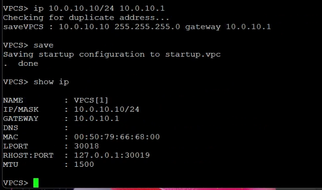{#fig:003 width=60%}

## Топология моделируемой сети

PC2:

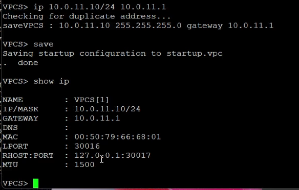{#fig:004 width=60%}

## Топология моделируемой сети

6. Настраиваем IPv4-адреса на интерфейсах маршрутизаторов.

msk-aaglushenok-gw-01:

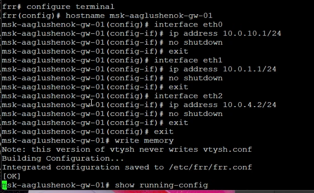{#fig:005 width=60%}

## Топология моделируемой сети

Проверяем правильность настроек перед сохранением.

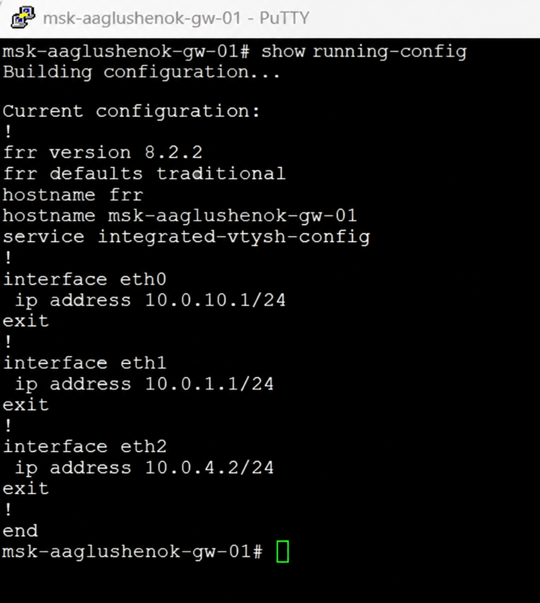{#fig:006 width=35%}

## Топология моделируемой сети

msk-aaglushenok-gw-02:

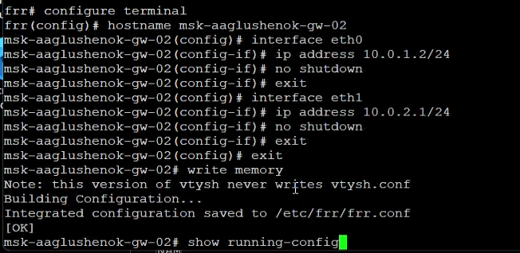{#fig:007 width=60%}

## Топология моделируемой сети

Проверяем правильность настроек перед сохранением.

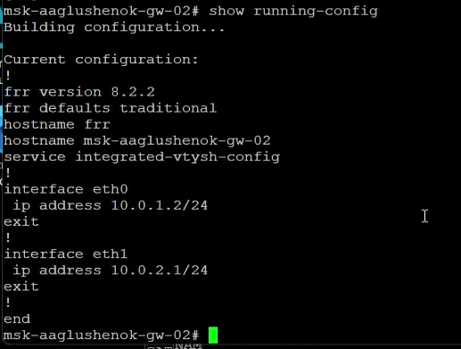{#fig:008 width=50%}

## Топология моделируемой сети

msk-aaglushenok-gw-03:

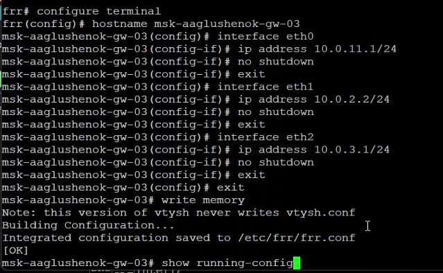{#fig:009 width=60%}

## Топология моделируемой сети

Проверяем правильность настроек перед сохранением.

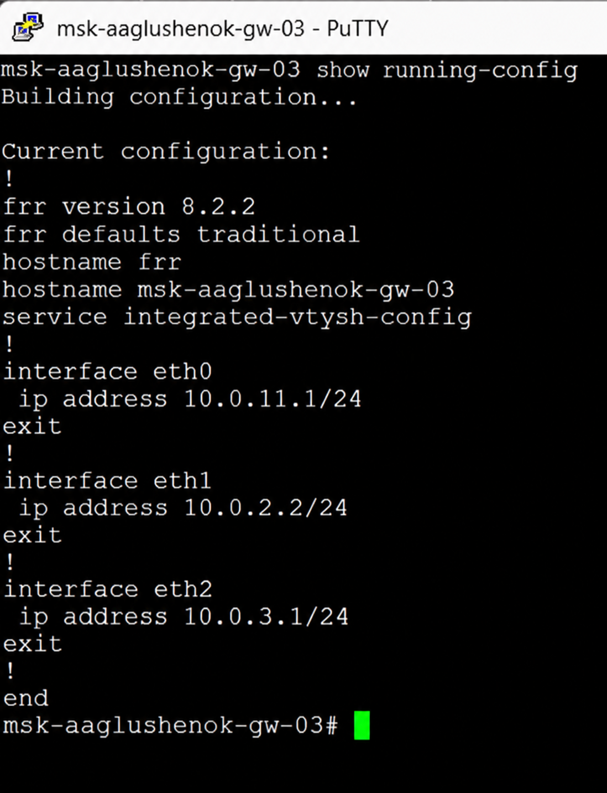{#fig:010 width=30%}

## Топология моделируемой сети

msk-aaglushenok-gw-04:

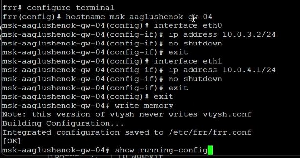{#fig:011 width=60%}

## Топология моделируемой сети

Проверяем правильность настроек перед сохранением.

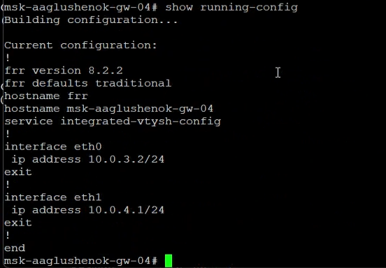{#fig:012 width=60%}

## Топология моделируемой сети

7. Присваиваем IPv6-адреса оконечным устройствам PC1 и PC2.

PC1:

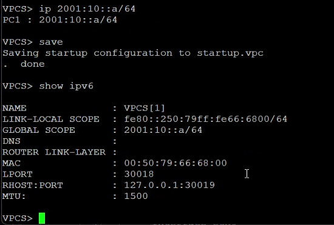{#fig:013 width=50%}

## Топология моделируемой сети

PC2:

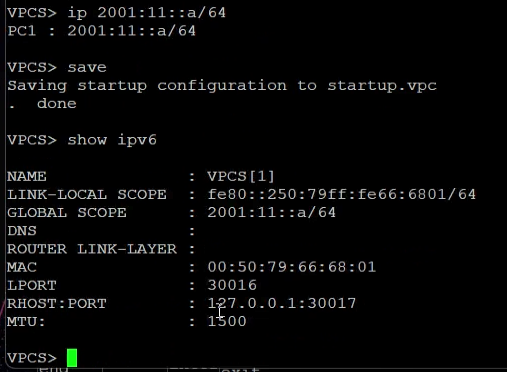{#fig:014 width=45%}

## Топология моделируемой сети

8. Настраиваем IPv6-адреса на интерфейсах маршрутизаторов.

msk-aaglushenok-gw-01:

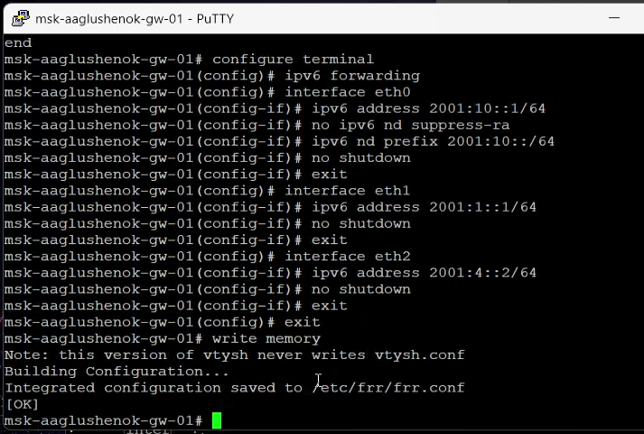{#fig:015 width=50%}

## Топология моделируемой сети

msk-aaglushenok-gw-02:

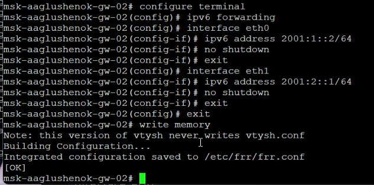{#fig:016 width=60%}

## Топология моделируемой сети

msk-aaglushenok-gw-03:

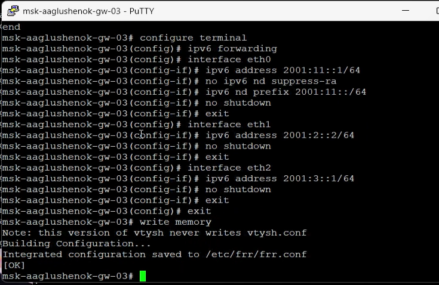{#fig:017 width=60%}

## Топология моделируемой сети

msk-aaglushenok-gw-04:

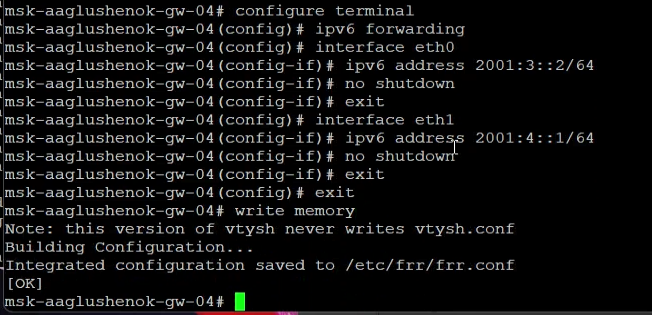{#fig:018 width=60%}

# Настройка динамической маршрутизации по протоколу RIP

## Настройка динамической маршрутизации по протоколу RIP

1. На маршрутизаторах настраиваем RIP в качестве протокола динамической маршрутизации.

msk-aaglushenok-gw-01:

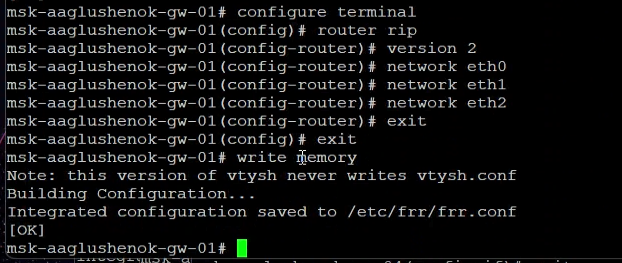{#fig:019 width=60%}

## Настройка динамической маршрутизации по протоколу RIP.

msk-aaglushenok-gw-02:

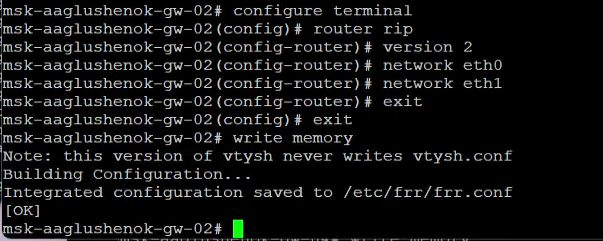{#fig:020 width=60%}

## Настройка динамической маршрутизации по протоколу RIP.

msk-aaglushenok-gw-03:

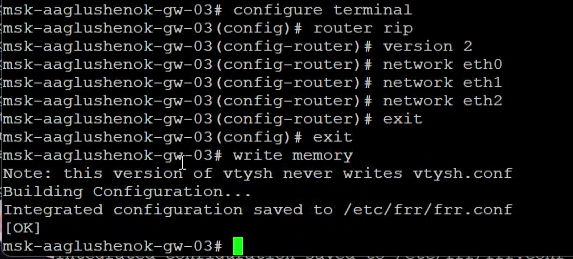{#fig:021 width=60%}

## Настройка динамической маршрутизации по протоколу RIP.

msk-aaglushenok-gw-04:

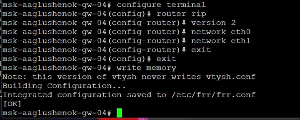{#fig:022 width=60%}

## Настройка динамической маршрутизации по протоколу RIP.

2. Убеждаемся, что маршрутизация по RIP настроена.

Проверка через show ip route rip.

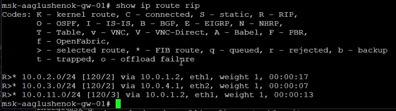{#fig:023 width=60%}

## Настройка динамической маршрутизации по протоколу RIP.

Проверка через show ip rip.

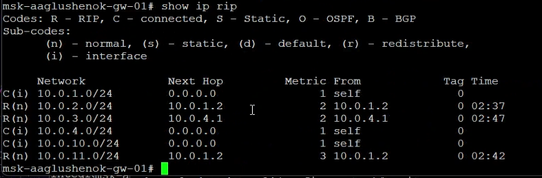{#fig:024 width=60%}

## Настройка динамической маршрутизации по протоколу RIP.

Проверка через show ip rip status.

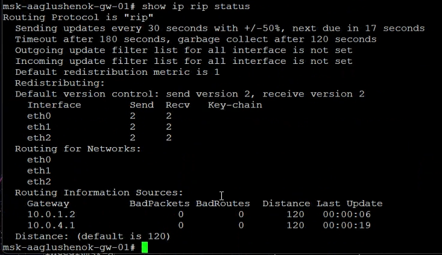{#fig:025 width=60%}

## Настройка динамической маршрутизации по протоколу RIP.

3. Проверяем пути прохождения пакетов.

С PC1 пингуем на PC2 (пакеты дошли успешно, путь следования: PC1 → gw-01 → gw-02 → gw-03 → PC2).

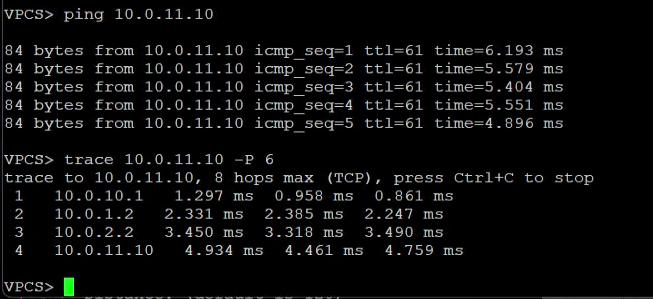{#fig:026 width=60%}

## Настройка динамической маршрутизации по протоколу RIP.

Отключаем на маршрутизаторе msk-aaglushenok-gw-02 интерфейс eth0.

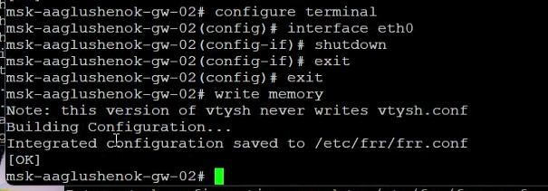{#fig:027 width=60%}

## Настройка динамической маршрутизации по протоколу RIP.

Проверяем метрики протокола RIP.

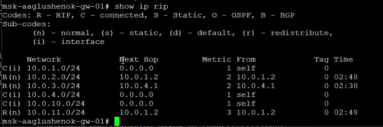{#fig:028 width=60%}

## Настройка динамической маршрутизации по протоколу RIP.

С PC1 пингуем на PC2 (пакеты НЕ дошли до PC2, так как интерфейс eth0 на маршрутизаторе msk-aaglushenok-gw-02 мы отключили на предыдущем шаге).

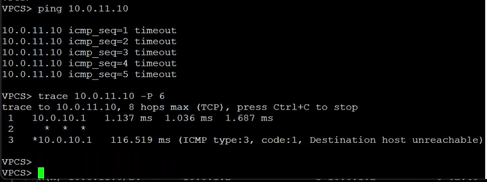{#fig:029 width=60%}

## Настройка динамической маршрутизации по протоколу RIP.

Обратно включаем на маршрутизаторе msk-aaglushenok-gw-02 интерфейс eth0.

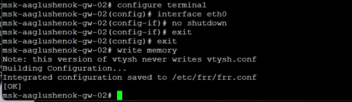{#fig:030 width=60%}

## Настройка динамической маршрутизации по протоколу RIP.

С PC1 пингуем на PC2 (пакеты дошли успешно, путь следования вернулся на исходный: PC1 → gw-01 → gw-02 → gw-03 → PC2).

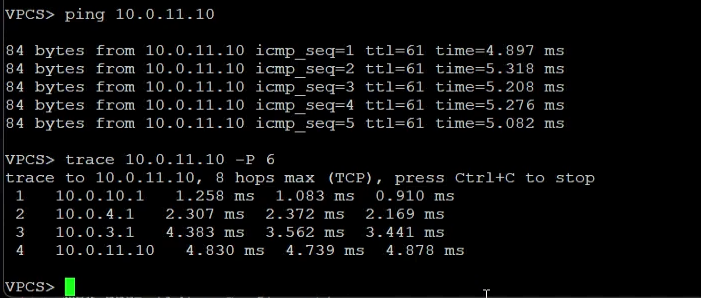{#fig:031 width=60%}

## Настройка динамической маршрутизации по протоколу RIP.

Смотрим захваченный на соединениях трафик по протоколу RIP, видим успешный обмен пакетами: отправку запросов (Request) и получение ответов (Response). 

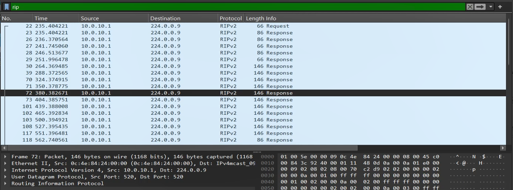{#fig:032 width=60%}

## Настройка динамической маршрутизации по протоколу RIP.

4. На маршрутизаторах настраиваем RIPng для сетей IPv6.

msk-aaglushenok-gw-01:

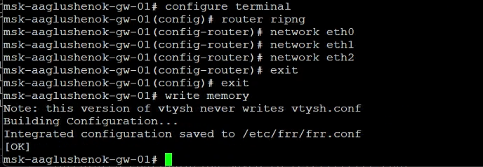{#fig:033 width=60%}

## Настройка динамической маршрутизации по протоколу RIP.

msk-aaglushenok-gw-02:

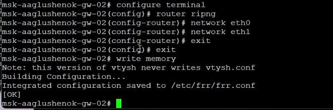{#fig:034 width=60%}

## Настройка динамической маршрутизации по протоколу RIP.

msk-aaglushenok-gw-03:

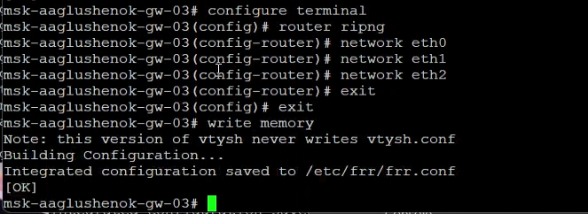{#fig:035 width=60%}

## Настройка динамической маршрутизации по протоколу RIP.

msk-aaglushenok-gw-04:

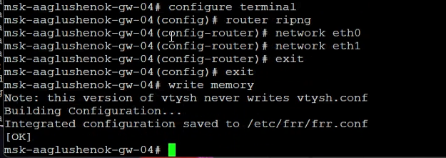{#fig:036 width=60%}

## Настройка динамической маршрутизации по протоколу RIP.

5. Проверяем пути прохождения пакетов.

С PC1 пингуем на PC2 (пакеты дошли успешно, путь следования: PC1 → gw-01 → gw-02 → gw-03 → PC2).

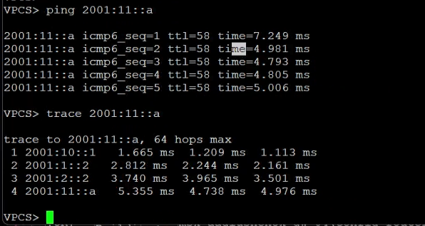{#fig:037 width=60%}

## Настройка динамической маршрутизации по протоколу RIP.

Проверяем метрики протокола RIP.

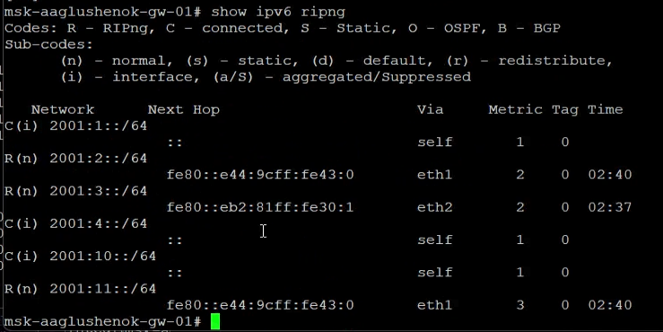{#fig:038 width=60%}

## Настройка динамической маршрутизации по протоколу RIP.

Снова отключаем на маршрутизаторе msk-aaglushenok-gw-02 интерфейс eth0.

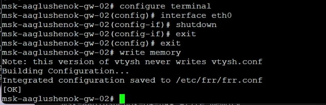{#fig:039 width=60%}

## Настройка динамической маршрутизации по протоколу RIP.

Проверяем метрики протокола RIPng.

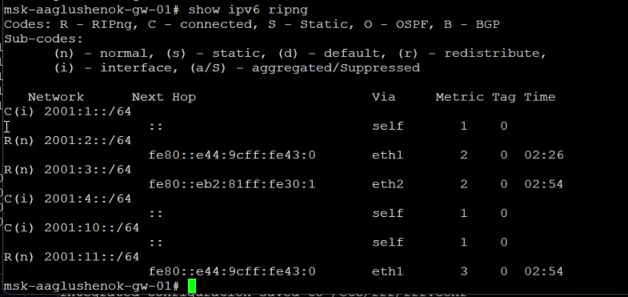{#fig:040 width=60%}

## Настройка динамической маршрутизации по протоколу RIP.

С PC1 пингуем на PC2 (пакеты НЕ дошли до PC2, так как интерфейс eth0 на маршрутизаторе msk-aaglushenok-gw-02 мы отключили на предыдущем шаге).

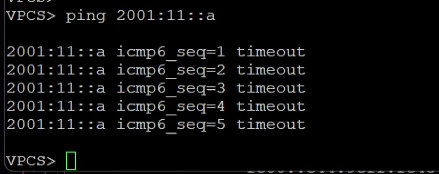{#fig:041 width=60%}

## Настройка динамической маршрутизации по протоколу RIP.

Проверяем метрики протокола RIPng (видим, что после отключения интерфейса eth0 на маршрутизаторе msk-aaglushenok-gw-02 протокол RIPng перестроил таблицу маршрутизации: PC1 → gw-01 → gw-04 → gw-03 → PC2).

{#fig:042 width=60%}

## Настройка динамической маршрутизации по протоколу RIP.

Обратно включаем на маршрутизаторе msk-aaglushenok-gw-02 интерфейс eth0.

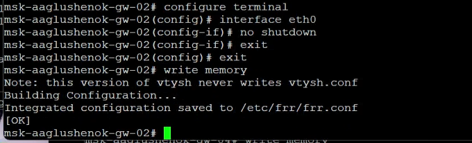{#fig:043 width=60%}

## Настройка динамической маршрутизации по протоколу RIP.

С PC1 пингуем на PC2 (пакеты дошли успешно, путь следования вернулся на кратчайший: PC1 → gw-01 → gw-02 → gw-03 → PC2).

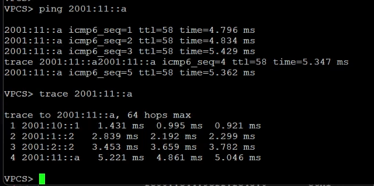{#fig:044 width=60%}

## Настройка динамической маршрутизации по протоколу RIP.

Смотрим захваченный на соединениях трафик по протоколу RIPng, видим успешный обмен пакетами: отправку запросов (Request) и получение ответов (Response).

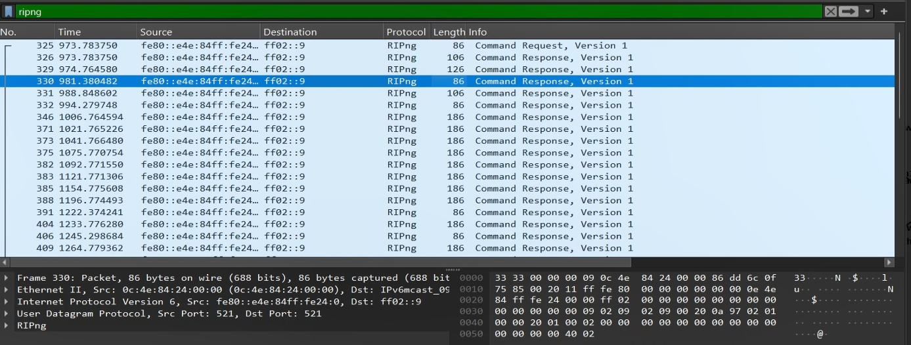{#fig:045 width=60%}

# Задание для самостоятельного выполнения

## Задание для самостоятельного выполнения

1. Запускаем GNS3 VM и GNS3. Создаем новый проект.
2. Размещаем и соединяем устройства в соответствии с топологией, приведённой на рис. 6.2.
3. Меняем отображаемые названия устройств.

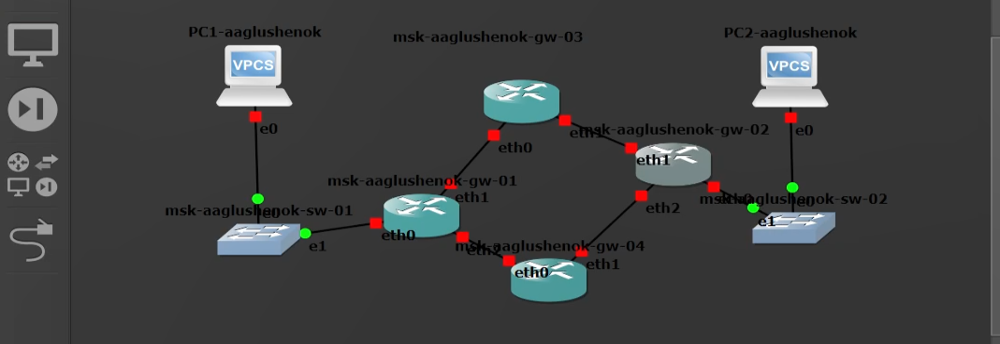{#fig:046 width=60%}

## Задание для самостоятельного выполнения

4. Настраиваем IPv4 и IPv6 адреса оконечным устройствам PC1 и PC2.

PC1:

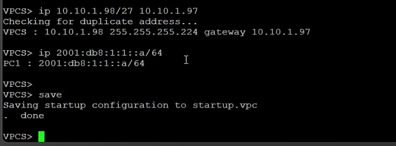{#fig:047 width=60%}

## Задание для самостоятельного выполнения

Проверяем правильность настроек перед сохранением.

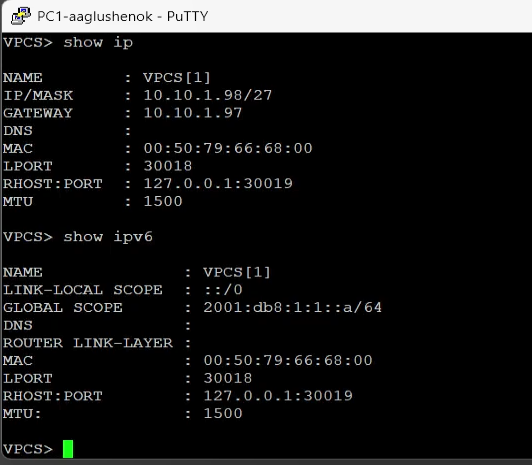{#fig:048 width=40%}

## Задание для самостоятельного выполнения

PC2:

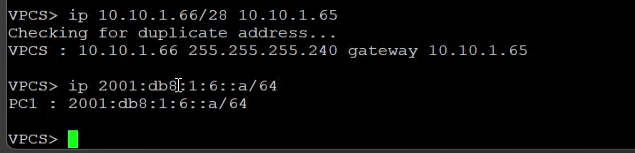{#fig:049 width=60%}

## Задание для самостоятельного выполнения

Проверяем правильность настроек перед сохранением.

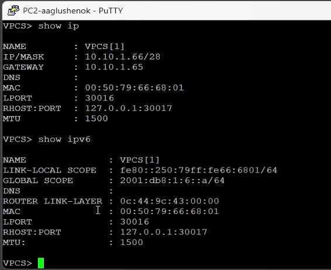{#fig:050 width=40%}

## Задание для самостоятельного выполнения

5. Настраиваем конфигурацию маршрутизаторов. 

msk-aaglushenok-gw-01:

{#fig:051 width=40%}

## Задание для самостоятельного выполнения

msk-aaglushenok-gw-02:

{#fig:052 width=40%}

## Задание для самостоятельного выполнения

msk-aaglushenok-gw-03:

{#fig:053 width=60%}

## Задание для самостоятельного выполнения

msk-aaglushenok-gw-04:

{#fig:054 width=60%}

## Задание для самостоятельного выполнения

6. Проверяем метрики протоколов RIP и RIPng.

{#fig:055 width=35%}

## Задание для самостоятельного выполнения

7. С PC1 пингуем на PC2 по протоколам IPv4 и IPv6 (пакеты дошли, путь следования: PC1 → gw-01 → gw-03 → gw-02 → PC2).

{#fig:056 width=35%}

# Выводы

## Выводы

В ходе выполнения лабораторной работы № 6 мне удалось изучить принципы маршрутизации по протоколу RIP в IPv4- и IPv6-сетях и принципы настройки сетевого оборудования. 

# Список литературы 

## Список литературы 

1. IETF. RFC 1058: Routing Information Protocol [Электронный ресурс]. — URL: https://datatracker.ietf.org/doc/html/rfc1058 (дата обращения: 20.11.2024).

2. IETF. RFC 2453: RIP Version 2 [Электронный ресурс]. — URL: https://datatracker.ietf.org/doc/html/rfc2453 (дата обращения: 20.11.2024).

3. IETF. RFC 2080: RIPng for IPv6 [Электронный ресурс]. — URL: https://datatracker.ietf.org/doc/html/rfc2080 (дата обращения: 20.11.2024).

4. IETF. RFC 8200: Internet Protocol, Version 6 (IPv6) Specification [Электронный ресурс]. — URL: https://datatracker.ietf.org/doc/html/rfc8200 (дата обращения: 20.11.2024).

5. FRRouting Documentation. RIPng [Электронный ресурс]. — URL: https://docs.frrouting.org/en/stable-10.5/ripngd.html (дата обращения: 20.11.2024).

