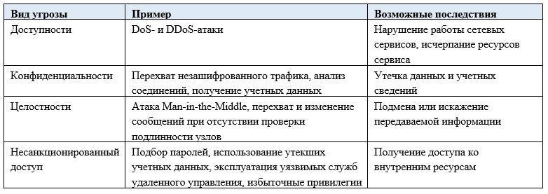
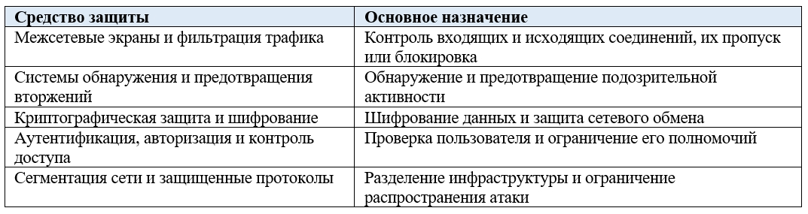
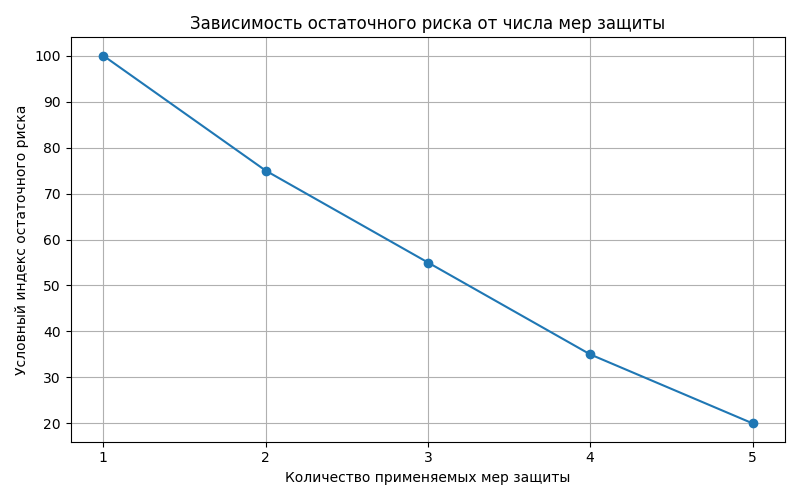
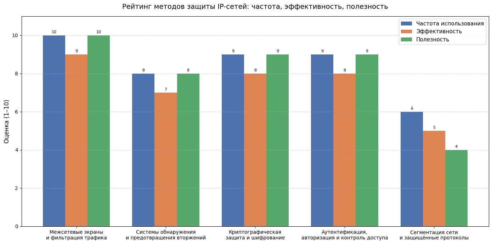

\renewcommand{\figurename}{Рисунок}

# ОГЛАВЛЕНИЕ

1. [Научный аппарат исследования](#1-научный-аппарат-исследования)
   - [1.1. Актуальность темы исследования](#11-актуальность-темы-исследования)
   - [1.2. Проблема исследования](#12-проблема-исследования)
   - [1.3. Объект и предмет исследования](#13-объект-и-предмет-исследования)
   - [1.4. Научная новизна исследования](#14-научная-новизна-исследования)
   - [1.5. Практическая значимость работы](#15-практическая-значимость-работы)
2. [Методологический аппарат исследования](#2-методологический-аппарат-исследования)
   - [2.1. Цель исследования](#21-цель-исследования)
   - [2.2. Гипотеза исследования](#22-гипотеза-исследования)
   - [2.3. Задачи исследования](#23-задачи-исследования)
   - [2.4. Методы и материалы исследования](#24-методы-и-материалы-исследования)
   - [2.5. Теоретическая база исследования](#25-теоретическая-база-исследования)
3. [Основные угрозы информационной безопасности в IP-сетях](#3-основные-угрозы-информационной-безопасности-в-ip-сетях)
   - [3.1. Особенности и уязвимости архитектуры IP-сетей](#31-особенности-и-уязвимости-архитектуры-ip-сетей)
   - [3.2. Классификация основных угроз информационной безопасности](#32-классификация-основных-угроз-информационной-безопасности)
   - [3.3. Причины возникновения уязвимостей и последствия сетевых атак](#33-причины-возникновения-уязвимостей-и-последствия-сетевых-атак)
   - [3.4. Анализ распространенных способов нарушения безопасности](#34-анализ-распространенных-способов-нарушения-безопасности)
4. [Технические средства и методы обеспечения информационной безопасности в IP-сетях](#4-технические-средства-и-методы-обеспечения-информационной-безопасности-в-ip-сетях)
   - [4.1. Межсетевые экраны и фильтрация сетевого трафика](#41-межсетевые-экраны-и-фильтрация-сетевого-трафика)
   - [4.2. Системы обнаружения и предотвращения вторжений](#42-системы-обнаружения-и-предотвращения-вторжений)
   - [4.3. Криптографическая защита сетевого взаимодействия](#43-криптографическая-защита-сетевого-взаимодействия)
   - [4.4. Аутентификация, авторизация и контроль доступа](#44-аутентификация-авторизация-и-контроль-доступа)
   - [4.5. Сегментация сети и защищенные сетевые протоколы](#45-сегментация-сети-и-защищенные-сетевые-протоколы)
5. [Разработка комплексного подхода к защите IP-сетей](#5-разработка-комплексного-подхода-к-защите-ip-сетей)
   - [5.1. Определение требований к системе информационной безопасности](#51-определение-требований-к-системе-информационной-безопасности)
   - [5.2. Выбор и обоснование комплекса защитных мер](#52-выбор-и-обоснование-комплекса-защитных-мер)
   - [5.3. Организация многоуровневой системы защиты](#53-организация-многоуровневой-системы-защиты)
   - [5.4. Организационные меры обеспечения информационной безопасности](#54-организационные-меры-обеспечения-информационной-безопасности)
   - [5.5. Оценка эффективности и ограничения предложенного комплекса](#55-оценка-эффективности-и-ограничения-предложенного-комплекса)
6. [Анализ и практическая значимость достигнутых результатов](#6-анализ-и-практическая-значимость-достигнутых-результатов)
7. [Общее заключение и выводы](#7-общее-заключение-и-выводы)
8. [Список использованных источников](#8-список-использованных-источников)

\newpage

```{=openxml}
<w:p><w:r><w:br w:type="page"/></w:r></w:p>
```

# 1. НАУЧНЫЙ АППАРАТ ИССЛЕДОВАНИЯ

## 1.1. Актуальность темы исследования

IP-сети являются основой современной цифровой инфраструктуры. На их базе функционируют корпоративные информационные системы, государственные и образовательные ресурсы, облачные платформы, системы промышленной автоматизации и средства связи.

Актуальность темы обусловлена ростом зависимости организаций от сетевых сервисов и увеличением числа подключенных устройств.

## 1.2. Проблема исследования

Проблема исследования заключается в противоречии между необходимостью обеспечивать надежное функционирование IP-сетей и наличием многочисленных угроз, использующих уязвимости сетевых протоколов, оборудования, программного обеспечения и процессов администрирования.

## 1.3. Объект и предмет исследования

Объект исследования — процессы передачи, обработки и защиты информации в IP-сетях.

Предмет исследования — угрозы информационной безопасности IP-сетей, а также технические и организационные методы их предупреждения, обнаружения и нейтрализации.

## 1.4. Научная новизна исследования

Научная новизна работы состоит в систематизации основных угроз IP-сетям и обобщении подхода к выбору взаимодополняющих мер защиты на основе принципов многоуровневой безопасности, минимально необходимых привилегий и сегментации.

## 1.5. Практическая значимость работы

Практическая значимость заключается в возможности использовать рекомендации при проектировании, модернизации и администрировании локальных и корпоративных IP-сетей.

\newpage

```{=openxml}
<w:p><w:r><w:br w:type="page"/></w:r></w:p>
```

# 2. МЕТОДОЛОГИЧЕСКИЙ АППАРАТ ИССЛЕДОВАНИЯ

## 2.1. Цель исследования

Цель исследования — изучить основные угрозы информационной безопасности в IP-сетях, проанализировать существующие средства защиты и разработать обоснованный комплекс технических и организационных мер, направленных на снижение рисков нарушения конфиденциальности, целостности и доступности информации.

## 2.2. Гипотеза исследования

Предполагается, что уровень защищенности IP-сети может быть повышен, если применять не отдельное средство защиты, а согласованный комплекс мер, включающий фильтрацию трафика, обнаружение вторжений, криптографическую защиту, строгий контроль доступа, сегментацию, мониторинг и регламентированное управление конфигурациями.

## 2.3. Задачи исследования

- рассмотреть назначение и особенности функционирования IP-сетей;
- выявить и классифицировать распространенные угрозы информационной безопасности;
- проанализировать причины возникновения сетевых уязвимостей и последствия атак;
- изучить назначение межсетевых экранов, IDS/IPS, VPN, IPsec и TLS;
- обосновать выбор мер защиты для различных уровней сетевой инфраструктуры;
- сформировать комплексный подход к защите IP-сети и определить критерии оценки эффективности.

## 2.4. Методы и материалы исследования

В работе применяются анализ и обобщение научно-технической литературы, сравнительный анализ средств защиты, классификация угроз, системный подход и моделирование типовой корпоративной IP-сети.

## 2.5. Теоретическая база исследования

IP-сеть — совокупность устройств и каналов связи, в которой передача пакетов осуществляется с использованием протокола Internet Protocol.

Информационная безопасность — состояние защищенности информации и поддерживающей ее инфраструктуры от угроз, способных привести к ущербу.

Угроза информационной безопасности — потенциальная причина нежелательного события, способного нанести ущерб активам организации.

Теоретическую основу также составляют принципы эшелонированной защиты, минимальных привилегий, безопасной конфигурации по умолчанию, регулярного обновления и непрерывного контроля.

\newpage

```{=openxml}
<w:p><w:r><w:br w:type="page"/></w:r></w:p>
```

# 3. ОСНОВНЫЕ УГРОЗЫ ИНФОРМАЦИОННОЙ БЕЗОПАСНОСТИ В IP-СЕТЯХ

## 3.1. Особенности и уязвимости архитектуры IP-сетей

IP-сеть обычно включает конечные устройства, коммутаторы, маршрутизаторы, серверы, точки беспроводного доступа, шлюзы и каналы связи.

Протокол IP обеспечивает адресацию и доставку пакетов, но не решает самостоятельно все задачи безопасности.

## 3.2. Классификация основных угроз информационной безопасности

К угрозам доступности относятся DoS- и DDoS-атаки. При DoS воздействии злоумышленник создает поток запросов или иным способом исчерпывает ресурсы сервиса.

К угрозам конфиденциальности относятся перехват незашифрованного трафика, анализ сетевых соединений и получение передаваемых учетных данных.

Атака Man-in-the-Middle предполагает вмешательство посредника в обмен данными между двумя сторонами. Злоумышленник может перехватывать, изменять или перенаправлять сообщения, если отсутствует надежная проверка подлинности узлов.

К отдельной группе относятся попытки несанкционированного доступа: подбор паролей, использование утекших учетных данных, эксплуатация уязвимых служб удаленного управления и злоупотребление избыточными привилегиями. Сводная классификация приведена на рисунке 1.

{width=70%}

## 3.3. Причины возникновения уязвимостей и последствия сетевых атак

Основными причинами уязвимостей являются несвоевременная установка обновлений, использование устаревших протоколов, слабые или повторно используемые пароли, открытые без необходимости сетевые порты, ошибки в правилах межсетевого экрана, отсутствие сегментации и недостаточный контроль действий администраторов.

Последствия реализации угроз различаются по характеру и масштабу. Нарушение конфиденциальности приводит к утечке персональных, коммерческих или служебных сведений.

## 3.4. Анализ распространенных способов нарушения безопасности

Атакующий часто использует не одну уязвимость, а цепочку недостатков. Например, фишинговое сообщение может привести к компрометации учетной записи, после чего злоумышленник попытается подключиться к внутренним ресурсам и переместиться между сегментами.

\newpage

```{=openxml}
<w:p><w:r><w:br w:type="page"/></w:r></w:p>
```

# 4. ТЕХНИЧЕСКИЕ СРЕДСТВА И МЕТОДЫ ОБЕСПЕЧЕНИЯ \newline ИНФОРМАЦИОННОЙ БЕЗОПАСНОСТИ В IP-СЕТЯХ

## 4.1. Межсетевые экраны и фильтрация сетевого трафика

Межсетевой экран (firewall) контролирует входящие и исходящие соединения между зонами с различным уровнем доверия \hyperref[src:1]{\textcolor{red}{[1]}}.

Эффективность экрана зависит от корректной политики правил. Рекомендуется разрешать только необходимые соединения, запрещать неиспользуемые направления обмена, документировать значимые правила и регулярно пересматривать их.

## 4.2. Системы обнаружения и предотвращения вторжений

Системы IDS и IPS предназначены для выявления подозрительной сетевой или системной активности \hyperref[src:2]{\textcolor{red}{[2]}}.

Сигнатурный анализ эффективен против известных шаблонов атак, но может не распознать ранее неизвестное воздействие.

## 4.3. Криптографическая защита сетевого взаимодействия

Шифрование защищает содержимое сетевого обмена от прочтения посторонними лицами. Для защиты соединений между приложениями широко применяется TLS \hyperref[src:3]{\textcolor{red}{[3]}}.

Для защиты IP-трафика на сетевом уровне применяется IPsec. Его архитектура описана в RFC 4301 и предусматривает механизмы защиты пакетов, включая ESP, а также управление параметрами безопасности и ключами \hyperref[src:4]{\textcolor{red}{[4]}}.

При внедрении криптографической защиты важно не ограничиваться фактом включения шифрования. Необходимо использовать актуальные версии протоколов и надежные алгоритмы, контролировать срок действия сертификатов, защищать закрытые ключи, отзывать скомпрометированные сертификаты и исключать устаревшие режимы.

## 4.4. Аутентификация, авторизация и контроль доступа

Аутентификация подтверждает, кто именно пытается получить доступ к системе; авторизация определяет, какие действия этому субъекту разрешены.

Права пользователей следует назначать по принципу минимальных привилегий: каждый сотрудник получает только полномочия, необходимые для выполнения рабочих обязанностей.

## 4.5. Сегментация сети и защищенные сетевые протоколы

Сегментация предполагает разделение общей IP-инфраструктуры на логические или физические зоны. Для этого применяются VLAN, маршрутизаторы, списки контроля доступа и межсетевые экраны.

Сегментация снижает вероятность горизонтального перемещения злоумышленника и ограничивает последствия компрометации одного узла. Сопоставление назначения основных технических средств защиты представлено на рисунке 2.

{width=70%}

\newpage

```{=openxml}
<w:p><w:r><w:br w:type="page"/></w:r></w:p>
```

# 5. РАЗРАБОТКА КОМПЛЕКСНОГО ПОДХОДА К ЗАЩИТЕ IP-СЕТЕЙ

## 5.1. Определение требований к системе информационной безопасности

Разработка системы защиты начинается с инвентаризации сетевых активов. Организации необходимо определить используемые маршрутизаторы, коммутаторы, серверы, рабочие станции и сетевые сервисы, ответственных за их эксплуатацию и категории обрабатываемых данных.

На основе инвентаризации формируется модель угроз и оцениваются риски. Для каждого существенного риска определяются вероятность реализации, потенциальные последствия и приоритет обработки.

## 5.2. Выбор и обоснование комплекса защитных мер

Для типовой корпоративной IP-сети целесообразно использовать несколько взаимодополняющих уровней защиты. На внешней границе устанавливается межсетевой экран, ограничивающий доступ из Интернета и разрешающий только необходимые сервисы.

Внутреннюю инфраструктуру следует разделить на сегменты по назначению и уровню критичности. Межсегментный обмен разрешается через контролируемые точки, где применяются правила фильтрации.

Выбор продуктов должен учитывать совместимость с инфраструктурой, пропускную способность, требования к отказоустойчивости, квалификацию персонала и стоимость сопровождения.

## 5.3. Организация многоуровневой системы защиты

Предлагаемый комплекс можно представить в виде четырех взаимосвязанных уровней.

Первый уровень — защита периметра: межсетевой экран, фильтрация нежелательных соединений, ограничение внешних интерфейсов управления и размещение публичных сервисов в DMZ.

Второй уровень — защита внутренней сети: сегментация инфраструктуры на зоны по назначению и критичности, межсегментная фильтрация, списки контроля доступа и изоляция наиболее ценных активов от общедоступных сегментов.

Третий уровень — защита узлов и каналов связи. Он включает обновление операционных систем и сетевого оборудования, антивирусную защиту, шифрование соединений с помощью TLS и VPN/IPsec, надежную аутентификацию и резервное копирование конфигураций.

Четвертый уровень — мониторинг, обнаружение и реагирование: системы IDS/IPS, централизованный сбор журналов, контроль изменений конфигураций, регулярное сканирование уязвимостей и регламент реагирования на инциденты.

Уровни не должны рассматриваться независимо. Межсетевой экран ограничивает доступ, но не гарантирует обнаружение вредоносной активности внутри разрешенного соединения. Зависимость условного остаточного риска от числа применяемых мер иллюстрирует рисунок 3.

{width=70%}

## 5.4. Организационные меры обеспечения информационной безопасности

Организационные меры определяют правила безопасной эксплуатации сети. К ним относятся политика информационной безопасности, порядок выдачи и отзыва прав доступа, правила удаленной работы, требования к паролям и многофакторной аутентификации, порядок установки обновлений и регламент резервного копирования.

Необходимо разработать план реагирования на инциденты. Он должен описывать регистрацию события, первичную оценку, изоляцию зараженного узла, сохранение журналов и иных цифровых доказательств, восстановление работоспособности и последующий анализ причин \hyperref[src:6]{\textcolor{red}{[6]}}.

Отдельное внимание уделяется управлению изменениями. Перед изменением правил межсетевого экрана, маршрутизации или конфигурации VPN следует оценить влияние на безопасность и доступность, зафиксировать исходное состояние и предусмотреть способ отката \hyperref[src:5]{\textcolor{red}{[5]}}.

## 5.5. Оценка эффективности и ограничения предложенного комплекса

Эффективность системы защиты следует оценивать не по количеству установленных средств, а по измеримым показателям.

Оценку можно проводить с помощью анализа конфигураций, сканирования уязвимостей, проверки сегментации, тестирования восстановления из резервных копий и учебных сценариев реагирования.

Предложенный комплекс имеет ограничения. Внедрение средств защиты требует затрат, квалифицированного персонала и постоянного сопровождения. Функциональные возможности рассматриваемых средств защиты обобщены на рисунке 4.

{width=70%}

\newpage

```{=openxml}
<w:p><w:r><w:br w:type="page"/></w:r></w:p>
```

# 6. АНАЛИЗ И ПРАКТИЧЕСКАЯ ЗНАЧИМОСТЬ ДОСТИГНУТЫХ РЕЗУЛЬТАТОВ

В ходе исследования установлено, что основные риски для IP-сетей связаны с нарушением конфиденциальности, целостности и доступности данных.

Анализ средств защиты показал, что межсетевые экраны обеспечивают контроль соединений, IDS/IPS помогают выявлять и блокировать подозрительную активность, а TLS и IPsec защищают данные при передаче.

Практическим результатом работы является сформированный комплексный подход: инвентаризация активов и оценка рисков, защита периметра, выделение DMZ, сегментация внутренней сети, криптографическая защита каналов, контроль доступа, мониторинг и регламент реагирования.

Практическая ценность подхода состоит в последовательности внедрения мер. На первом этапе организация определяет активы и критичные сервисы, затем устраняет наиболее опасные уязвимости и закрывает ненужные сетевые доступы.

Таким образом, гипотеза исследования получает теоретическое подтверждение: согласованное применение технических и организационных механизмов обеспечивает более устойчивую защиту IP-сети, чем использование отдельных несвязанных средств.

\newpage

```{=openxml}
<w:p><w:r><w:br w:type="page"/></w:r></w:p>
```

# 7. ОБЩЕЕ ЗАКЛЮЧЕНИЕ И ВЫВОДЫ

В докладе рассмотрены особенности обеспечения информационной безопасности в IP-сетях, основные виды угроз и средства противодействия им.

В рамках исследования классифицированы основные угрозы: атаки на доступность, перехват и подмена трафика, IP-спуфинг, атаки типа Man-in-the-Middle, несанкционированный доступ и распространение вредоносного программного обеспечения.

На основании анализа предложен комплексный подход, основанный на эшелонированной защите. Он предусматривает контроль периметра, разделение сети на зоны, шифрование передаваемых данных, минимизацию привилегий, централизованный мониторинг, регулярное обновление оборудования и программного обеспечения, резервное копирование и план реагирования на инциденты.

Поставленная цель достигнута, задачи исследования решены. Выдвинутая гипотеза подтверждается на теоретическом уровне: совместное использование взаимодополняющих мер позволяет снизить вероятность успешной атаки и ограничить ее последствия.

Общий вывод заключается в том, что информационная безопасность IP-сетей представляет собой непрерывный процесс, а не разовое внедрение оборудования или программного обеспечения.

\newpage

```{=openxml}
<w:p><w:r><w:br w:type="page"/></w:r></w:p>
```

# 8. СПИСОК ИСПОЛЬЗОВАННЫХ ИСТОЧНИКОВ

1. \label{src:1} Scarfone, K. Guidelines on Firewalls and Firewall Policy / K. Scarfone, P. Hoffman. — Gaithersburg : National Institute of Standards and Technology, 2009. — (NIST Special Publication ; 800-41 Rev. 1). — Текст : электронный. — URL: <https://csrc.nist.gov/pubs/sp/800/41/r1/final> (дата обращения: 16.11.2026).

2. \label{src:2} Scarfone, K. Guide to Intrusion Detection and Prevention Systems (IDPS) / K. Scarfone, P. Mell. — Gaithersburg : National Institute of Standards and Technology, 2007. — (NIST Special Publication ; 800-94). — Текст : электронный. — URL: <https://csrc.nist.gov/pubs/sp/800/94/final> (дата обращения: 16.11.2026).

3. \label{src:3} Rescorla, E. The Transport Layer Security (TLS) Protocol Version 1.3 / E. Rescorla. — Internet Engineering Task Force, 2018. — (RFC 8446). — Текст : электронный. — URL: <https://www.rfc-editor.org/rfc/rfc8446.html> (дата обращения: 16.11.2026).

4. \label{src:4} Kent, S. Security Architecture for the Internet Protocol / S. Kent, K. Seo. — Internet Engineering Task Force, 2005. — (RFC 4301). — Текст : электронный. — URL: <https://www.rfc-editor.org/rfc/rfc4301.html> (дата обращения: 16.11.2026).

5. \label{src:5} CISA, FBI, NSA и партнерские организации. Enhanced Visibility and Hardening Guidance for Communications Infrastructure. — 2024. — Текст : электронный. — URL: <https://www.ic3.gov/CSA/2024/241203.pdf> (дата обращения: 16.11.2026).

6. \label{src:6} CISA. Technical Approaches to Uncovering and Remediating Malicious Activity. — Joint Cybersecurity Advisory AA20-245A, 2020. — Текст : электронный. — URL: <https://www.cisa.gov/uscert/ncas/alerts/aa20-245a> (дата обращения: 16.11.2026).
