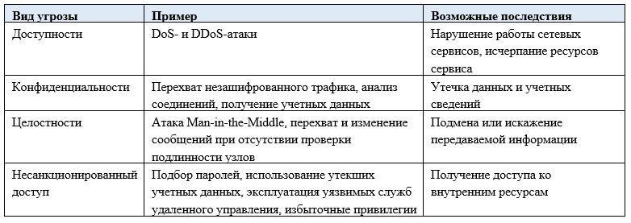
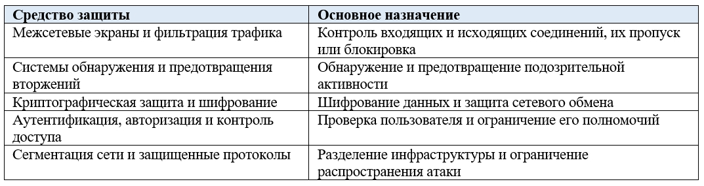
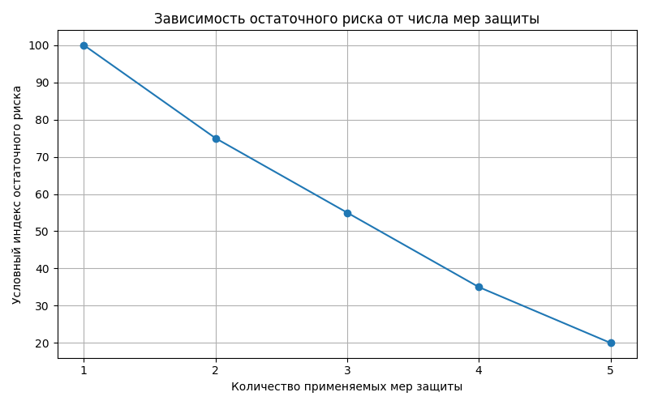
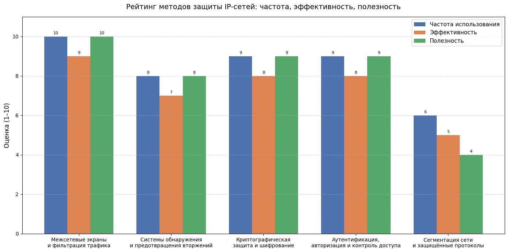

## Докладчик

:::::::::::::: {.columns align=center}
::: {.column width="70%"}

* Глушенок Анна Александровна
* Учебная группа: НПИбд-01-24
* Студенческий билет: 1132246844

:::
::: {.column width="30%"}

:::
::::::::::::::

# НАУЧНЫЙ АППАРАТ ИССЛЕДОВАНИЯ

## НАУЧНЫЙ АППАРАТ ИССЛЕДОВАНИЯ

**Актуальность:**  
- IP-сети - основа современной цифровой инфраструктуры.  
- Рост зависимости организаций от сетевых сервисов.  
- Увеличение числа подключенных устройств.  

**Проблема:**  
Противоречие между необходимостью обеспечивать надежное функционирование IP-сетей и наличием многочисленных угроз.

## НАУЧНЫЙ АППАРАТ ИССЛЕДОВАНИЯ

**Объект исследования:** процессы передачи, обработки и защиты информации в IP-сетях.

**Предмет исследования:** угрозы информационной безопасности IP-сетей, а также технические и организационные методы их предупреждения, обнаружения и нейтрализации.

**Научная новизна:** систематизация угроз IP-сетям и обобщение подхода к выбору мер защиты.

**Практическая значимость:** возможность использования рекомендаций при работе с IP-сетями.

# МЕТОДОЛОГИЧЕСКИЙ АППАРАТ ИССЛЕДОВАНИЯ

## МЕТОДОЛОГИЧЕСКИЙ АППАРАТ ИССЛЕДОВАНИЯ

**Цель:** изучить угрозы ИБ в IP-сетях, проанализировать средства защиты и разработать комплекс мер, снижающих риск нарушения безопасности.

**Гипотеза:** уровень защищенности IP-сети может быть повышен, если применять не отдельное средство защиты, а согласованный комплекс мер.

**Задачи:**  
- выявить и классифицировать распространенные угрозы информационной безопасности;  
- проанализировать причины возникновения сетевых уязвимостей, последствия атак;  
- обосновать выбор мер защиты для различных уровней сетевой инфраструктуры;  
- сформировать комплексный подход к защите IP-сети и определить критерии оценки эффективности.  

## МЕТОДОЛОГИЧЕСКИЙ АППАРАТ ИССЛЕДОВАНИЯ

**Методы и материалы:** анализ и обобщение научно-технической литературы, сравнительный анализ средств защиты, классификация угроз, системный подход и моделирование типовой корпоративной IP-сети.

**Теоретическая база исследования:**  
- *IP-сеть* — совокупность устройств и каналов связи, в которой передача пакетов осуществляется с использованием протокола Internet Protocol.  
- *Информационная безопасность* — состояние защищенности информации и поддерживающей ее инфраструктуры от угроз, способных привести к ущербу.  
- *Угроза информационной безопасности* — потенциальная причина нежелательного события, способного нанести ущерб безопасности сети.  

# 1. ОСНОВНЫЕ УГРОЗЫ ИНФОРМАЦИОННОЙ БЕЗОПАСНОСТИ В IP-СЕТЯХ

## Особенности и уязвимости архитектуры IP-сетей

- IP-сеть включает конечные устройства, коммутаторы, маршрутизаторы, серверы, точки беспроводного доступа, шлюзы и каналы связи.
- Протокол IP обеспечивает адресацию и доставку пакетов, но не решает самостоятельно все задачи безопасности.

## Классификация основных угроз

{width=85%}

## Причины уязвимостей и последствия атак

- **ПО и учетные данные:** Несвоевременные обновления, устаревшие протоколы, слабые или повторно используемые пароли.
- **Конфигурация сети:** Открытые без необходимости порты, ошибки в правилах межсетевого экрана, отсутствие сегментации.
- **Организация и администрирование:** Недостаточный контроль действий администраторов.

# 2. ТЕХНИЧЕСКИЕ СРЕДСТВА И МЕТОДЫ ОБЕСПЕЧЕНИЯ ИНФОРМАЦИОННОЙ БЕЗОПАСНОСТИ В IP-СЕТЯХ

## Межсетевые экраны и фильтрация трафика

- Межсетевой экран контролирует входящие и исходящие соединения между зонами с разным уровнем доверия.
- Эффективность зависит от корректной политики: разрешать только необходимые соединения, запрещать неиспользуемые направления, документировать и пересматривать правила.

**Основной недостаток:** анализирует только по формальным признакам (адреса, порты, протокол), но не видит, что происходит внутри разрешённого соединения, из-за чего может пропустить вредоносную активность внутри него. Зависим от возможных ошибок в политике.

## Системы обнаружения и предотвращения вторжений

- Выявляют подозрительную сетевую или системную активность.
- Сигнатурный анализ эффективен против известных атак, но может не распознать ранее неизвестное воздействие.

**Основной недостаток:** распознают только шаблоны уже известных атак, могут не распознавать ранее неизвестное воздействие, давать ложные срабатывания и требуют постоянной актуализации сигнатур (шаблонов).

## Криптографическая защита

- **TLS:** защищает соединения между приложениями.
- **IPsec:** защищает IP-трафик на сетевом уровне.

**Основной недостаток:** защищает данные только при корректной настройке и надежном хранении ключей. Ошибки в конфигурации, устаревшие версии протоколов, слабые алгоритмы или компрометация закрытых ключей сводят защиту на нет.

## Аутентификация, авторизация и контроль доступа

- Аутентификация подтверждает, кто пытается получить доступ; авторизация определяет разрешенные действия.
- Права назначаются по принципу минимальных привилегий: только полномочия, необходимые для выполнения обязанностей.

**Основной недостаток:** надежность зависит от дисциплины пользователей и администрирования: слабые или украденные пароли, избыточные привилегии и ошибки в разграничении доступа позволяют обойти защиту.

## Сегментация сети и защищенные протоколы

- Сегментация — разделение IP-инфраструктуры на логические или физические зоны с помощью локальных сетей, маршрутизаторов, списков контроля доступа и межсетевых экранов.
- Снижает вероятность горизонтального перемещения злоумышленника и ограничивает последствия компрометации одного узла.

**Основной недостаток:** не защищает узлы внутри сегмента и зависит от корректности межсегментной фильтрации: ошибка в правилах или обходные пути между сегментами могут свести защиту на нет.

## Классификация средств и методов обеспечения безопасности 

{width=85%}

# 3. РАЗРАБОТКА КОМПЛЕКСНОГО ПОДХОДА К ЗАЩИТЕ IP-СЕТЕЙ

## Организация комплекса защитных мер

Комплексный подход - защита **внешней границы** и **внутренней инфраструктуры**.

**1 уровень — защита периметра:**  
- Межсетевые экраны и фильтрация трафика.  
- Сегментация сети.  
- Системы обнаружения и предотвращения вторжений.  
**2 уровень — защита внутренней сети:**  
- Сегментация сети и защищённые протоколы.  
- Межсетевые экраны и фильтрация трафика.  
**3 уровень — защита узлов и каналов связи:**  
- Криптографическая защита и шифрование.  
- Аутентификация, авторизация и контроль доступа.  
**4 уровень — мониторинг и реагирование:**  
- Системы обнаружения и предотвращения вторжений.  

## Организация многоуровневой системы защиты

{width=70%}

## Оценка эффективности и ограничения

{width=80%}

# АНАЛИЗ И ПРАКТИЧЕСКАЯ ЗНАЧИМОСТЬ ДОСТИГНУТЫХ РЕЗУЛЬТАТОВ

## Анализ и практическая значимость

- **Основные риски:** нарушение доступности, конфиденциальности, целостности, несанкционированный доступ.
- **причины уязвимостей:** ПО и учетные данные, конфигурация сети, организация и администрирование.
- **Практический результат:** сформирован комплексный подход.
- **Гипотеза подтверждена:** согласованное применение технических и организационных мер обеспечивает более устойчивую защиту, чем отдельные средства.

# ОБЩЕЕ ЗАКЛЮЧЕНИЕ И ВЫВОДЫ

## Общее заключение и выводы

- Классифицированы угрозы.
- Определены причины уязвимостей.
- Предложен комплексный подход для обеспечения безопасности.
- Цель достигнута, задачи решены, гипотеза подтверждена.

**Вывод:** Информационная безопасность IP-сетей — **непрерывный процесс**, состоящий из нескольких уровней и обеспечиваемый множеством методов в совокупности.

# СПИСОК ИСПОЛЬЗОВАННЫХ ИСТОЧНИКОВ

## СПИСОК ИСПОЛЬЗОВАННЫХ ИСТОЧНИКОВ

1. \label{src:1} Scarfone, K. Guidelines on Firewalls and Firewall Policy / K. Scarfone, P. Hoffman. — Gaithersburg : National Institute of Standards and Technology, 2009. — (NIST Special Publication ; 800-41 Rev. 1). — Текст : электронный. — URL: <https://csrc.nist.gov/pubs/sp/800/41/r1/final> (дата обращения: 16.11.2026).

2. \label{src:2} Scarfone, K. Guide to Intrusion Detection and Prevention Systems (IDPS) / K. Scarfone, P. Mell. — Gaithersburg : National Institute of Standards and Technology, 2007. — (NIST Special Publication ; 800-94). — Текст : электронный. — URL: <https://csrc.nist.gov/pubs/sp/800/94/final> (дата обращения: 16.11.2026).

3. \label{src:3} Rescorla, E. The Transport Layer Security (TLS) Protocol Version 1.3 / E. Rescorla. — Internet Engineering Task Force, 2018. — (RFC 8446). — Текст : электронный. — URL: <https://www.rfc-editor.org/rfc/rfc8446.html> (дата обращения: 16.11.2026).

## 8. СПИСОК ИСПОЛЬЗОВАННЫХ ИСТОЧНИКОВ

4. \label{src:4} Kent, S. Security Architecture for the Internet Protocol / S. Kent, K. Seo. — Internet Engineering Task Force, 2005. — (RFC 4301). — Текст : электронный. — URL: <https://www.rfc-editor.org/rfc/rfc4301.html> (дата обращения: 16.11.2026).

5. \label{src:5} CISA, FBI, NSA и партнерские организации. Enhanced Visibility and Hardening Guidance for Communications Infrastructure. — 2024. — Текст : электронный. — URL: <https://www.ic3.gov/CSA/2024/241203.pdf> (дата обращения: 16.11.2026).

6. \label{src:6} CISA. Technical Approaches to Uncovering and Remediating Malicious Activity. — Joint Cybersecurity Advisory AA20-245A, 2020. — Текст : электронный. — URL: <https://www.cisa.gov/uscert/ncas/alerts/aa20-245a> (дата обращения: 16.11.2026).
